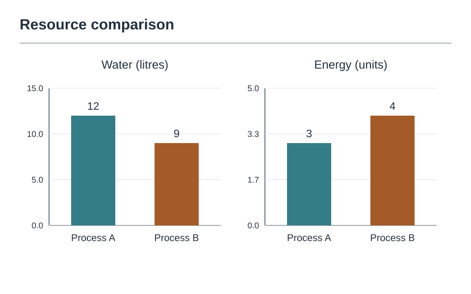

# M18-L3 – Plant and microbial biotechnology {#L3}

**Course area:** M18 – Molecular and Applied Electives

**Level:** Bachelor

**Prerequisites:** [M7-L5](M7-L5.md): symbioses; [M10-L4](M10-L4.md): environmental responses.

**Learning objective:** Classify plant and microbial biotechnology applications and assess benefits using transparent comparison metrics.

## Introduction {#S1}

Biotechnology uses biological processes, organisms or their products for defined applications. Examples include traditional fermentation, plant tissue culture, genetic resource analysis and modern molecular approaches. Technology selection depends on the problem rather than technical novelty alone.

## Principles and model {#S2}

### Plants and microorganisms as biological systems

Plant biotechnology includes conserving genetic resources, propagating selected plants and examining differences in traits. Tissue culture draws on the developmental potential of plant cells under suitable conditions; not all cells or species regenerate equally well. Molecular markers can support breeding decisions without themselves altering the genome. Traits such as drought tolerance are often polygenic and environmentally dependent.

Microbial biotechnology includes using microbial metabolites in food and producing enzymes. An industrial system connects biological function, product quality, resource consumption and controlled processes. Comparisons with a reference must also consider waste streams, energy demand and ecological effects. Greater output per unit does not automatically improve the overall environmental balance.

### Comparing applications

The functional unit defines the service being compared, for instance one kilogram of equivalent product. System boundaries determine which inputs, transport and disposal stages are included. Ratios such as water use per product unit are interpretable only with comparable quality, time periods and boundaries. Local environmental conditions, genetic diversity, ownership and seed access are also relevant in plant applications. Microbial applications require appropriate oversight, safety assessment and quality assurance.

*Figure: Two processes supply equivalent products but differ in water and energy requirements.*

## Application {#S3}

Two fictional processes each provide the same functional product unit. A uses 12 litres of water and 3 energy units; B uses 9 litres and 4 energy units. B reduces water use by $(12-9)/12=25\%$ but increases energy demand by $(4-3)/3\approx33.3\%$. Without information about water scarcity, energy sources and other impacts, no clear overall winner can be identified.

## Self-assessment {#S4}

### Exercises

1. Calculate the percentage water saving from 20 to 15 litres.
2. Why must functional units be equivalent?
3. Name a societal consideration in plant biotechnology.

::: {.lc-solutions data-lc-section="S4"}
1. $5/20=25\%$.
2. Otherwise different services are compared.
3. For example, seed access or conservation of genetic diversity.
:::

## Assumptions and limitations {#S5}

Values are illustrative comparison data, not production parameters. This chapter provides no instructions for cultivation, genetic modification or optimisation of biological systems. Real environmental assessment requires empirical life-cycle data.

## Summary and transition {#S6}

Technical performance is only one dimension of responsible biotechnology. The next lesson examines diagnostic system evaluation.

**Continue:** [M18-L4](M18-L4.md)

## Sources {#S7}

- [FAO – Biotechnology in food and agriculture](https://www.fao.org/biotechnology/en) · Agricultural applications and genetic resource conservation; indexed text · Last accessed: 2026-11-25
- [FAO – Crops](https://www.fao.org/biotechnology/topics/crops/) · Plant biotechnology and conservation; indexed text · Last accessed: 2026-11-25

