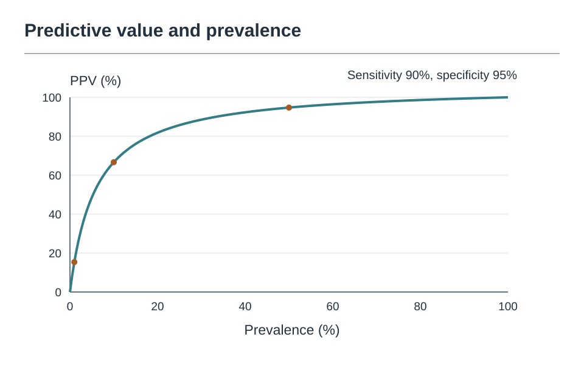

# M18-L4 – Immunobiology and applied diagnostic concepts {#L4}

**Course area:** M18 – Molecular and Applied Electives

**Level:** Bachelor

**Prerequisites:** [M9-L4](M9-L4.md): immunity; [M16-L3](M16-L3.md): detection methods.

**Learning objective:** Explain immunological detection principles and interpret diagnostic measures, including their dependence on prevalence.

## Introduction {#S1}

Antibodies recognise molecular structures called epitopes. This selectivity underlies many detection methods. An analytically measurable signal and the clinical significance of a finding are different claims. Diagnostic quality must be assessed against a suitable reference.

## Principles and model {#S2}

### Detection principles and error sources

Immunological tests exploit antigen-antibody binding. A bound complex may be observed through a signal; signal strength is not proportional to target abundance under all conditions. Cross-reactivity, nonspecific binding and matrix effects may complicate interpretation. Detection of an antigen and detection of antibodies against that antigen answer distinct questions. An antibody finding alone does not establish a current pathological condition.

Analytical sensitivity describes the ability to detect small target quantities; diagnostic sensitivity instead measures the fraction of true positive results among people with the target condition. Diagnostic specificity measures the fraction of true negative results among people without it. A threshold influences both metrics. A ROC diagram plots sensitivity against the false-positive rate and shows threshold dependence, but does not directly express individual consequences of testing.

### Prevalence and predictive values

For prevalence $p$, sensitivity $s$ and specificity $c$, positive predictive value is $PPV=sp/[sp+(1-c)(1-p)]$. Negative predictive value is $NPV=c(1-p)/[c(1-p)+(1-s)p]$. These values apply only to the modelled target population and assumed test metrics. In real populations, sensitivity and specificity may also change with the spectrum of disease or reference definition.

*Figure: Positive predictive value rises with prevalence when test characteristics are fixed.*

## Application {#S3}

A fictional test with $s=0.90$ and $c=0.95$ yields 90 true positives, 10 false negatives, 45 false positives and 855 true negatives among 1,000 model individuals at 10% prevalence. Thus $PPV=90/135\approx66.7\%$ and $NPV=855/865\approx98.8\%$. At 1% prevalence the same formula gives $PPV=0.009/(0.009+0.0495)\approx15.4\%$. A positive result therefore does not mean the same thing in both groups.

## Self-assessment {#S4}

### Exercises

1. What is the false-positive rate at 95% specificity?
2. Calculate PPV for $p=0.5$, $s=0.9$, $c=0.95$.
3. Why is an analytical detection result alone insufficient for clinical assessment?

::: {.lc-solutions data-lc-section="S4"}
1. $1-0.95=0.05$, or 5%.
2. $0.45/(0.45+0.025)\approx94.7\%$.
3. The target condition, reference, error sources and context must be considered.
:::

## Assumptions and limitations {#S5}

All test data are simulated. This is a statistics and immunobiology exercise, not guidance for interpreting personal tests, diagnosis or treatment. No practical test protocols are provided.

## Summary and transition {#S6}

Diagnostics links molecular selectivity to statistical evidence. The next lesson broadens the perspective to responsibility and systems design.

**Continue:** [M18-L5](M18-L5.md)

## Sources {#S7}

- [NCBI Bookshelf – Diagnostic Testing Accuracy](https://www.ncbi.nlm.nih.gov/books/NBK557491/) · Sensitivity, specificity and predictive values; indexed text · Last accessed: 2026-11-25

