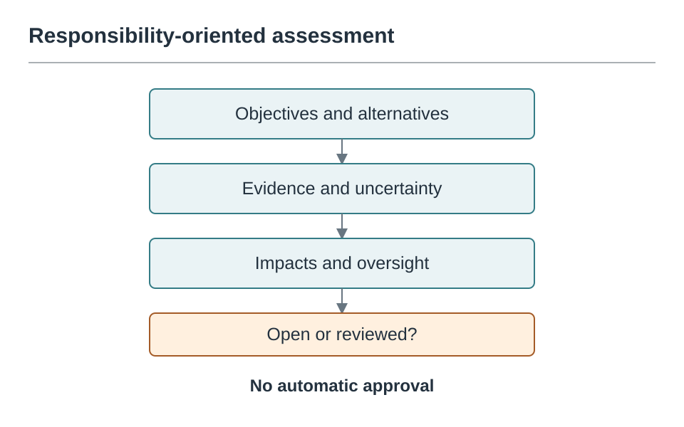

# M18-L5 – Synthetic biology and responsibility {#L5}

**Course area:** M18 – Molecular and Applied Electives

**Level:** Bachelor

**Prerequisites:** [M1-L2](M1-L2.md): research ethics; [M6-L6](M6-L6.md): gene regulation.

**Learning objective:** Classify synthetic biology as an interdisciplinary field and apply a non-operational, responsibility-oriented assessment framework.

## Introduction {#S1}

Synthetic biology combines biological research with concepts from engineering, computer science and systems theory. Among other questions, it examines how biological functions can be described, predicted and responsibly designed. An intelligible model does not imply safe practical control.

## Principles and model {#S2}

### Systems thinking and limitations

An abstract system description distinguishes inputs, internal states and outputs. In biological systems, environmental conditions, feedback, stochastic variation and evolution alter observed function. Predictions must therefore state their boundary conditions. Modularity is a useful descriptive concept, but biological components are not necessarily independent. Models may explain relationships and reveal uncertainties without supplying a feasible biological design.

Applications include basic research, materials science and more sustainable production. A claimed benefit begins as a testable hypothesis. Responsible assessment includes comparison with non-biological alternatives, evidence quality and possible unintended effects. The distribution of costs and benefits among different populations is also relevant.

### Governance and responsibility

Biosafety particularly concerns unintended harm or exposure; biosecurity also addresses unauthorised access and deliberate misuse. Dual-use questions arise when knowledge may enable both beneficial and harmful applications. WHO describes responsibility as shared among researchers, institutions, funders and other stakeholders. Appropriate institutional assessment and oversight cannot be replaced by a private checklist.

A documented decision structure separates objectives and alternatives, evidence and uncertainty, risks and responsible oversight. Missing information remains explicitly open. Where significant uncertainty or missing authorisation exists, a simplified assessment score must not imply approval.

*Figure: Documentation and assessment areas with an explicitly open decision rather than automatic approval.*

## Application {#S3}

A fictional non-experimental teaching project compares two literature models. Four of five evidence criteria are supported for A and three of five for B. Coverage is $4/5=80\%$ and $3/5=60\%$. A, however, lacks a required independent impact assessment. The higher coverage score therefore does not mean approval or lower hazard. A remains open; B is likewise assessed against missing information.

## Self-assessment {#S4}

### Exercises

1. Calculate evidence coverage for six out of eight criteria.
2. Distinguish biosafety and biosecurity.
3. Why must a high score not replace a missing required assessment?

::: {.lc-solutions data-lc-section="S4"}
1. $6/8=75\%$.
2. Biosafety particularly addresses unintended harm; biosecurity also addresses unauthorised access and deliberate misuse.
3. Aggregate scores can obscure decisive exclusion or uncertainty criteria.
:::

## Assumptions and limitations {#S5}

The example is a purely educational document comparison, not a real safety assessment. It contains no biological constructs, sequences or experimental procedures. Legal requirements and institutional oversight must be checked separately in context.

## Summary and transition {#S6}

Responsible research combines scientific plausibility with transparent decisions and appropriate oversight. This concludes the molecular bachelor elective; M19 prepares for a bachelor project.

**Continue:** [M19-L1](M19-L1.md)

## Sources {#S7}

- [WHO (2022) – Global guidance framework for the responsible use of the life sciences](https://www.who.int/publications/i/item/9789240056107) · Shared governance and biorisk mitigation; indexed publication overview · Last accessed: 2026-11-25
- [WHO – What is dual-use research of concern?](https://www.who.int/news-room/questions-and-answers/item/what-is-dual-use-research-of-concern) · Potential misuse and responsible oversight; indexed text · Last accessed: 2026-11-25

