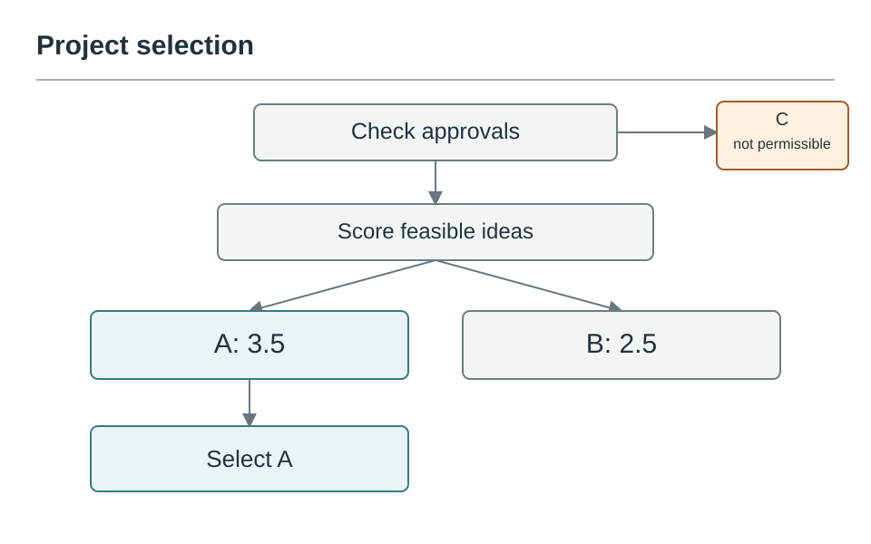

# M19-L1 – Choosing specializations and checking prerequisites {#L1}

**Course area:** M19 – Elective Selection and Bachelor Project

**Level:** Bachelor

**Prerequisites:** [M17-L1](M17-L1.md) and [M18-L1](M18-L1.md): electives; [M16-L5](M16-L5.md): documentation.

**Learning objective:** Select a realistically scoped bachelor project based on interests, prior knowledge, resources and mandatory prerequisites.

## Introduction {#S1}

A research project is more than an interesting topic. A testable question must be answerable using available methods. This lesson introduces a continuous fictional project on plant leaf area under different light conditions. It supports self-study with simulated data, not an accredited practical course.

## Principles and model {#S2}

### Selecting a subject profile

Organismal research may connect traits with environmental conditions; molecular research investigates the functions and regulation of biological components. Bioinformatics can connect both perspectives but requires data skills. A topic need not combine as many levels as possible. A narrow, precise question is generally more appropriate for a first thesis than an extensive research programme.

For each project idea, specify an expected outcome variable, a possible data source and missing skills. Check whether the data are actually available and whether their use is permitted. A literature review or secondary analysis can constitute independent research if the question, selection and analysis are transparent. A new empirical study may require additional supervision, approvals and safety assessment. Formal eligibility, supervision rules and deadlines depend on the institution; its applicable examination regulations, not this course model, are authoritative.

### Feasibility and planning

First list non-negotiable conditions: authorised data use, appropriate supervision, ethical and legal approvals, available competencies and accessible resources. Only then compare feasible options. A scoring system can make the decision transparent but cannot compensate for absent approvals. Set milestones for the question, literature, data checks, analysis and report. Document a contingency plan, such as using a suitable open dataset if new measurements prove impossible. A proposal records the question, rationale, planned approach, risks and expected deliverables.

*Figure: Eligibility check before weighted scoring of two feasible project ideas.*

## Application {#S3}

Two already permissible project ideas A and B are rated on a scale from 0 to 4. Weight subject interest by 0.25, prior knowledge by 0.25 and feasibility by 0.50. A (leaf area analysis) receives 3, 3 and 4 points; B receives 4, 2 and 2. Weighted scores are $0.25\cdot3+0.25\cdot3+0.50\cdot4=3.5$ and $0.25\cdot4+0.25\cdot2+0.50\cdot2=2.5$. A is selected for subsequent lessons. Project C lacks data-use permission and is excluded regardless of its score.

## Self-assessment {#S4}

### Exercises

1. Calculate the weighted score for a permissible idea D with 2, 4 and 3 points.
2. Why must a high score not replace missing approval?
3. Name a suitable contingency project when new measurements are unavailable.

::: {.lc-solutions data-lc-section="S4"}
1. $0.25\cdot2+0.25\cdot4+0.50\cdot3=3.0$.
2. Legal, ethical and institutional prerequisites are exclusion conditions, not preferences.
3. A narrowly scoped secondary analysis of a lawfully accessible leaf-area dataset or a documented literature review.
:::

## Assumptions and limitations {#S5}

The weighting is an illustrative decision aid, not an examination regulation or objective aptitude test. Assess sensitivity to alternative weights. The project uses simulated data and cannot replace supervision or admission.

## Summary and transition {#S6}

A feasible project idea has been selected. The next lesson converts it into a research question and a documented literature plan.

**Continue:** [M19-L2](M19-L2.md)

## Sources {#S7}

- [Universität Regensburg – Bachelor’s thesis (Biology)](https://www.uni-regensburg.de/en/biology-preclinical-medicine/study/study-programs/bachelor-biology/bachelors-thesis) · Institution-specific supervision and thesis/seminar requirements; indexed page · Last accessed: 2026-11-25
- [Universität Hamburg – Offene Themen und Leitfaden (Angewandte Pflanzenökologie)](https://www.biologie.uni-hamburg.de/en/forschung/angewandte-pflanzenoekologie/abschlussarbeiten/infos.html) · Topic selection and exposé; indexed page · Last accessed: 2026-11-25
- [DFG – Code of Conduct: Guidelines for Safeguarding Good Research Practice](https://www.dfg.de/en/basics-topics/basics-and-principles-of-funding/good-research-practice/code-of-conduct) · Research integrity, institutional implementation; indexed page · Last accessed: 2026-11-25

