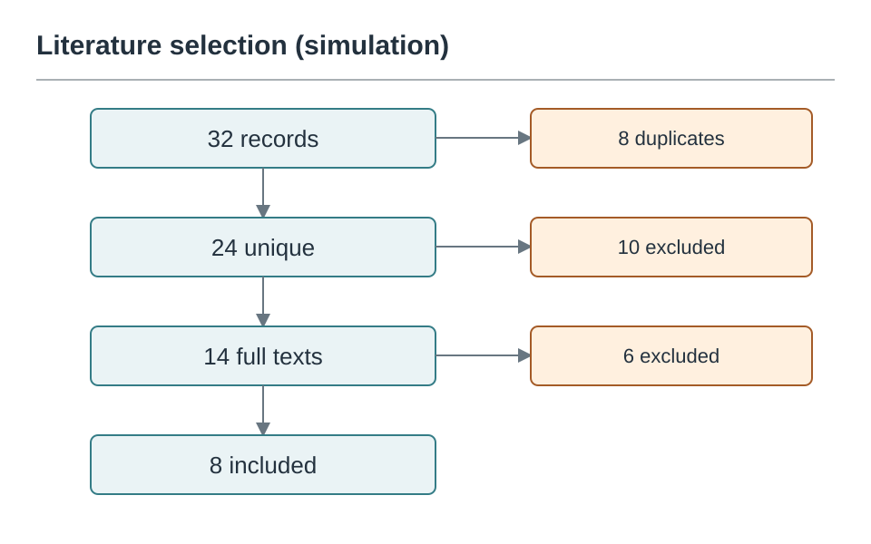

# M19-L2 – Research question and literature review {#L2}

**Course area:** M19 – Elective Selection and Bachelor Project

**Level:** Bachelor

**Prerequisites:** [M1-L4](M1-L4.md): literature; [M19-L1](M19-L1.md): project selection.

**Learning objective:** Formulate an operational research question and document literature selection, search terms and exclusion reasons transparently.

## Introduction {#S1}

Light and leaf development is too broad for a single comparison. A suitable question specifies the unit of study, explanatory variable, outcome and scope. It also determines which literature is relevant and which data are needed.

## Principles and model {#S2}

### Research question and hypothesis

For the fictional project the question is: Does mean leaf area per plant at a defined observation time differ between two light conditions A and B? The independent unit is a plant, provided the light condition can be assigned independently at plant level. The outcome is a plant-level summary of leaf area in square centimetres. The null hypothesis is $\mu_B-\mu_A=0$; the alternative allows a difference in either direction. A biological rationale, such as light affecting photosynthesis and development, does not establish the direction of the effect.

### Transparent literature search

Start with subject terms and synonyms for the outcome and explanatory variable. A possible search is `("leaf area" OR "leaf expansion") AND ("light intensity" OR irradiance)`. Adapt syntax and search fields to the database. Record the database, search date, exact query and number of hits. Before screening, specify which organisms, outcomes and study designs match the question. Distinguish original research, reviews and textbooks. An abstract supports initial screening but cannot replace full evaluation of methods and findings. Verify citations against original sources and retain contradictory evidence.

Create an evidence table containing source ID, organism, light comparison, sampling unit, outcome, result, uncertainty and major limitations. Document duplicates and reasons for exclusion. PRISMA 2020 provides guidance on transparent reporting of systematic reviews; an ordinary bachelor-level literature review does not automatically meet every PRISMA requirement by adopting these ideas.

*Figure: Documented selection flow with declining record counts and exclusion reasons.*

## Application {#S3}

A simulated search yields 32 records. Removing 8 duplicates leaves 24. Title/abstract screening excludes 10, so 14 full texts are assessed. Six do not match the question. Eight studies are included. The inclusion fraction among unique records is $8/24=1/3$. This describes selection, not literature quality.

## Self-assessment {#S4}

### Exercises

1. Another search yields 50 records including 10 duplicates; how many unique records remain after 25 exclusions?
2. Why define eligibility criteria before screening?
3. What information from an original study helps assess the independence of measurements?

::: {.lc-solutions data-lc-section="S4"}
1. $50-10-25=15$.
2. They limit retrospective selection favouring expected results and make the search transparent.
3. Experimental unit, treatment assignment, number of independent units and hierarchical measurement structure.
:::

## Assumptions and limitations {#S5}

All search counts are fictional. A query guarantees neither completeness nor unbiased selection; database coverage, language, publication bias and search terms influence selection. Full-text review and risk-of-bias assessment remain necessary.

## Summary and transition {#S6}

The question and literature strategy are in place. Next comes a study design distinguishing independent units and comparison groups.

**Continue:** [M19-L3](M19-L3.md)

## Sources {#S7}

- [Universität Hamburg – Offene Themen und Leitfaden (Angewandte Pflanzenökologie)](https://www.biologie.uni-hamburg.de/en/forschung/angewandte-pflanzenoekologie/abschlussarbeiten/infos.html) · Topic selection and exposé; indexed page · Last accessed: 2026-11-25
- [Page et al. (2021) – The PRISMA 2020 statement](https://doi.org/10.1136/bmj.n71) · Eligibility criteria, information sources, study selection; reporting guideline for systematic reviews; indexed article · Last accessed: 2026-11-25
- [National Library of Medicine – PubMed User Guide](https://pubmed.ncbi.nlm.nih.gov/help/) · Search field tags; publication types; citation status · Last accessed: 2026-11-25

