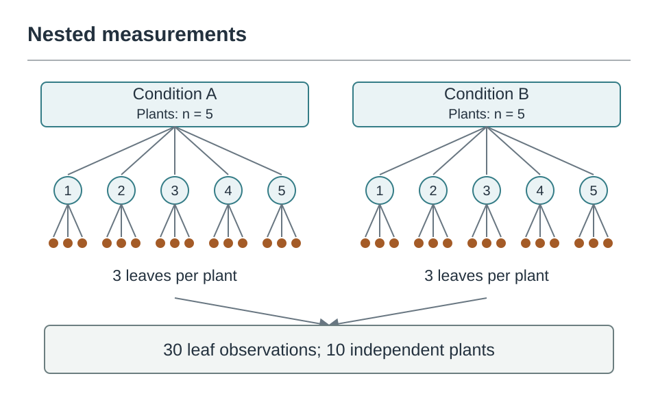

# M19-L3 – Methodology and control groups {#L3}

**Course area:** M19 – Elective Selection and Bachelor Project

**Level:** Bachelor

**Prerequisites:** [M1-L5](M1-L5.md): experimental design; [M2-L5](M2-L5.md): sampling; [M19-L2](M19-L2.md): research question.

**Learning objective:** Distinguish experimental units, comparison groups, randomisation and repeated measurements and justify a pre-specified analysis plan.

## Introduction {#S1}

A dataset with many observations may originate from very few independent units. To evaluate the light comparison correctly, identify the level at which conditions are assigned and outcomes measured. This lesson uses only a conceptual model and fictional data.

## Principles and model {#S2}

### Comparison and independence

Reference group A provides a comparison for condition B. In the idealised model, it differs only in the explanatory factor being investigated. Random assignment can reduce systematic group differences in expectation, but does not guarantee perfect balance in small samples. Blocking can account for previously known nuisance variables. Blinded assessment can reduce expectation effects on measurement. Document the measurement definition and units before data collection.

If several plants in a single light chamber receive a condition jointly, the chamber is the relevant assignment unit; additional plants in that chamber are not independent replicates of the condition. A comparison with one chamber per condition cannot separate chamber and condition effects. In the fictional alternative, conditions are assigned independently at plant level. Multiple leaves from one plant are then nested measurements. A pre-specified plant-level mean or an appropriate hierarchical model accounts for this dependence.

### Analysis plan and data structure

Define the outcome, the contrast B minus A, the planned descriptive display, the measure of uncertainty and rules for missing values. For independent plants and a continuous outcome, a difference in means with a suitable confidence interval is one reasonable approach. Small samples require particularly careful assessment of model assumptions. Sample size planning should depend on biologically relevant effect sizes, expected variability and desired precision, not an arbitrary minimum count. Separate raw data, documented processing and analysis results. Do not change exclusion rules after seeing group differences; label post-hoc analyses as exploratory.

*Figure: Two groups with five independent plants each and three leaf observations per plant.*

## Application {#S3}

In the simulated model, five plants per condition are assigned independently and three leaves per plant are measured. This produces $2\cdot5\cdot3=30$ leaf observations but only $2\cdot5=10$ independent plant units. After calculating plant means, the analysis file contains five values per group. If all five plants in a group were jointly assigned to just one chamber per condition, only two chambers would be assigned; a credible causal comparison of light conditions would not be possible.

## Self-assessment {#S4}

### Exercises

1. How many independent units and observations result from four independently assigned plants per group and five leaves per plant?
2. Why is one chamber per condition problematic?
3. What is the purpose of a pre-specified missing-data rule?

::: {.lc-solutions data-lc-section="S4"}
1. Eight independent plants and $2\cdot4\cdot5=40$ leaf observations.
2. Chamber and condition are completely confounded; additional leaves or plants do not remove that confounding.
3. It limits outcome-dependent selection and supports reproducible analysis.
:::

## Assumptions and limitations {#S5}

The fictional design does not specify real laboratory conditions. It assumes independent assignment and no relevant interference between units. Actual sample size requires separate planning and any necessary approvals.

## Summary and transition {#S6}

The model yields ten independent plant values. The next lesson analyses these simulated data.

**Continue:** [M19-L4](M19-L4.md)

## Sources {#S7}

- [Kass et al. (2016) – Ten Simple Rules for Effective Statistical Practice](https://doi.org/10.1371/journal.pcbi.1004961) · Statistical reasoning, study design, uncertainty and reproducibility; indexed article · Last accessed: 2026-11-25
- [NIH – Principles and Guidelines for Reporting Preclinical Research](https://grants.nih.gov/policy-and-compliance/policy-topics/reproducibility/principles-guidelines-reporting-preclinical-research) · Transparency; Replicates; Randomization; Blinding; Inclusion and exclusion · Last accessed: 2026-11-25
- [DFG – Code of Conduct: Guidelines for Safeguarding Good Research Practice](https://www.dfg.de/en/basics-topics/basics-and-principles-of-funding/good-research-practice/code-of-conduct) · Research integrity, institutional implementation; indexed page · Last accessed: 2026-11-25

