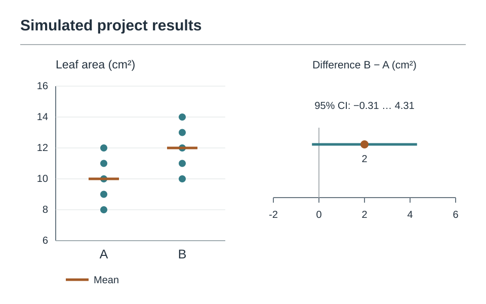

# M19-L4 – Data interpretation and discussion {#L4}

**Course area:** M19 – Elective Selection and Bachelor Project

**Level:** Bachelor

**Prerequisites:** [M2-L3](M2-L3.md): variability; [M2-L4](M2-L4.md): confidence intervals; [M19-L3](M19-L3.md): study design.

**Learning objective:** Calculate a difference in means with uncertainty and distinguish results, biological interpretation and limits of inference.

## Introduction {#S1}

A results section first answers what was observed. Biological interpretation follows in the discussion. The example continues the fictional comparison of two light conditions with five independently assigned plants per group.

## Principles and model {#S2}

### Descriptive and inferential analysis

Plant-level means for A are 8, 9, 10, 11 and 12; for B they are 10, 11, 12, 13 and 14, all in cm². Display individual observations together with suitable location and variability measures to show overlap. Group means are 10 and 12 cm²; the sample variance in each group is 2.5 cm⁴. The estimated difference B minus A is 2 cm², or 20 percent of the A mean. This relative value depends on the selected reference.

Under an independent two-sample model, the standard error of the difference is $SE=\sqrt{s_A^2/n_A+s_B^2/n_B}=1$ cm². The Welch interval has eight degrees of freedom here because the variances and sample sizes are equal. Using the critical t value 2.306, the two-sided 95 percent confidence interval is $2\pm2.306$, approximately −0.31 to 4.31 cm². The interval includes zero and potentially biologically relevant positive differences. This neither establishes equality nor provides convincing evidence of a positive effect. The model assumptions (including independent units and adequately fitting distributional assumptions) must be justified.

### Discussion and alternative explanations

Compare the observed direction and magnitude with the literature. A discussion also addresses divergent findings, measurement uncertainty, limited representativeness and possible confounders. Distinguish causal interpretation under a suitable randomised design from mere association in observational data. The statement cannot be generalised from a simulated sample to all plant species, developmental stages and environmental conditions. Propose a follow-up study addressing a specific remaining uncertainty. Report non-significant findings and document planned as well as post-hoc analyses.

*Figure: Individual observations and group means, plus the mean difference with Welch confidence interval.*

## Application {#S3}

A results section might state: In the simulated data, mean leaf area in B exceeded A by 2 cm² (95 percent Welch confidence interval −0.31 to 4.31 cm², five independent plants per group). The discussion adds: The estimated difference is compatible with a positive effect, but the data also allow small negative differences. A larger, appropriate and independently replicated dataset could improve precision. This is not empirical evidence.

## Self-assessment {#S4}

### Exercises

1. Calculate the relative difference for group means of 20 and 23 cm², using A as reference.
2. What does a confidence interval including zero establish about equality of the groups?
3. Why include individual observations in the graphical display?

::: {.lc-solutions data-lc-section="S4"}
1. $(23-20)/20=0.15$, or 15 percent.
2. It does not establish equality; zero is compatible with the data and model assumptions at that confidence level.
3. They show variability, overlap and potentially unusual observations that means alone can hide.
:::

## Assumptions and limitations {#S5}

The interval applies only under the stated statistical model. Small samples limit assessment of assumptions. All data are educational simulations; the percentage and interval are not published biological findings.

## Summary and transition {#S6}

The results are described with explicit uncertainty. The final bachelor lesson combines the research question, methods and findings into a report and defence.

**Continue:** [M19-L5](M19-L5.md)

## Sources {#S7}

- [Kass et al. (2016) – Ten Simple Rules for Effective Statistical Practice](https://doi.org/10.1371/journal.pcbi.1004961) · Statistical reasoning, study design, uncertainty and reproducibility; indexed article · Last accessed: 2026-11-25
- [DFG – Code of Conduct: Guidelines for Safeguarding Good Research Practice](https://www.dfg.de/en/basics-topics/basics-and-principles-of-funding/good-research-practice/code-of-conduct) · Research integrity, institutional implementation; indexed page · Last accessed: 2026-11-25
- [OpenStax – Introductory Statistics 2e, 8.2 A Single Population Mean using the Student t Distribution](https://openstax.org/books/introductory-statistics-2e/pages/8-2-a-single-population-mean-using-the-student-t-distribution) · Student t confidence interval · Last accessed: 2026-11-25

