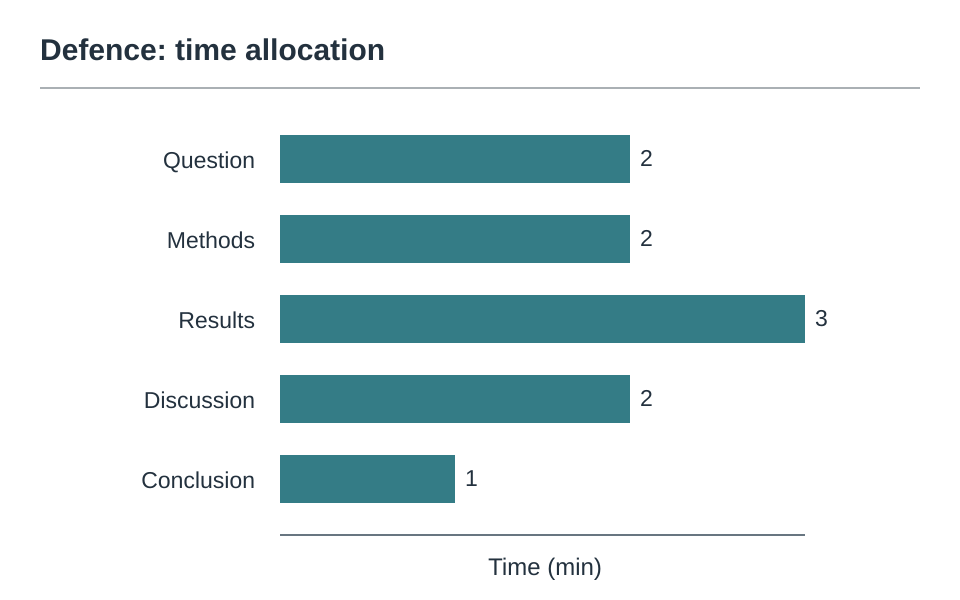

# M19-L5 – Thesis and defence {#L5}

**Course area:** M19 – Elective Selection and Bachelor Project

**Level:** Bachelor

**Prerequisites:** [M19-L2](M19-L2.md): research question; [M19-L4](M19-L4.md): analysis; [M16-L5](M16-L5.md): documentation.

**Learning objective:** Structure an auditable research report, defend its evidence and document an independent bachelor-level capstone project.

## Introduction {#S1}

A thesis is a traceable argument, not merely a collection of facts. Readers must be able to identify the question, how the data originated, what follows from them and where inference ends. This lesson completes the continuous simulated leaf-area project.

## Principles and model {#S2}

### Report structure

The introduction leads from biological relevance to the precise research question and states the hypothesis. Methods describe data origin, experimental units, comparison conditions, measurement definition, statistical model and processing rules. Results present observed values and uncertainty, such as the figure from M19-L4, without presenting simulated data as actual measurements. The discussion answers the question within the evidence, compares literature, describes limitations and justifies possible next steps. An abstract summarises the aim, methods, major findings and conclusion. For an actual thesis, exact structure, declarations of independent work and submission format follow local requirements.

Figures need understandable axes, units, legends and sample information. Cite others' ideas, data and illustrations where used. Document tools used, including software and, if applicable, generative AI, according to relevant requirements. Record versions and decisions. A reproducible appendix may contain the fictional dataset, a data dictionary, calculation steps and a reference list; confidential or unauthorised data do not belong in public appendices. Unpublished or untraceable results must not be misrepresented as sources.

### Defence and self-assessment

A short presentation should explain the question, design, central finding and limitations in a logical sequence. Practise justifying the independent unit, explaining the confidence interval and distinguishing the results from a causal claim. Answer objections with the evidence actually available. If a question cannot be answered, state the missing data or assumptions. The ability to explain limitations is part of scientific competence.

*Figure: Illustrative division of a ten-minute presentation into five sections.*

## Application {#S3}

As an optional self-study capstone, write a short report on the data in M19-L4 and outline a ten-minute presentation: question and relevance 2 minutes, methods 2, results 3, discussion and limitations 2, conclusion 1 minute. Check six criteria: clear question, independent units, traceable data, correct statistics, bounded conclusion and complete references. If five are met, the simple completion fraction is $5/6\approx83.3$ percent. Missing evidence of data provenance must be corrected regardless of this fraction.

## Self-assessment {#S4}

### Exercises

1. In which section should data exclusion rules be explained?
2. How would you answer a defence question asking whether the light condition demonstrably causes larger leaves?
3. Which four components should accompany a traceable analysis appendix at minimum?

::: {.lc-solutions data-lc-section="S4"}
1. In the methods section; actual exclusions and deviations should be reported transparently.
2. The fictional comparison estimates a positive difference, but its interval includes zero. Simulated data provide no empirical evidence. The claim also depends on independent assignment and model assumptions.
3. Dataset, data dictionary, traceable calculation steps and sources or provenance information.
:::

## Assumptions and limitations {#S5}

Timing and self-assessment checklist are course suggestions, not official examination or grading requirements. A self-study report does not replace a supervised bachelor thesis, nor does its defence constitute a recognised university examination.

## Summary and transition {#S6}

The bachelor learning path is complete. Use the self-assessment to revisit outstanding foundations. The subsequent master's electives assume the bachelor core and can be selected separately according to subject interest.

**Continue:** [M20-L1](M20-L1.md)

## Sources {#S7}

- [Duke University – Biology Thesis Guidelines](https://biology.duke.edu/undergraduate/graduation-with-distinction/thesis-guidelines) · Research goals and thesis structure; indexed page · Last accessed: 2026-11-25
- [KIT – Biology: Scientific Writing](https://biologie.chem-bio.kit.edu/english/822.php) · Introduction, question, methods, results, discussion and institutional guidance; indexed page · Last accessed: 2026-11-25
- [DFG – Code of Conduct: Guidelines for Safeguarding Good Research Practice](https://www.dfg.de/en/basics-topics/basics-and-principles-of-funding/good-research-practice/code-of-conduct) · Research integrity, institutional implementation; indexed page · Last accessed: 2026-11-25
- [Universität Regensburg – Bachelor’s thesis (Biology)](https://www.uni-regensburg.de/en/biology-preclinical-medicine/study/study-programs/bachelor-biology/bachelors-thesis) · Institution-specific supervision and thesis/seminar requirements; indexed page · Last accessed: 2026-11-25

