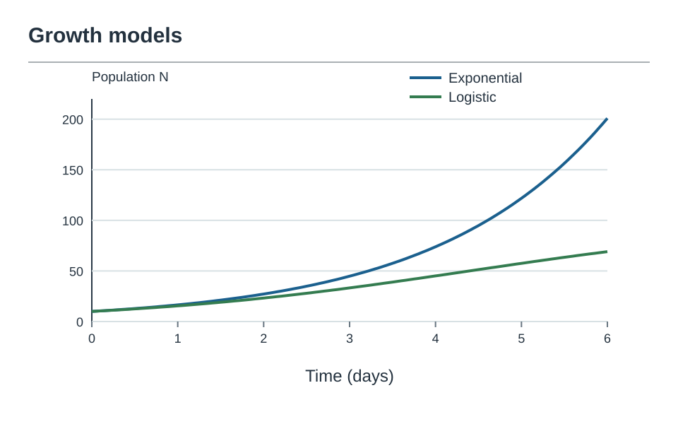

# M2-L1 – Functions, derivatives and growth models {#L1}

**Course area:** M2 – Mathematics, Statistics and Data Literacy

**Level:** Bachelor

**Prerequisites:** School mathematics: powers, exponential functions and linear equations; [M1-L5](M1-L5.md).

**Learning objective:** Distinguish linear, exponential and logistic growth models, interpret derivatives biologically and check parameter units.

## Introduction {#S1}

A population may initially grow rapidly and later approach a stable level. Absolute increase, relative growth rate and long-term limitation describe different features of the same trajectory. The choice of function depends on the assumed process, not merely on visual agreement with measurements.

## Principles and model {#S2}

Linear growth follows $N(t)=N_0+at$: equal time intervals add equal numbers of individuals. Its derivative $dN/dt=a$ is constant. Exponential growth instead satisfies $dN/dt=rN$, with solution $N(t)=N_0e^{rt}$. The relative rate $(dN/dt)/N=r$ is constant. If $r>0$, doubling time is $\ln(2)/r$; if $r<0$, the modelled quantity decreases. With time in days, the unit of $r$ is day⁻¹.

The logistic differential equation $dN/dt=rN(1-N/K)$ describes a simple density-dependent limitation. Carrying capacity $K$ has the same unit as $N$. For $0<N<K$ and $r>0$, $N$ increases but approaches $K$. At $N=K/2$, absolute growth rate is maximal at $rK/4$. At $N=0$ or $N=K$ the derivative vanishes. The model assumes constant capacity and immediate feedback.

The derivative gives local slope, whereas the difference quotient $\Delta N/\Delta t$ describes the average rate over an interval. In measured data the latter approximates the former; measurement noise can strongly affect the estimate.

*Figure: Exponential and logistic models with N₀=10, r=0.5 per day, K=100.*

## Application {#S3}

A fictional model uses $N_0=10$, $r=0.5$ day⁻¹ and $K=100$. After four days, exponential growth gives $10e^2\approx73.89$. Logistic growth gives $N(t)=K/[1+(K/N_0-1)e^{-rt}]$, or $100/(1+9e^{-2})\approx45.09$. The curves in the figure use these exact parameters. At $N=50$, logistic growth gives $0.5\cdot50\cdot(1-0.5)=12.5$ individuals per day as the instantaneous rate. Fractional model values are continuous approximations, not counted individuals.

## Self-assessment {#S4}

### Exercises

1. Calculate exponential doubling time for $r=0.5$ day⁻¹.
2. Find instantaneous logistic growth rate at $N=80$.
3. Which model assumption is violated if carrying capacity fluctuates seasonally?

::: {.lc-solutions data-lc-section="S4"}
1. $\ln(2)/0.5\approx1.39$ days.
2. $0.5\cdot80\cdot(1-80/100)=8$ individuals per day.
3. Capacity $K$ is not constant; a time-dependent model or another resource model is required.
:::

## Assumptions and limitations {#S5}

The deterministic model includes neither random births and deaths nor age structure, migration or delayed competition. Fitting short time series is insufficient to distinguish exponential and logistic growth reliably over the long term.

## Summary and transition {#S6}

Growth functions connect population size, rate and resource limitation. M2-L2 introduces randomness into biological models.

**Continue:** [M2-L2](M2-L2.md)

## Sources {#S7}

- [OpenStax – Biology 2e, 45.3 Environmental Limits to Population Growth](https://openstax.org/books/biology-2e/pages/45-3-environmental-limits-to-population-growth) · Exponential and logistic growth · Last accessed: 2026-11-25

