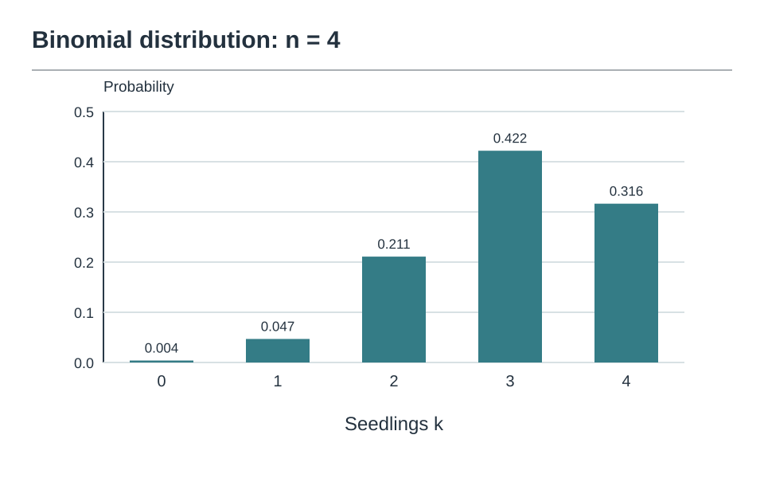

# M2-L2 – Probability and distributions {#L2}

**Course area:** M2 – Mathematics, Statistics and Data Literacy

**Level:** Bachelor

**Prerequisites:** Basic arithmetic, powers and fractions; [M2-L1](M2-L1.md).

**Learning objective:** Distinguish events, conditional probability and random variables; calculate binomial counts and assess model assumptions.

## Introduction {#S1}

Not every seed in a batch germinates. Probability describes uncertainty about the result of an experiment under particular conditions. It does not specify which individual seed will germinate.

## Principles and model {#S2}

For events $A$ and $B$, $P(A\mid B)=P(A\cap B)/P(B)$ if $P(B)>0$. Under independence, $P(A\cap B)=P(A)P(B)$. Mutually exclusive events of positive probability are not independent. Complementary probability is $P(A^c)=1-P(A)$.

A random variable assigns numbers to outcomes. A Bernoulli variable takes 1 with probability $p$ and otherwise 0. For $n$ independent trials with identical $p$, the sum $X$ is binomial: $P(X=k)=\binom{n}{k}p^k(1-p)^{n-k}$. The expectation $E(X)=np$ is a long-run average; variance $\mathrm{Var}(X)=np(1-p)$ measures dispersion. Standard deviation is its square root. A continuous distribution, such as the normal distribution, instead assigns probabilities to intervals; a single exact value has zero probability.

*Figure: Model probabilities for four independent seeds with p=0.75.*

## Application {#S3}

Four independent fictional seeds germinate with $p=0.75$ each. The probability of exactly three seedlings is $P(X=3)=4(0.75)^3(0.25)=0.421875$. The probability of at least one seedling is $1-(0.25)^4=0.99609375$. Expectation is 3 and variance 0.75. The diagram shows all five possible counts. It uses model probabilities rather than observations.

## Self-assessment {#S4}

### Exercises

1. Calculate the probability that all four seeds germinate.
2. Calculate the standard deviation of $X$.
3. Why might shared culture in a single dish violate the binomial assumption?

::: {.lc-solutions data-lc-section="S4"}
1. $(0.75)^4=0.31640625$.
2. $\sqrt{0.75}\approx0.866$ seedlings.
3. Shared environmental conditions may correlate outcomes; independent trials and constant $p$ are then not guaranteed.
:::

## Assumptions and limitations {#S5}

Probabilities apply within the specified model. Without empirical estimation or a justified assumption, $p=0.75$ is not a claim about a real seed batch. Variable individual probabilities or dependent outcomes require other models.

## Summary and transition {#S6}

Random variables and distributions underpin description and subsequent inference from samples.

**Continue:** [M2-L3](M2-L3.md)

## Sources {#S7}

- [OpenStax – Introductory Statistics 2e, 4.3 Binomial Distribution](https://openstax.org/books/introductory-statistics-2e/pages/4-3-binomial-distribution) · Binomial assumptions, mean and variance · Last accessed: 2026-11-25

