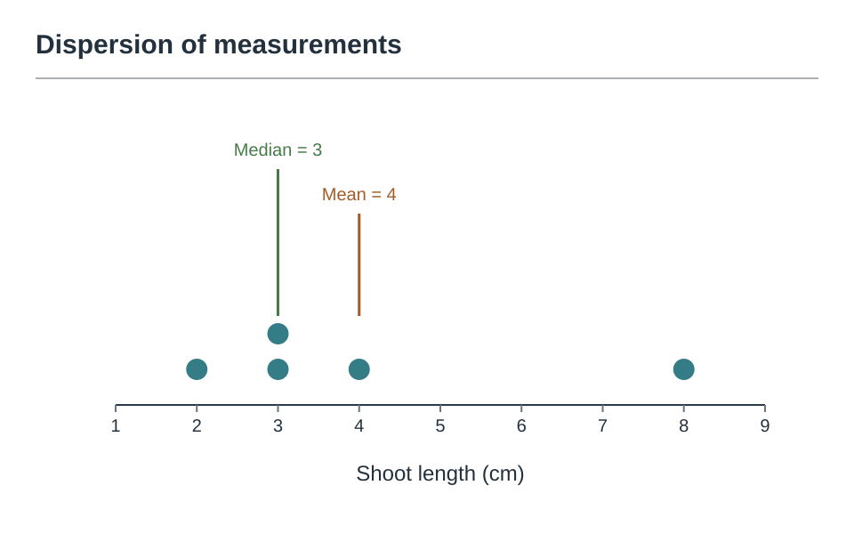

# M2-L3 – Descriptive statistics {#L3}

**Course area:** M2 – Mathematics, Statistics and Data Literacy

**Level:** Bachelor

**Prerequisites:** [M2-L2](M2-L2.md); sums and square roots.

**Learning objective:** Describe location, dispersion and distribution shape; calculate mean, median and sample standard deviation from biological measurements.

## Introduction {#S1}

Five plants of the same species have different shoot lengths. A single average length can obscure these differences. A descriptive analysis should therefore show measurements, units, sample size and appropriate summaries together.

## Principles and model {#S2}

For quantitative values $x_1,\ldots,x_n$, the mean is $\bar x=\sum_i x_i/n$. The median divides ordered data into two halves; for an even number, conventionally take the mean of the two middle values. The median is less sensitive to isolated extreme observations. Range is maximum minus minimum. The interquartile range spans the first and third quartiles; for small samples, calculation conventions differ.

Sample variance is $s^2=\sum_i(x_i-\bar x)^2/(n-1)$ for $n>1$. Under independent identical distributions and finite variance, it is an unbiased estimator of population variance. Sample standard deviation $s$ has the original measurement unit. It is not the standard error of the mean $s/\sqrt n$, which estimates the mean's sampling uncertainty under relevant assumptions. Dot plots show individual values, histograms show class frequencies and box plots show quartiles. For categorical data, frequencies and proportions are more suitable than means of arbitrary category codes.

*Figure: Dot plot of fictional shoot lengths 2, 3, 3, 4 and 8 cm.*

## Application {#S3}

Fictional shoot lengths in cm: 2, 3, 3, 4, 8. Sum 20, mean 4 cm and median 3 cm. Squared deviations from the mean are 4, 1, 1, 0, 16; hence $s^2=22/4=5.5\,\mathrm{cm^2}$ and $s\approx2.35$ cm. Range is 6 cm. The cluster at 3 and high value 8 are directly visible in the dot plot. The value 8 should not be excluded as an error merely because it is unusual.

## Self-assessment {#S4}

### Exercises

1. Calculate mean and median without the value 8 as a sensitivity analysis only.
2. Calculate the estimated standard error of the original mean under independence.
3. Name one advantage of a dot plot with only five measurements.

::: {.lc-solutions data-lc-section="S4"}
1. $12/4=3$ cm; median 3 cm. This calculation does not justify exclusion.
2. $\sqrt{5.5}/\sqrt5\approx1.05$ cm.
3. Every measurement and repeated value is visible; small sample size is not concealed.
:::

## Assumptions and limitations {#S5}

Descriptive statistics alone cannot establish causality or representativeness. Interpretation depends on measurement quality, sampling design and selection process.

## Summary and transition {#S6}

Descriptive measures characterize observed data. Confidence intervals and tests additionally incorporate sampling uncertainty.

**Continue:** [M2-L4](M2-L4.md)

## Sources {#S7}

- [OpenStax – Introductory Statistics 2e, 2.5 Measures of the Center of the Data](https://openstax.org/books/introductory-statistics-2e/pages/2-5-measures-of-the-center-of-the-data) · Mean and median · Last accessed: 2026-11-25
- [OpenStax – Introductory Statistics 2e, 2.7 Measures of the Spread of the Data](https://openstax.org/books/introductory-statistics-2e/pages/2-7-measures-of-the-spread-of-the-data) · Sample standard deviation and variance · Last accessed: 2026-11-25

