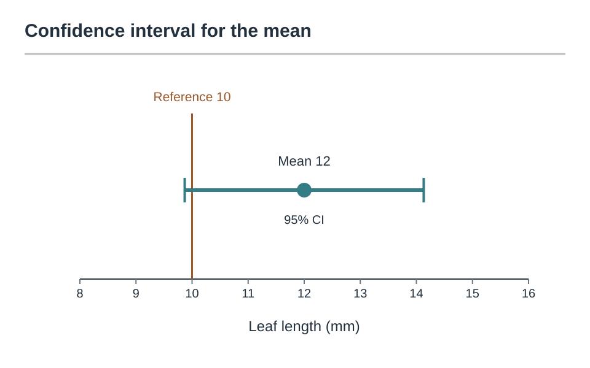

# M2-L4 – Hypothesis tests and confidence intervals {#L4}

**Course area:** M2 – Mathematics, Statistics and Data Literacy

**Level:** Bachelor

**Prerequisites:** [M2-L3](M2-L3.md): mean, dispersion and standard error.

**Learning objective:** Calculate a confidence interval for a mean, interpret a two-sided t test and distinguish statistical from biological relevance.

## Introduction {#S1}

A difference between measured and expected leaf length may arise from sampling variation or a real difference in the underlying mean. Inference connects measurements to an explicitly chosen model of this uncertainty.

## Principles and model {#S2}

For independent identically normally distributed observations with unknown population variance, the two-sided $(1-\alpha)$ confidence interval for the mean is $\bar x\pm t_{n-1,1-\alpha/2}s/\sqrt n$. The critical value comes from Student's t distribution with $n-1$ degrees of freedom. A 95% confidence procedure produces intervals containing the true mean in 95% of repeated samples under the model assumptions. The interval already calculated does not assign a subsequent probability of 95% to the fixed parameter.

A two-sided test of $H_0:\mu=\mu_0$ uses $t=(\bar x-\mu_0)/(s/\sqrt n)$. The p value is the probability, under $H_0$ and the model assumptions, of a test statistic at least as extreme as observed. It is not the probability that $H_0$ is true. With prespecified $\alpha$, reject $H_0$ if $p\leq\alpha$. A type I error is rejection of a true null hypothesis; a type II error is failure to reject a false null hypothesis. Power is one minus the probability of a type II error for a specified alternative.

*Figure: 95% confidence interval from 9.869 to 14.131 mm; reference value 10 mm lies inside.*

## Application {#S3}

Fictional summary of 16 independently sampled plants: mean 12 mm, sample standard deviation 4 mm. With 15 degrees of freedom, the 97.5th percentile is about 2.131; standard error is 1 mm. The 95% interval is [9.869, 14.131] mm. Against a reference of 10 mm, $t=2$, giving $p\approx0.064$. At $\alpha=0.05$ the null is not rejected; the difference of 2 mm remains an estimated effect. The interval includes 10 mm, corresponding to the same inferential decision in the matching two-sided test.

## Self-assessment {#S4}

### Exercises

1. Calculate standard error for $n=64$ with unchanged $s=4$ mm.
2. Does $p\approx0.064$ prove equality with 10 mm?
3. Why additionally report effect and confidence interval?

::: {.lc-solutions data-lc-section="S4"}
1. $4/\sqrt{64}=0.5$ mm.
2. No. Failure to reject only means that the decision rule did not yield sufficient evidence against the null.
3. They show magnitude and uncertainty; a p value alone does not indicate biological relevance.
:::

## Assumptions and limitations {#S5}

For small samples the normality assumption is important. Dependent observations, severe outliers, selective reporting and multiple testing may distort inference. Sample size alone does not guarantee reliability. Establishing equivalence requires a separate prespecified procedure and a scientifically justified tolerance margin.

## Summary and transition {#S6}

Inference requires a model, an effect and a transparent decision. M2-L5 considers how study design constrains those conclusions.

**Continue:** [M2-L5](M2-L5.md)

## Sources {#S7}

- [OpenStax – Introductory Statistics 2e, 8.2 A Single Population Mean using the Student t Distribution](https://openstax.org/books/introductory-statistics-2e/pages/8-2-a-single-population-mean-using-the-student-t-distribution) · Student t confidence interval · Last accessed: 2026-11-25
- [OpenStax – Introductory Statistics 2e, Ch. 9 Introduction](https://openstax.org/books/introductory-statistics-2e/pages/9-introduction) · Hypothesis testing, error types · Last accessed: 2026-11-25

