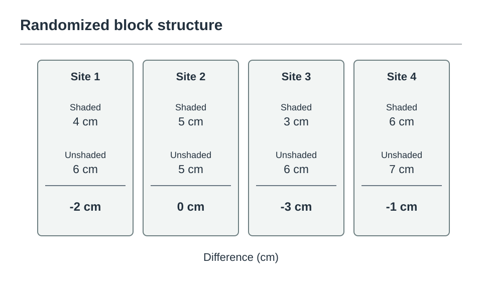

# M2-L5 – Experimental design and sampling {#L5}

**Course area:** M2 – Mathematics, Statistics and Data Literacy

**Level:** Bachelor

**Prerequisites:** [M1-L5](M1-L5.md), [M2-L4](M2-L4.md).

**Learning objective:** Define target population and sample; distinguish random selection from random assignment and analyze blocked designs.

## Introduction {#S1}

An ecological study aims to estimate whether shading affects plant growth. Soil type and moisture vary spatially. If all shaded plants are studied in the wet area and all controls in the dry area, the effect of shade cannot be separated from the effect of soil.

## Principles and model {#S2}

The target population is the set of units to which a claim is intended to apply. The sample contains the units actually observed; a sampling frame defines which units can be reached. In simple random sampling, equal-sized subsets have the same selection probability. Stratified samples draw units from prespecified subpopulations; cluster samples select groups of units, requiring dependence within those groups to be considered.

Random **selection** supports generalization to a population; random **assignment** of conditions supports causal comparisons. They have distinct functions. In a randomized block design, comparable units are grouped, for instance by site, and conditions randomly assigned within each block. Paired analysis uses within-block differences. Repeated measurements on the same unit do not automatically increase the number of independent units. Sample size planning requires a scientifically relevant effect size, an estimate of dispersion, a decision rule and desired power in advance.

*Figure: Four sites, each with two conditions and their paired differences.*

## Application {#S3}

Four fictional independent sites each contain two randomly assigned plots. Growth in cm under shade is 4, 5, 3, 6 and without shade 6, 5, 6, 7. Paired differences (shaded minus unshaded) are −2, 0, −3, −1 cm; their mean is −1.5 cm. Four differences are available for blockwise analysis. Treating the eight individual measurements as eight independently drawn differences would be wrong. This illustrates analysis structure, not an established environmental effect.

## Self-assessment {#S4}

### Exercises

1. What quantity is analyzed in a paired comparison?
2. What is one possible advantage of stratification by soil type when selecting sites?
3. Do 20 measurements per plot turn the study into 160 independent plots?

::: {.lc-solutions data-lc-section="S4"}
1. For each site, the difference between the two assigned conditions.
2. Relevant soil types can be deliberately represented and described separately; weighting and selection must suit the target population.
3. No. Measurements are nested within plots; independent units and blocking remain decisive.
:::

## Assumptions and limitations {#S5}

Not all ecological factors can be manipulated. Observational studies may support hypotheses but require additional assumptions for causal claims. Missing observations and nonrandom dropout can impair even a carefully planned design.

## Summary and transition {#S6}

Good sampling and experimental designs specify the statistical unit and scope. The next lesson connects these decisions to reproducible analyses.

**Continue:** [M2-L6](M2-L6.md)

## Sources {#S7}

- [NIH – Principles and Guidelines for Reporting Preclinical Research](https://grants.nih.gov/policy-and-compliance/policy-topics/reproducibility/principles-guidelines-reporting-preclinical-research) · Transparency; Replicates; Randomization; Blinding; Inclusion and exclusion · Last accessed: 2026-11-25
- [OpenStax – Biology 2e, 1.1 The Science of Biology](https://openstax.org/books/biology-2e/pages/1-1-the-science-of-biology) · The Process of Science; Scientific Reasoning · Last accessed: 2026-11-25
- [OpenStax – Introductory Statistics 2e, 1.2 Data, Sampling, and Variation in Data and Sampling](https://openstax.org/books/introductory-statistics-2e/pages/1-2-data-sampling-and-variation-in-data-and-sampling) · Random, stratified and cluster sampling; variation in samples · Last accessed: 2026-11-25

