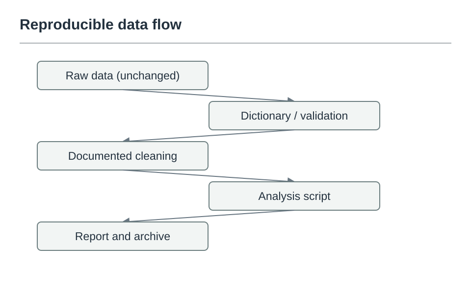

# M2-L6 – Reproducible data analysis {#L6}

**Course area:** M2 – Mathematics, Statistics and Data Literacy

**Level:** Bachelor

**Prerequisites:** [M2-L3](M2-L3.md) to [M2-L5](M2-L5.md).

**Learning objective:** Design a transparent data workflow with preserved raw data, a data dictionary, documented cleaning and executable analysis.

## Introduction {#S1}

A mean in a report is hard to verify if it is unclear which observations were used, which units converted and which rows excluded. Reproducible data analysis connects a reported value to its derivation.

## Principles and model {#S2}

Raw data are preserved unchanged. A data dictionary describes variable names, units, encodings, allowed values and missing entries. A machine-readable table uses a clear observational unit per row, unique keys and separate variables per column. Quality checks examine, for example, value ranges, duplicate keys, units and missing data. Cleaning steps are recorded as distinct reproducible transformations; an unusual value is not removed without scientific justification.

An analysis script reads the data, checks expected conditions, generates derived values and saves tables and figures. The runtime environment, library versions, input files and parameters are documented. In stochastic procedures, a fixed random seed can help reproduce a run; software versions may still produce different results. A hash can detect file changes but proves neither truth nor correct provenance. For personal or otherwise protected data, reproducibility must comply with relevant access rules.



*Figure: Preserved raw data pass through documented processing and scripts to a verifiable report.*

## Application {#S3}

Fictional measurements in cm: A=4, B=6, C=missing, D=8. Missing is not zero. An executable Python example with no additional libraries preserves this distinction:

```python
raw = [('A', 4), ('B', 6), ('C', None), ('D', 8)]
assert len({k for k, _ in raw}) == len(raw)
values = [v for _, v in raw if v is not None]
assert all(v >= 0 for v in values)
print(len(values), len(raw)-len(values), sum(values)/len(values))
```

Output: `3 1 6.0`. Three observed values and one missing value were counted; the mean of observed values is 6 cm. This does not explain why C is missing. Report both counts and the exclusion rule.

## Self-assessment {#S4}

### Exercises

1. What would the mean be if the missing value were wrongly encoded as zero?
2. What information must a data dictionary provide for the measurement column?
3. Why is a hash alone insufficient for scientific quality assessment?

::: {.lc-solutions data-lc-section="S4"}
1. $(4+6+0+8)/4=4.5$ cm; that would be a different and unjustified analysis here.
2. At least meaning, unit, value range, encoding and handling of missing entries.
3. It shows file equality or changes, not validity, measurement quality or ethical acceptability.
:::

## Assumptions and limitations {#S5}

The example uses complete-case analysis for a single variable. If missingness is systematically related to the measured quantity, this approach may be biased. More complex methods require justified assumptions and do not replace investigation of why observations are missing.

## Summary and transition {#S6}

M2 connects mathematical models, statistical inference, experimental design and transparent data processing. These methods are used again in later biology modules.

**Continue:** [M3-L1](M3-L1.md)

## Sources {#S7}

- [DFG – Leitlinie 12: Dokumentation](https://www.wissenschaftliche-integritaet.de/de/ll-12-389682) · Dokumentation / Documentation · Last accessed: 2026-11-25
- [NIH – Principles and Guidelines for Reporting Preclinical Research](https://grants.nih.gov/policy-and-compliance/policy-topics/reproducibility/principles-guidelines-reporting-preclinical-research) · Transparency; Replicates; Randomization; Blinding; Inclusion and exclusion · Last accessed: 2026-11-25

