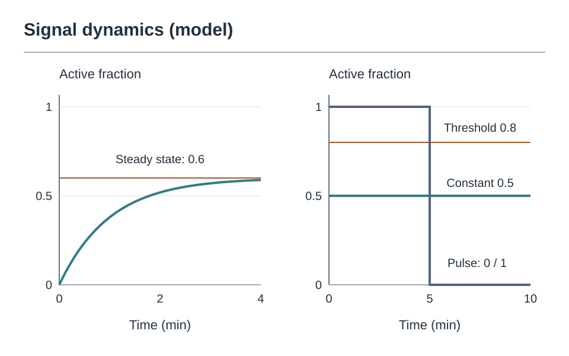

# M20-L1 – Signalling networks {#L1}

**Course area:** M20 – Advanced Cell and Molecular Biology

**Level:** Master – elective profile

**Prerequisites:** [M4-L5](M4-L5.md), [M5-L2](M5-L2.md), [M2-L1](M2-L1.md): signalling, kinetics and differential equations.

**Learning objective:** Analyse signalling networks as dynamic systems, calculate steady states and distinguish temporal signal patterns from mean activity.

## Introduction {#S1}

A receptor translates an extracellular cue into intracellular activity. Its effect depends not only on messenger concentration but also on signal strength, duration and temporal organisation. This master's elective builds on cell biology and biochemistry by treating dynamics as a measurable system.

## Principles and model {#S2}

### Network architecture and dynamics

In a kinase cascade successive stages activate additional components. Phosphatases can reverse phosphorylation. Scaffold proteins and compartments influence which reactions are spatially possible. Branches generate distinct outputs, while convergence integrates multiple inputs. Positive feedback can stabilise switch-like behaviour under suitable conditions; negative feedback can limit amplification or favour adaptation and, with sufficient delay, oscillation. Topology alone does not prove a particular dynamic regime: parameters, initial conditions and timescales also matter.

A two-state model for the active fraction $x$ between zero and one is

$$\frac{dx}{dt}=a(1-x)-bx,$$

where $a,b>0$ are effective activation and deactivation rates in inverse time units. The steady-state fraction is $x^*=a/(a+b)$ and relaxation time $\tau=1/(a+b)$. At constant input, $x(t)=x^*+(x(0)-x^*)e^{-t/\tau}$. This model conserves total abundance and contains no explicit feedback.

### From signal trajectories to evidence

A time average may conceal pulses. In an experimental study Albeck and colleagues examined time-varying ERK activity and its relationship to S-phase entry. An individual fluorescence signal may nevertheless combine reporter kinetics with biological activity. Model assessment compares time trajectories, independent units, alternative explanations and uncertainty in estimated parameters. Correlation between a pulse feature and cell fate alone does not establish a necessary or sufficient cause.

*Figure: Relaxation towards a steady state and two signals with equal time means but different threshold crossings.*

## Application {#S3}

Simulated rates $a=0.6\,\mathrm{min}^{-1}$ and $b=0.4\,\mathrm{min}^{-1}$ yield $x^*=0.6$ and $\tau=1\,\mathrm{min}$. Starting from $x(0)=0$, after two minutes $x(2)=0.6(1-e^{-2})\approx0.519$. Two idealised signals over ten minutes have the same integral of 5 activity-minutes: A remains at 0.5; B stays at one for the first five minutes and at zero for the next five. A downstream nonlinear threshold of 0.8 would be crossed only by B. The time mean alone is insufficient to predict the response.

## Self-assessment {#S4}

### Exercises

1. Calculate the steady-state fraction and relaxation time for $a=0.2$, $b=0.3$ per minute.
2. Why cannot a single steady-state measurement uniquely determine $a$ and $b$?
3. Which measurement could distinguish a pulse model from a constant signal?

::: {.lc-solutions data-lc-section="S4"}
1. $x^*=0.4$, $\tau=2\,\mathrm{min}$.
2. The steady-state fraction determines only the rate ratio. A time series with known stimulation can additionally constrain the sum of rates.
3. Adequately time-resolved single-cell trajectories using a validated reporter and multiple independent biological units.
:::

## Assumptions and limitations {#S5}

The model ignores synthesis, degradation, spatial distribution and stochastic fluctuations. All numbers are illustrative. The threshold response is hypothetical, not a universal ERK rule.

## Summary and transition {#S6}

Dynamic networks explain why signal shape and strength must be considered separately. The next lesson examines regulatory layers at the genome.

**Continue:** [M20-L2](M20-L2.md)

## Sources {#S7}

- [Albeck, Mills & Brugge (2013) – Frequency-modulated pulses of ERK activity transmit quantitative proliferation signals](https://pubmed.ncbi.nlm.nih.gov/23219535/) · Abstract: temporal ERK activity and cell-to-cell variability; indexed abstract · Last accessed: 2026-11-25

