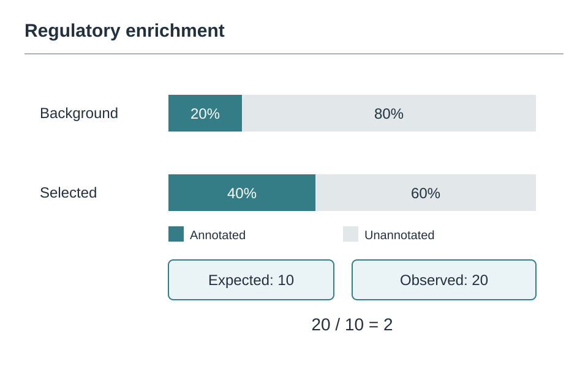

# M20-L2 – Chromatin and genome regulation {#L2}

**Course area:** M20 – Advanced Cell and Molecular Biology

**Level:** Master – elective profile

**Prerequisites:** [M6-L1](M6-L1.md), [M6-L6](M6-L6.md), [M18-L2](M18-L2.md): chromatin, epigenetics and functional genetics.

**Learning objective:** Integrate regulatory genomic data, distinguish candidates from causally supported elements and interpret a simple enrichment analysis.

## Introduction {#S1}

A genome contains regulatory regions as well as protein-coding segments. Which regions participate functionally in a cell type cannot be inferred from sequence alone. Chromatin state, transcription factors and spatial organisation influence the accessibility and use of regulatory DNA.

## Principles and model {#S2}

### Measurement layers and regulatory hypotheses

ATAC-seq provides chromatin accessibility data; ChIP-seq measures enrichment of particular bound proteins or histone modifications. RNA-seq supplies an expression profile, while contact-based data can describe spatial proximity in the genome. These methods produce different measurements, not interchangeable proofs. H3K27ac, for example, is commonly used as an indicator of active regulatory regions but does not establish a direct effect on a particular target gene. An enhancer can be distant from a promoter; the nearest gene need not be the true target.

ENCODE catalogues candidate regulatory elements using genome-wide data. Comparing datasets requires attention to reference genome, cell type, assay, quality indicators and replicates. Interval overlap is meaningful only after harmonising coordinate systems. A hypothesis gains support when independent evidence layers agree. Causal evidence supported by experiments or appropriate natural variation remains distinct.

### Enrichment and background

An overlap analysis requires a biologically and technically comparable universe. For $N$ surveyed regions, of which $K$ are annotated, and a selection of $n$ regions, random sampling without replacement gives an expected hit count of $E[X]=nK/N$. The ratio of observed to expected hits describes enrichment. The hypergeometric distribution is a possible null model if regions can genuinely be treated as exchangeable. Genomic clustering, length differences and accessibility bias can violate this assumption.

*Figure: Comparison of annotated fractions in background and selection; expected and observed hits.*

## Application {#S3}

A fictional dataset contains 1000 comparable regions, 200 with a regulatory annotation. Among 50 selected regions, 20 are annotated. Expected hits are $50\cdot200/1000=10$; enrichment is $20/10=2$. The 40% in the selected set is twice the 20% in the background. This is neither an error probability nor the fraction of causally functional elements. A second evidence layer could prioritise candidates without automatically confirming them.

## Self-assessment {#S4}

### Exercises

1. Calculate expectation and enrichment for $N=800$, $K=100$, $n=40$, observed $X=15$.
2. Why does overlap with a chromatin mark not prove function?
3. Name two properties by which comparable background regions should be selected.

::: {.lc-solutions data-lc-section="S4"}
1. $E[X]=5$; enrichment $15/5=3$.
2. The mark is an associated signal; effect, target gene and direction are not uniquely identified.
3. For example interval length, cell type, accessibility, GC content or technical detectability.
:::

## Assumptions and limitations {#S5}

The numbers are simulated. Statistical significance requires a suitable null distribution, accounting for multiple tests and independent validation. Epigenetic marks are context-dependent and not automatically heritable.

## Summary and transition {#S6}

Regulatory annotations generate testable hypotheses. The next lesson addresses quantitative measurement at the image level.

**Continue:** [M20-L3](M20-L3.md)

## Sources {#S7}

- [NHGRI – The Encyclopedia of DNA Elements (ENCODE)](https://www.genome.gov/Funded-Programs-Projects/ENCODE-Project-ENCyclopedia-Of-DNA-Elements) · Project overview: candidate regulatory elements and human/mouse datasets; indexed page · Last accessed: 2026-11-25

