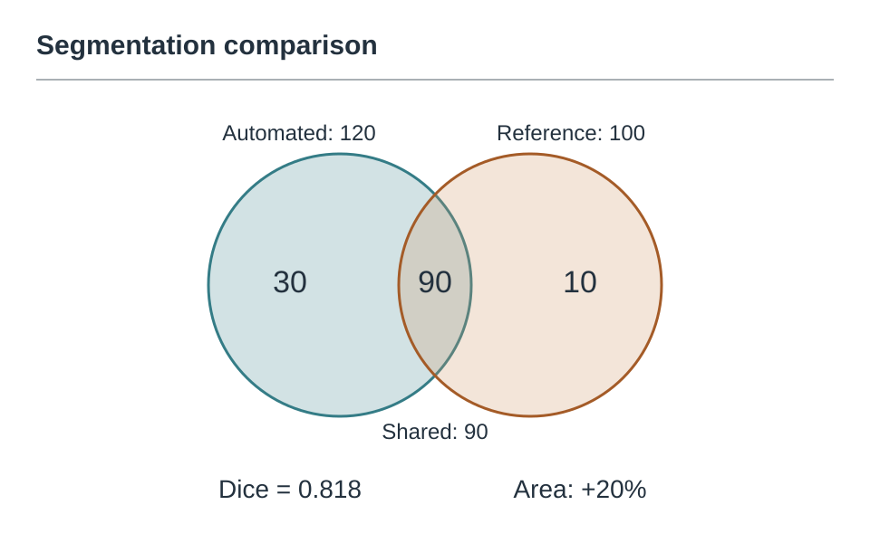

# M20-L3 – Quantitative image analysis {#L3}

**Course area:** M20 – Advanced Cell and Molecular Biology

**Level:** Master – elective profile

**Prerequisites:** [M16-L1](M16-L1.md), [M2-L5](M2-L5.md): microscopy and independent experimental units.

**Learning objective:** Assess segmentation quality, background-corrected intensity and measurement uncertainty quantitatively.

## Introduction {#S1}

A microscopy image is a discrete measurement, not an unchanged object. Optical blur, detector noise, background and limited dynamic range affect the image. Quantitative image analysis translates pixels into biologically interpretable features and must explicitly consider errors.

## Principles and model {#S2}

### Measurement chain and features

Preserve raw data, calibration and metadata. Segmentation defines a mask for cells, nuclei or other structures. Area, shape, integrated intensity or mean intensity can be derived from the mask. With pixel side length $s$ and $n$ pixels, area is $A=ns^2$. For pixel intensities $I_i$ and an estimated constant background $B$, $F=\sum_i I_i-nB$. Mean corrected intensity is $F/n$. Integrated and mean intensities address different questions; cell size and marker abundance may correlate. Subtraction cannot repair saturation.

### Validation and statistical unit

Compare an automated mask $P$ with an independently reviewed reference mask $G$. The Dice coefficient is $D=2|P\cap G|/(|P|+|G|)$. It lies between zero and one when the masks are not both empty. A high score may nevertheless fail to capture small biologically important structures. Assess counting errors, oversegmentation and merged objects separately. A test set should be independent of method selection or tuning and cover different image qualities.

Multiple cells per image and images per sample create nested measurements. For group comparisons, the level of independent treatment assignment matters. Large pixel or cell counts cannot replace independent samples. Report image processing, exclusion criteria, calibration, versions and the relationship between raw data and result figures. Sensitivity analyses using plausible alternative masks can reveal whether a conclusion depends on arbitrary segmentation.

*Figure: Schematic mask overlap with pixel counts and Dice coefficient; not area-proportional.*

## Application {#S3}

A simulated cell mask contains 120 pixels at $s=0.2\,\mu\mathrm m$; the intensity sum is 3600 detector units and background is 10 per pixel. Thus $A=4.8\,\mu\mathrm m^2$, $F=2400$ and mean corrected intensity is 20. A reference mask contains 100 pixels, with 90 in the intersection. Then $D=180/220\approx0.818$. Despite substantial overlap, area differs by 20% relative to the reference. Segmentation quality must therefore be evaluated in relation to the outcome.

## Self-assessment {#S4}

### Exercises

1. A mask contains 80 pixels at $s=0.5\,\mu\mathrm m$, intensity sum 2400 and background 5. Calculate area and corrected mean intensity.
2. For two masks of 100 pixels each with 75 shared pixels, calculate Dice.
3. Why should 200 cells from two independently treated samples not automatically be treated as 200 independent replicates?

::: {.lc-solutions data-lc-section="S4"}
1. $A=80\cdot0.5^2=20\,\mu\mathrm m^2$; $(2400-80\cdot5)/80=25$.
2. $D=150/200=0.75$.
3. Cells within a sample share treatment and context. The independent unit here is the sample, not each cell; the hierarchy must be modelled.
:::

## Assumptions and limitations {#S5}

All image values are simulated. Dice assumes comparable coordinates and an appropriate reference. Intensities are not absolute molecular counts without additional calibration. The overview does not replace supervised instrument training.

## Summary and transition {#S6}

Quantitative imaging combines measurement and validation. The next lesson transfers these principles to single-cell datasets.

**Continue:** [M20-L4](M20-L4.md)

## Sources {#S7}

- [Community-developed checklists for publishing images and image analyses (2023)](https://www.nature.com/articles/s41592-023-01987-9) · Reporting acquisition, processing and analysis; indexed article · Last accessed: 2026-11-25
- [Made to measure: An introduction to quantifying microscopy data in the life sciences](https://doi.org/10.1111/jmi.13208) · Quantification goal, segmentation, measurement limitations; indexed article · Last accessed: 2026-11-25

