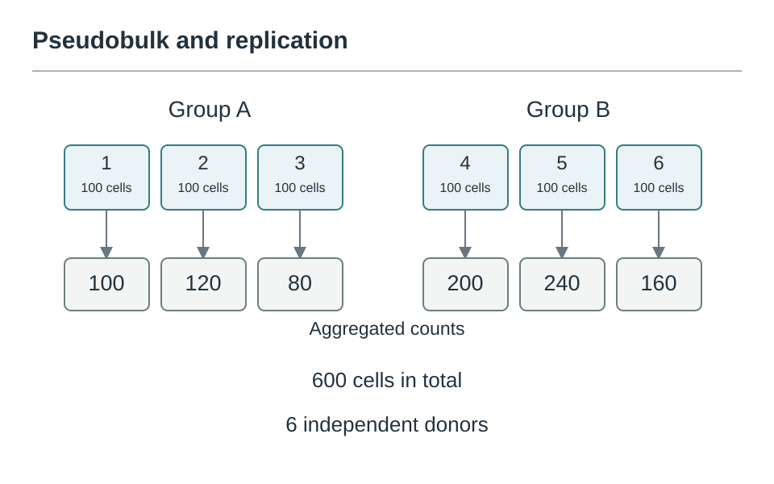

# M20-L4 – Single-cell and omics methods {#L4}

**Course area:** M20 – Advanced Cell and Molecular Biology

**Level:** Master – elective profile

**Prerequisites:** [M15-L4](M15-L4.md), [M15-L5](M15-L5.md), [M12-L1](M12-L1.md): omics, analysis and cell states.

**Learning objective:** Distinguish single-cell data structures, quality control, cell-state annotation and donor-level inference.

## Introduction {#S1}

Bulk RNA-seq averages over a mixture of cells. Single-cell RNA-seq enables the study of heterogeneous cell states but does not capture every RNA molecule. The measurement matrix often contains many zeros for both biological and technical reasons. The central challenge is to separate signal, technical variation and sampling structure.

## Principles and model {#S2}

### Data matrix and analysis levels

A count matrix contains recorded counts for each gene and cell. Cell and gene metadata include information such as sample, donor, batch and annotation. Before comparison, assess quality indicators, unusual multicell profiles and potential background signal. Thresholds depend on tissue and assay; rigid filtering may discard real rare states. Normalisation accounts for differences in captured library size but cannot automatically distinguish global biological changes from technical effects.

Dimensionality reduction (such as PCA) compresses variation. Nonlinear embeddings often serve visualisation; distances and apparent clusters do not directly establish lineage. Marker profiles, reference data and domain expertise support annotations. Pseudotime orders states along an assumed trajectory; it is not directly measured time and does not establish lineage without additional evidence.

### Biological-level inference

For condition-related differential expression, counts within a cell population may be aggregated per independent biological sample (pseudobulk) and analysed with an appropriate count model. This avoids treating thousands of cells from the same donor as independent donors. Sample size, design, batch confounding and cell-type composition remain crucial. Proteomics, single-cell chromatin accessibility and spatial transcriptomics measure different features; agreement supplies complementary evidence, not necessarily identical results.

*Figure: Three independent donors per group; cells are aggregated per donor, not counted as independent donors.*

## Application {#S3}

Fictional data: Two groups have three independent donors each. For one cell type, 100 cells are captured per donor, giving 600 cells. Aggregated counts for gene G per donor are 100, 120, 80 in A and 200, 240, 160 in B. Under the simplified assumption of equal library sizes, the mean ratio is $200/100=2$ and $\log_2(2)=1$. There are six independent donors, not 600; the ratio alone does not establish significance. Real analyses incorporate library sizes, variance models and appropriate multiple-testing correction.

## Self-assessment {#S4}

### Exercises

1. Three donors per group yield 250 cells each. How many cells and independent donors are there?
2. Calculate log2 fold change for mean values of 80 and 40 (B/A).
3. Why cannot complete confounding of batch and condition simply be resolved through integration?

::: {.lc-solutions data-lc-section="S4"}
1. 1500 cells and six independent donors.
2. $\log_2(40/80)=-1$.
3. Both effects are unidentifiable in the design; computational correction requires additional assumptions or independent information.
:::

## Assumptions and limitations {#S5}

The counts are illustrative, not real. Pseudobulk is one possible approach rather than a universal method; paired or repeated samples require explicit accounting for dependence. Personal genomic data may be subject to special access and privacy requirements.

## Summary and transition {#S6}

Single-cell analysis requires biological replication and critical interpretation. The final lesson integrates assessment of different evidence types.

**Continue:** [M20-L5](M20-L5.md)

## Sources {#S7}

- [Luecken & Theis (2019) – Current best practices in single-cell RNA-seq analysis: a tutorial](https://doi.org/10.15252/msb.20188746) · Quality control, normalization, annotation and inference pitfalls; indexed article · Last accessed: 2026-11-25

