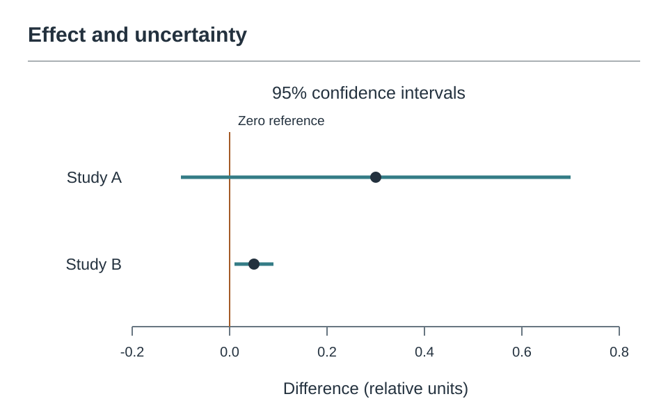

# M20-L5 – Critical reading of research literature {#L5}

**Course area:** M20 – Advanced Cell and Molecular Biology

**Level:** Master – elective profile

**Prerequisites:** [M19-L2](M19-L2.md), [M19-L4](M19-L4.md), [M20-L1](M20-L1.md) to [M20-L4](M20-L4.md): research questions, inference and assays.

**Learning objective:** Critically evaluate a molecular biology publication through its hypotheses, evidence chains, replication and alternative explanations.

## Introduction {#S1}

An impressive figure or a small p-value alone does not establish a robust mechanistic conclusion. Critical reading separates observed effects, statistical inference and the proposed biological mechanism. The aim is a reasoned assessment rather than blanket acceptance or rejection.

## Principles and model {#S2}

### Evidence chain and design

First record the precise claim and the data intended to support it. Determine whether the design can investigate association, temporal order or causal effects. Controls must address alternative explanations. Independent biological units, random assignment, blinded assessment and predefined exclusions may reduce bias. Their necessity and feasibility depend on design. Distinguish technical repeats from biological replication.

For figures, examine units, axes, sample size, variability, links to raw data, image processing and selection of representative examples. For omics, assess normalisation, model choice, batch, multiple tests and independent validation. An effect in a model organism or cell line does not automatically generalise to other tissues or humans. An orthogonal measurement may have different sources of error; shared systematic errors remain possible.

### Quantitative assessment and synthesis

Extract effect size and uncertainty. A confidence interval including zero does not prove equality. A statistically supported small effect need not be biologically meaningful. Check whether the research question was predefined, whether findings are exploratory and whether all relevant outcomes are reported. For conflicting studies, compare models, populations, timescales and measurement definitions rather than just counts of significant results. Reproducible analysis and independent replication are distinct criteria.

*Figure: Two fictional effect sizes with confidence intervals; only the second excludes zero.*

## Application {#S3}

A fictional publication measures a reporter in three independent samples per group. Group means are 1.0 and 1.3 relative units. The estimated difference is 0.3, with a 95% confidence interval from -0.1 to 0.7. The relative difference is 30%, but the interval is compatible with zero and positive effects. The claim of unequivocal pathway activation is not adequately supported. An independent study with a second measurement could assess the hypothesis; the reporter's effect on biological activity must also be considered. The interval is supplied for illustration, not calculated from means alone.

## Self-assessment {#S4}

### Exercises

1. A second experiment yields a difference of 0.05 with interval 0.01 to 0.09. What does this not establish?
2. Why is repeating the analysis by two people not independent biological replication?
3. Write a cautious results statement for the first experiment.

::: {.lc-solutions data-lc-section="S4"}
1. The interval lies above zero, but biological relevance, mechanism and generalisability do not automatically follow.
2. Both use the same biological data; the repeat may assess analysis reproducibility only.
3. The estimated reporter difference is positive but considerably uncertain; no effect is compatible with the reported interval.
:::

## Assumptions and limitations {#S5}

All values are fictional. Under model assumptions a 95% interval has 95% long-run coverage, not a 95% probability for a fixed unknown parameter to lie within this particular interval. A report may omit important details without that alone establishing misconduct.

## Summary and transition {#S6}

This master's elective ends with an evidence audit. Further elective profiles can be selected according to interests and prerequisites; they are not cumulative requirements.

**Continue:** [M21-L1](M21-L1.md)

## Sources {#S7}

- [NIH – Principles and Guidelines for Reporting Preclinical Research](https://www.grants.nih.gov/policy-and-compliance/policy-topics/reproducibility/principles-guidelines-reporting-preclinical-research) · Replicates, statistical reporting, randomization and blinding; indexed page · Last accessed: 2026-11-25
- [Community-developed checklists for publishing images and image analyses (2023)](https://www.nature.com/articles/s41592-023-01987-9) · Reporting acquisition, processing and analysis; indexed article · Last accessed: 2026-11-25
- [Luecken & Theis (2019) – Current best practices in single-cell RNA-seq analysis: a tutorial](https://doi.org/10.15252/msb.20188746) · Quality control, normalization, annotation and inference pitfalls; indexed article · Last accessed: 2026-11-25
- [Albeck, Mills & Brugge (2013) – Frequency-modulated pulses of ERK activity transmit quantitative proliferation signals](https://pubmed.ncbi.nlm.nih.gov/23219535/) · Abstract: temporal ERK activity and cell-to-cell variability; indexed abstract · Last accessed: 2026-11-25

