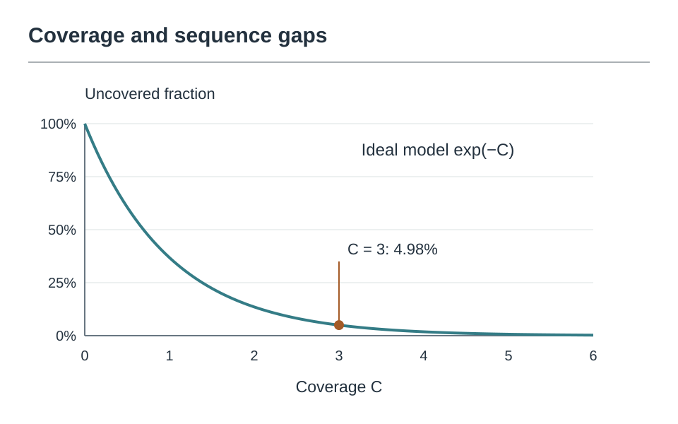

# M21-L1 – NGS and experimental design {#L1}

**Course area:** M21 – Genomics and Systems Biology

**Level:** Master – elective profile

**Prerequisites:** [M15-L1](M15-L1.md), [M15-L6](M15-L6.md), [M2-L5](M2-L5.md): sequence data, quality scores and experimental design.

**Learning objective:** Compare sequencing strategies against a research question, calculate nominal coverage and distinguish technical depth from biological replication.

## Introduction {#S1}

Genomic research begins not with an instrument choice but with a decision about what information must be obtained from DNA or RNA. Detecting small variants, reconstructing chromosome structure and quantifying transcripts place different demands on data and models.

## Principles and model {#S2}

### Sequencing strategies and information content

Short reads provide many relatively short sequence segments. When mapping is unambiguous they can support small-variant analysis, whereas repetitive regions complicate assignment. Long reads span larger continuous regions and help investigate structural differences, repetitive regions and linked variants. Error models, costs and available data volumes depend on the platform. Paired-end data contain two reads per fragment; the two ends are not independent biological samples. Reference-based analyses can disadvantage sequences that differ strongly from the reference. De novo assembly reconstructs sequence relationships without a prescribed complete reference, but remains dependent on factors such as repeat length and coverage.

For $N$ individual reads with mean length $L$ and a target sequence of length $G$, nominal coverage is

$$C=\frac{NL}{G}.$$

When counting read pairs, bases at both ends must be included. This calculation describes sequenced bases per target base, not actual coverage at every position. With idealised independent, uniformly distributed starts, the number of reads at a position is approximately Poisson-distributed; the fraction lacking coverage is then $P(D=0)\approx e^{-C}$. Repeats, duplicates, overlaps, filtering and uneven sequencing violate model assumptions.

### Experimental design and quality assessment

Define the independent biological unit and planned comparison before analysis. For group-level questions, more reads from the same individual may improve its measurement but cannot replace additional individuals. Balancing groups across processing batches reduces confounding of treatment and batch. Greater depth may help with rare features; variation among independent units must also be considered. Quality reports document base quality, mapping rates, coverage distribution and missing positions separately. RNA-seq is not expected to cover the whole genome uniformly because gene expression varies greatly. Nominal genome coverage is therefore not a measure of transcriptome completeness.

*Figure: Exponential curve of the expected uncovered fraction under the idealised Poisson model.*

## Application {#S3}

A fictional plant target genome is 200 million bases long. Forty million individual reads of 150 bases yield six billion sequenced bases and hence $C=30$. If only 80% of bases are counted as usable mapped bases, their average coverage is 24. Under idealised nominal coverage of 3, a fraction $e^{-3}\approx0.0498$ remains uncovered. At 30 the ideal fraction is almost zero; real gaps can nevertheless persist. Two groups of four plants constitute eight biological units even if multiple data files exist per plant.

## Self-assessment {#S4}

### Exercises

1. Calculate nominal coverage for 20 million read pairs, each containing two 100-base reads, with $G=100$ million bases.
2. Why can a high mean coverage conceal problematic gaps?
3. A treatment was measured entirely in batch A and the control entirely in batch B. Why is post hoc batch correction alone not a solution?

::: {.lc-solutions data-lc-section="S4"}
1. $C=20\cdot10^6\cdot2\cdot100/10^8=40$.
2. Highly covered regions can raise the mean while repetitive or difficult positions remain missing. Coverage distribution and fraction of covered positions must be assessed separately.
3. The two influences are completely confounded. Without extra information or an improved design their separate contributions are not identifiable.
:::

## Assumptions and limitations {#S5}

Numbers are teaching model values, not recommendations for actual sequencing projects. Poisson coverage assumes highly simplified random sampling. High nominal coverage guarantees neither correct variant calls nor representative sampling.

## Summary and transition {#S6}

The question determines the sequence information required; design determines the scope of inference. The next lesson compares RNA and protein measurements.

**Continue:** [M21-L2](M21-L2.md)

## Sources {#S7}

- [EMBL-EBI – Genome bioinformatics: from short- to long-read sequencing (2026)](https://www.ebi.ac.uk/training/events/genome-bioinformatics-2026/) · Course overview: sequencing technologies and downstream analysis; indexed page · Last accessed: 2026-11-25
- [EMBL-EBI – Introduction to RNA-seq and functional interpretation (2026)](https://www.ebi.ac.uk/training/events/introduction-rna-seq-and-functional-interpretation-2026/) · Experimental design and bulk RNA-seq workflows; indexed page · Last accessed: 2026-11-25

