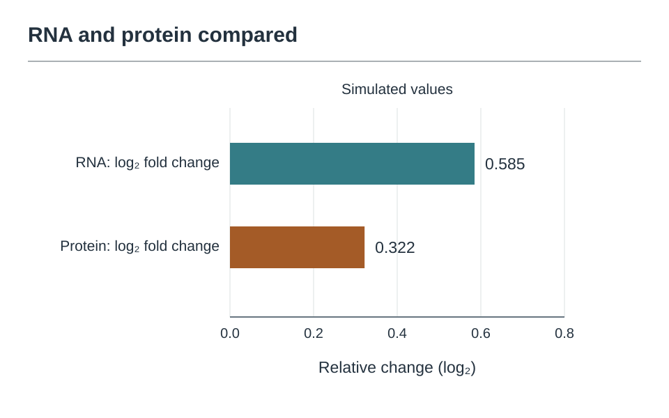

# M21-L2 – Transcriptomics and proteomics {#L2}

**Course area:** M21 – Genomics and Systems Biology

**Level:** Master – elective profile

**Prerequisites:** [M5-L1](M5-L1.md), [M6-L3](M6-L3.md), [M15-L4](M15-L4.md): proteins, transcription and omics.

**Learning objective:** Interpret RNA and protein abundance as different measurements, calculate relative changes after simple normalisation and distinguish error control at different levels.

## Introduction {#S1}

A gene can produce more RNA without a proportional increase in protein abundance. Translation, protein degradation and time delays influence the relationship between the layers. Joint biological interpretation thus requires separate measurement models.

## Principles and model {#S2}

### Transcriptomics: counts and statistical models

Bulk RNA-seq measures sequence fragments from a cell population. Assignment to genes or isoforms depends on annotation and sequence uniqueness. Library size is one influence on the resulting raw counts. Counts per million (CPM) divide a count by the total number of counted fragments and multiply by one million. CPM is an intuitive relative measure, but when RNA composition changes greatly, a constant absolute abundance can have a changed relative value. Approaches such as DESeq2 estimate size factors more robustly under their own assumptions and model counts with a negative binomial distribution. Biological replicates support dispersion estimation; multiple tests require error control, such as control of the false discovery rate (FDR).

### Proteomics: peptides and protein inference

Mass spectrometry-based proteomics often investigates peptides from which proteins are inferred. One peptide can match several proteins. Peptide-spectrum matches must therefore be distinguished from peptide and protein levels. Identification error control can use target and decoy databases; identification FDR is not automatically FDR for differential protein abundance. Quantitative signals depend on measurement platform, peptide characteristics and normalisation. A protein that is not detected may be below the detection limit or absent for technical reasons. Missing values are not automatically zero. Repositories such as PRIDE provide mass spectrometry data and evidence for identifications.

For comparable positive normalised values $A,B$, log-base-two fold change is $\log_2(B/A)$. Differences between such values across omics layers, however, do not describe translation rates without additional assumptions. Time-matched measurements, appropriate referencing and independent replicates are crucial for further inference.

*Figure: Two bars show different log fold changes in RNA and protein measurements.*

## Application {#S3}

In a fictional pair of RNA libraries, one gene has 100 and 300 assigned fragments out of one and two million counted fragments respectively. The values are 100 and 150 CPM. Their ratio is 1.5 and $\log_2(1.5)\approx0.585$, whereas the raw count ratio is three. A separate protein measurement gives 80 and 100 normalised intensity units: ratio 1.25, $\log_2(1.25)\approx0.322$. Both changes are positive but not equal. Without biological replicates the pair does not support a reliable significance test.

## Self-assessment {#S4}

### Exercises

1. Calculate CPM and log-base-two fold change for 50 out of 500,000 and 200 out of 1,000,000 fragments.
2. Why is a peptide shared by two proteins not unambiguous evidence for each individual protein?
3. Why must a 1% identification FDR not be interpreted directly as the probability of error for a particular expression comparison?

::: {.lc-solutions data-lc-section="S4"}
1. 100 and 200 CPM; $\log_2(2)=1$.
2. The sequence information does not distinguish the two possible origins. Further unique evidence or protein grouping is required.
3. Identification FDR concerns a set of accepted identifications and its expected false proportion. Differential analysis tests different hypotheses with its own uncertainty and multiple-testing correction.
:::

## Assumptions and limitations {#S5}

All measurements are simulated. CPM illustrates normalisation but does not replace a complete differential expression model. RNA and protein intensities have different scales and are not directly comparable as molecule counts.

## Summary and transition {#S6}

Multiple omics layers provide complementary evidence. Systems biology models next connect such evidence with hypothetical mechanisms.

**Continue:** [M21-L3](M21-L3.md)

## Sources {#S7}

- [EMBL-EBI – Introduction to RNA-seq and functional interpretation (2026)](https://www.ebi.ac.uk/training/events/introduction-rna-seq-and-functional-interpretation-2026/) · Experimental design and bulk RNA-seq workflows; indexed page · Last accessed: 2026-11-25
- [EMBL-EBI – Proteomics bioinformatics](https://www.ebi.ac.uk/training/materials/proteomics-bioinformatics-materials/) · Mass spectrometry, identification, quantification and repositories; indexed page · Last accessed: 2026-11-25
- [Love, Huber and Anders (2014), Moderated estimation of fold change and dispersion for RNA-seq data with DESeq2](https://doi.org/10.1186/s13059-014-0550-8) · Count models, size factors and dispersion; indexed article text · Last accessed: 2026-11-25
- [EMBL-EBI – PRIDE](https://www.ebi.ac.uk/training/online/courses/proteomics-an-introduction/proteomics-resources-at-the-ebi/pride/) · Mass spectrometry repository, peptide and protein identifications; indexed page · Last accessed: 2026-11-25

