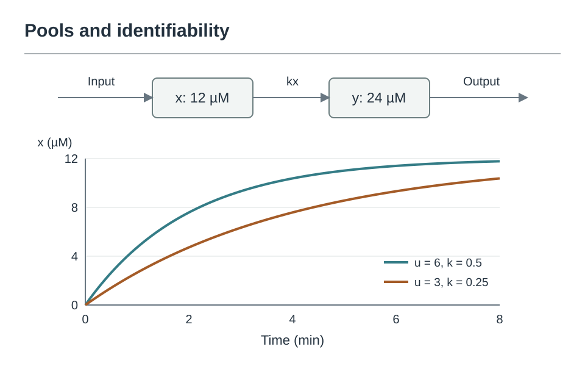

# M21-L3 – Networks and mathematical models {#L3}

**Course area:** M21 – Genomics and Systems Biology

**Level:** Master – elective profile

**Prerequisites:** [M20-L1](M20-L1.md), [M5-L2](M5-L2.md), [M2-L1](M2-L1.md): dynamics, kinetics and differential equations.

**Learning objective:** Represent biological networks as directed graphs and dynamic models, determine steady states and time constants, and distinguish identifiability from mere fit.

## Introduction {#S1}

A network diagram displays possible interactions. It does not automatically explain how quickly a system responds, how large a change will be or whether a state is stable. Systems biology supplements topology with quantitative relationships and tests them against data.

## Principles and model {#S2}

### Graphs, reaction balances and models

Nodes may represent genes, proteins, metabolites or biological states. Directed edges indicate an assumed direction of influence; correlations, by contrast, are often undirected relationships. A highly connected node is not necessarily a causal regulator. For a reaction network with concentration vector $x$, stoichiometric matrix $S$ and reaction rate vector $v(x,\theta)$, a deterministic balance can be written as

$$\frac{dx}{dt}=S v(x,\theta).$$

A steady state satisfies $Sv=0$; individual fluxes may remain nonzero. In an open system a constant input $u$ can be balanced by linear loss $kx$. For two sequential pools $x,y$ with the same concentration units, let

$$\dot x=u-kx,\qquad\dot y=kx-hy.$$

Here $k,h>0$ are inverse times and $u$ is concentration per time. The steady state is $x^*=u/k$, $y^*=u/h$. The eigenvalues of the linear system matrix are $-k$ and $-h$; both are negative, so the steady state is asymptotically stable. The model assumes linear rates, homogeneous compartments and constant input. Nonlinear saturation or feedback can change the dynamics.

### Model testing and exchange

Parameters can be estimated from time series and multiple input conditions. A steady-state value alone identifies only the ratio $u/k$ in the first equation, not both parameters independently. Local sensitivity describes how a model quantity responds to small parameter changes; it is not identical to statistical uncertainty. Alternative models can explain the same data comparably well. Independent predictions, residuals and uncertainty analysis are therefore more important than goodness of fit alone. SBML offers machine-readable model representation; parameter values, units, initial conditions, simulation methods and data provenance still need documentation. Constraint-based models use different assumptions, such as steady-state mass balances and flux bounds, and do not automatically provide time courses.

*Figure: Two coupled pools and two rising curves with the same steady value but different time constants.*

## Application {#S3}

For fictional pools, let $u=6\,\mu\mathrm{M/min}$, $k=0.5\,\mathrm{min}^{-1}$ and $h=0.25\,\mathrm{min}^{-1}$. Steady concentrations are 12 and 24 micromolar. Characteristic times $1/k=2$ and $1/h=4$ minutes differ. At steady state input and output are both 6 micromolar per minute. When the constant input is turned on from $x(0)=0$, $x(t)=12(1-e^{-0.5t})$; after two minutes $x$ is about 7.59 micromolar. A steady measurement of 12 alone would also be compatible with $u=3$ and $k=0.25$, but the time course would be slower.

## Self-assessment {#S4}

### Exercises

1. Calculate $x^*$ and $y^*$ for $u=4$, $k=0.2$, $h=0.4$ in the same units.
2. Does $Sv=0$ imply $v=0$? Explain using the open model.
3. What additional information helps distinguish the two alternative parameter pairs for $x$?

::: {.lc-solutions data-lc-section="S4"}
1. $x^*=20\,\mu\mathrm{M}$, $y^*=10\,\mu\mathrm{M}$.
2. No. Flux through both pools at constant concentrations equals the positive input; inflows and outflows cancel in the balance.
3. A time-resolved rise after a known input or an independent flux measurement can constrain the parameters better.
:::

## Assumptions and limitations {#S5}

All parameters are hypothetical. Stability follows from this linear model, not a universal property of biological networks. A machine-readable model is not yet an experimentally validated model.

## Summary and transition {#S6}

Models make assumptions about biological relationships explicit. The next lesson examines joint analysis of multiple high-dimensional measurements.

**Continue:** [M21-L4](M21-L4.md)

## Sources {#S7}

- [SBML – What is SBML?](https://sbml.org/documents/what-is-sbml/) · Exchange of computational models and model annotation; indexed page · Last accessed: 2026-11-25

