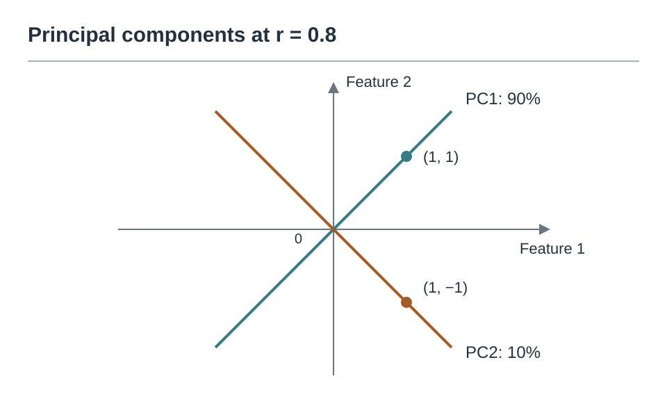

# M21-L4 – Multidimensional data interpretation {#L4}

**Course area:** M21 – Genomics and Systems Biology

**Level:** Master – elective profile

**Prerequisites:** [M2-L3](M2-L3.md), [M15-L5](M15-L5.md), [M21-L2](M21-L2.md): dispersion, visualisation and omics measurement models.

**Learning objective:** Integrate multidimensional measurement matrices by sample identity and scaling, interpret principal components and distinguish exploratory patterns from validated predictions.

## Introduction {#S1}

When the same biological samples are investigated at RNA, protein and metabolite levels, different data matrices result. Joint analysis aims to expose shared and layer-specific variation without misrepresenting measurement differences as biological effects.

## Principles and model {#S2}

### Data matching and dimensionality reduction

Matrix rows may represent samples and columns measured features. Before joint analysis, samples are matched using unique identifiers. Joining by row position would be wrong if the ordering differs. Missing assays, different time points and ambiguous mappings must be documented. Suitable transformations depend on data type; relative intensities, counts and concentrations are not equivalent.

Principal component analysis (PCA) projects centred data onto orthogonal directions of maximal variance. When features are standardised to mean zero and standard deviation one, the covariance matrix is the correlation matrix. For two standardised features with correlation $r$, it is

$$\Sigma=\begin{pmatrix}1&r\\r&1\end{pmatrix}.$$

For $r>0$, directions $(1,1)/\sqrt{2}$ and $(1,-1)/\sqrt{2}$ have eigenvalues $1+r$ and $1-r$. The first component explains $(1+r)/2$ of total variance. Eigenvector signs are arbitrary. A component represents a statistical pattern, not necessarily a biological process. In joint PCA of many features, a feature-rich assay can dominate even if every feature is individually standardised. Methods such as MOFA model shared and view-specific latent factors; their interpretation requires subject-specific and statistical validation.

### Confounding and external assessment

PCA plots coloured by group, processing batch and other metadata aid exploration. Apparent separation by treatment may also arise from batch, age or sample quality. If a confounder is completely associated with the target variable, it cannot simply be removed. In prediction models, standardisation, feature selection and model optimisation must not use information from the subsequent test data. Repeated measurements from one person or organism must be considered when splitting data. An independent test set estimates generalisability better than fit to training data.

*Figure: Two orthogonal eigendirections explaining 90 and 10 percent of variance.*

## Application {#S3}

Two standardised fictional features have correlation $r=0.8$. Eigenvalues are 1.8 and 0.2; the first component explains 90% of total variance. A sample with standardised values $(1,1)$ has score $\sqrt{2}\approx1.414$ on the chosen first direction and zero on the second. A sample $(1,-1)$ has first score zero and second score $\sqrt{2}$. The first component thus captures shared variation, the second differences between features. Whether shared variation reflects a biological state or a technical disturbance must be investigated separately.

## Self-assessment {#S4}

### Exercises

1. For $r=0.4$, determine the eigenvalues and proportion of variance explained by the first component.
2. Why would matching two omics tables by row position be risky?
3. Why must standardisation for prediction be estimated within training data?

::: {.lc-solutions data-lc-section="S4"}
1. 1.4 and 0.6; proportion $1.4/2=0.7$ or 70%.
2. Tables may be sorted differently or samples may be missing. Incorrectly paired data generate misleading relationships; unique sample identifiers are necessary.
3. Otherwise means and variation from the test set influence model construction. Evaluation is no longer fully independent.
:::

## Assumptions and limitations {#S5}

The two-dimensional matrix is a teaching example. Real data may contain nonlinear, compositional, missing or time-dependent measurements. High explained variance means neither high biological relevance nor causal evidence.

## Summary and transition {#S6}

Multidimensional analyses require documented data matching, model assumptions and independent evaluation. The next lesson links these steps in a traceable workflow.

**Continue:** [M21-L5](M21-L5.md)

## Sources {#S7}

- [EMBL-EBI – Multi-omics data integration using MOFA](https://www.ebi.ac.uk/training/materials/systems-biology-large-datasets-biological-insight-materials/integration-using-mofa-2/) · Unsupervised factor analysis for multi-omics data; indexed page · Last accessed: 2026-11-25
- [Bioconductor – BatchQC](https://bioconductor.org/packages/release/bioc/html/BatchQC.html) · Batch assessment, differential expression and PCA; indexed page · Last accessed: 2026-11-25

