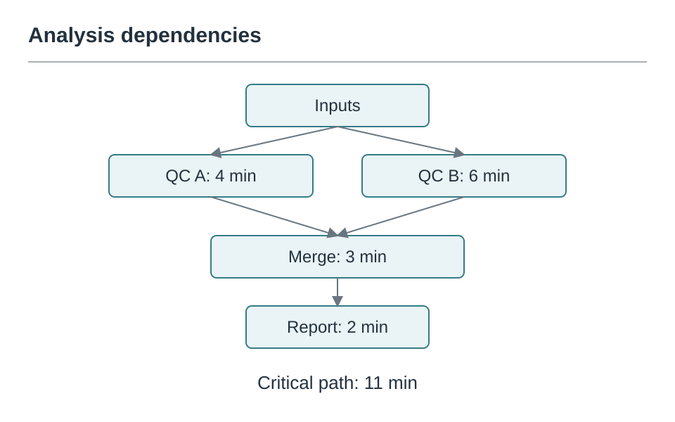

# M21-L5 – Reproducible pipelines {#L5}

**Course area:** M21 – Genomics and Systems Biology

**Level:** Master – elective profile

**Prerequisites:** [M15-L5](M15-L5.md), [M15-L6](M15-L6.md), [M19-L5](M19-L5.md): data processing and scientific documentation.

**Learning objective:** Plan a reproducible pipeline as a dependency graph, preserve traceable inputs and versions, and distinguish technical reproducibility from biological validation.

## Introduction {#S1}

A genomic analysis may involve many files and programs. Without documented inputs, references, parameters and software versions, it is difficult to identify why two results differ. A workflow makes dependencies between processing steps explicit.

## Principles and model {#S2}

### Dependencies, provenance and failure behaviour

A pipeline can be represented as a directed acyclic graph (DAG). Nodes are tasks; edges denote required inputs or prior results. Two independent quality checks can run in parallel; a joint analysis requires both. If a check fails, the output must not silently be treated as complete. A run record includes input files, checksums, parameters, reference data and version, software versions, return codes and output paths. Containers can package dependencies but guarantee neither bit-identical output on every hardware platform nor correct scientific assumptions. A fixed revision and immutable container digest are more informative than a mutable tag such as `latest`.

Workflow systems such as Nextflow separate processing descriptions from execution. Caching may reuse matching intermediate results, but a cache hit does not replace checking data validity. A good workflow has explicit success criteria, small test data, expected outputs and traceable rules for missing values. The final report also documents failed runs and deviations. With personal genomic data, reproducibility must not be equated with public release; access and sharing are subject to applicable privacy and consent requirements.

### A deterministic model test

The following Python example checks fictional measurements with neutral sample identifiers. It is not a sequencing or laboratory protocol. Inputs are serialised in a stable order and hashed; the summary is checked against an expected result. The checksum detects differences in the chosen serialisation, not errors in measurement.

```python
import hashlib
import json
from statistics import mean

records = {"P3": 6, "P1": 2, "P2": 4}
serialized = json.dumps(records, sort_keys=True,
                        separators=(",", ":")).encode("utf-8")
assert serialized == b'{"P1":2,"P2":4,"P3":6}'
digest = hashlib.sha256(serialized).hexdigest()
result = mean(records.values())
assert result == 4
print(len(records), result, len(digest))
```

The output is `3 4 64`. Changing P3 to 9 changes the input hash and mean. The same content in a different insertion order produces the same hash through sorted serialisation. The 64 hexadecimal characters represent 256 bits; length alone does not establish equality between hashes.



*Figure: Two parallel quality checks feed joint processing and the report.*

## Application {#S3}

In a fictional project, quality check A requires 4 minutes and B requires 6 minutes. Merging takes 3 minutes after both checks finish, followed by a 2-minute report. With no resource bottlenecks or start delays, the longest dependency path takes $\max(4,6)+3+2=11$ minutes. Fully sequential execution would take 15 minutes. The difference concerns computational organisation, not the strength of the biological evidence.

## Self-assessment {#S4}

### Exercises

1. What mean does the Python example produce if P3 changes to 9?
2. Calculate the shortest duration if B takes 8 minutes instead and all other durations stay the same.
3. What information besides a software container is required for another team to trace the analysis?

::: {.lc-solutions data-lc-section="S4"}
1. $(2+4+9)/3=5$.
2. $\max(4,8)+3+2=13$ minutes.
3. For example, exact inputs and reference versions, their checksums, parameters, pipeline revision, documented data processing and success criteria, and appropriate access arrangements.
:::

## Assumptions and limitations {#S5}

All measurements and run times are simulated. Parallel time is an idealised lower bound without startup overhead or resource constraints. The Python test demonstrates only deterministic processing; the validity of a biological experiment must be assessed separately.

## Summary and transition {#S6}

This elective connects data acquisition, modelling and traceable analysis. Further master's elective profiles are alternative specialisations.

**Continue:** [M22-L1](M22-L1.md)

## Sources {#S7}

- [Nextflow training – Run remote pipelines](https://training.nextflow.io/latest/nextflow_run/04_remote_repositories/) · Pinning a pipeline revision; indexed page · Last accessed: 2026-11-25
- [Nextflow training – Nextflow Run](https://training.nextflow.io/latest/nextflow_run/) · Workflow mechanics and containerised dependencies; indexed page · Last accessed: 2026-11-25

