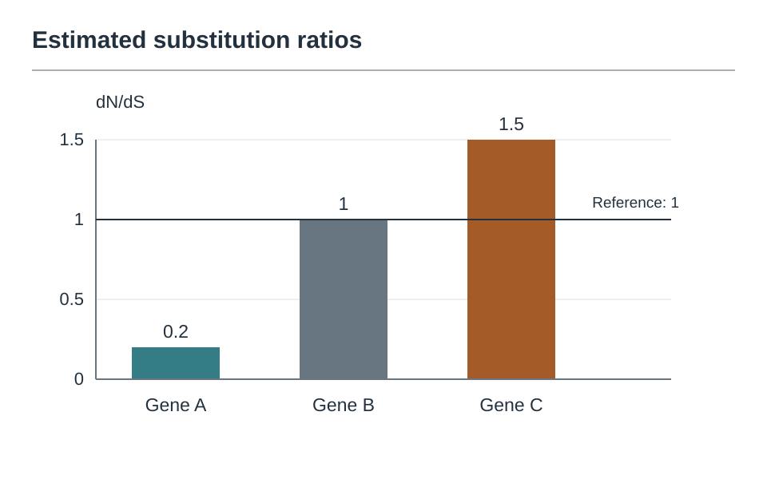

# M22-L1 – Molecular evolution {#L1}

**Course area:** M22 – Evolutionary Genomics and Biodiversity

**Level:** Master – elective profile

**Prerequisites:** [M6-L5](M6-L5.md), [M13-L2](M13-L2.md), [M15-L2](M15-L2.md): mutation, selection and homology.

**Learning objective:** Distinguish substitution rates, interpret dN/dS and evaluate the assumptions of molecular evolutionary models.

## Introduction {#S1}

Two homologous proteins may have different amino acid sequences despite shared ancestry. Molecular evolution studies which changes persist across generations and which processes explain the observed pattern. Observed divergence is not directly the mutation rate.

## Principles and model {#S2}

### From mutations to substitutions

A mutation produces a new variant. In an idealised population model, a substitution denotes the fixation of a different state along a lineage. Neutral variants can become fixed by drift. In the simple neutral diploid model, approximately $2N\mu$ new mutations arise per generation at the site considered, with individual fixation probability $1/(2N)$. Their product gives the neutral substitution rate $\mu$. This relationship assumes neutral mutations and a suitable idealised population, among other conditions; it does not apply to every observed variant.

### Coding sequences and selection models

Synonymous substitutions leave the encoded amino acid unchanged; nonsynonymous substitutions change it. In a codon model, $d_N$ and $d_S$ are estimated substitutions per available nonsynonymous and synonymous site respectively. Simply dividing raw counts is therefore inappropriate. The ratio is

$$\omega=\frac{d_N}{d_S}.$$

Under a suitable model for diverged lineages, $\omega<1$ is often evidence consistent with purifying selection, $\omega>1$ with positive selection, and a value near 1 with neutrality. A gene-wide mean can conceal individual adaptively evolving sites. Synonymous changes can also be subject to selection. Very small $d_S$ makes the ratio unstable; it is undefined when $d_S=0$.

Codon-based comparisons require reliable orthologous sequences, correct alignment and a plausible phylogeny. Models may allow rates to vary among branches or sites. A likelihood comparison of a restricted and alternative model requires a reference distribution appropriate to the question; model assumptions and multiple testing matter. Within populations, segregating variants are not independent fixed substitutions. The usual interpretation of the ratio cannot simply be transferred.

*Figure: Three model genes with dN/dS of 0.2, 1 and 1.5; the reference line is at 1.*

## Application {#S3}

In a fictional comparison of three plant genes, estimated rates are A: $d_N=0.02,d_S=0.10$; B: $0.10,0.10$; C: $0.15,0.10$. Ratios are 0.2, 1 and 1.5. C warrants further investigation, but without uncertainty, alignment checks and model comparison it does not establish adaptive evolution. A may contain individual sites with different dynamics despite a low overall ratio.

## Self-assessment {#S4}

### Exercises

1. Calculate $\omega$ for $d_N=0.04,d_S=0.20$.
2. How does the interpretation change when $d_S=0$?
3. Why is a short sequence with several segregating variants not equivalent to diverged orthologous genes?

::: {.lc-solutions data-lc-section="S4"}
1. $0.04/0.20=0.2$.
2. The ratio is undefined; estimability of the rates must be examined separately.
3. Polymorphisms can still be lost or fixed. Their frequencies also depend on demography and sampling; the substitution interpretation does not apply directly.
:::

## Assumptions and limitations {#S5}

All numbers are model data. Saturation, recombination, paralogous genes, codon usage and erroneous assignments can distort results. A ratio is not a direct measure of organismal fitness.

## Summary and transition {#S6}

Molecular evolutionary models connect sequence change with explicit assumptions. The next lesson examines variation among populations.

**Continue:** [M22-L2](M22-L2.md)

## Sources {#S7}

- [Kryazhimskiy & Plotkin (2008) – The Population Genetics of dN/dS](https://pmc.ncbi.nlm.nih.gov/articles/PMC2596312/) · Interpretation across evolutionary timescales; indexed abstract and text · Last accessed: 2026-11-25

