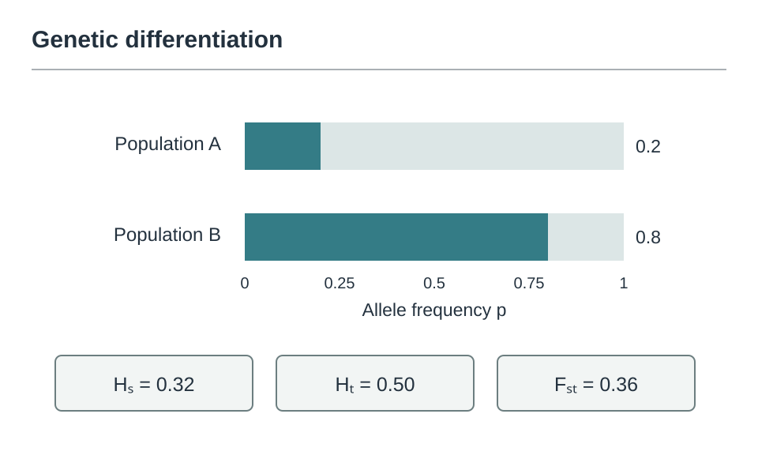

# M22-L2 – Population genomics {#L2}

**Course area:** M22 – Evolutionary Genomics and Biodiversity

**Level:** Master – elective profile

**Prerequisites:** [M13-L1](M13-L1.md), [M13-L2](M13-L2.md), [M21-L1](M21-L1.md): allele frequencies, drift and genomic data.

**Learning objective:** Quantify genetic differentiation and compare alternative explanations for unusual genomic regions.

## Introduction {#S1}

Populations of a species often differ in allele frequencies. Population genomics studies this variation across many genomic positions. It combines sampling design, sequence quality, statistical models and evolutionary hypotheses.

## Principles and model {#S2}

### Heterozygosity and differentiation

For a biallelic locus with allele frequency $p$, expected heterozygosity under random mating is $H=2p(1-p)$. For two equally weighted populations, $H_S$ is the mean of their expected heterozygosities and $H_T$ is heterozygosity calculated from their shared mean allele frequency. A simplified differentiation measure is

$$F_{ST}=\frac{H_T-H_S}{H_T},\qquad H_T>0.$$

The example describes population parameters under simplified conditions, not a generally unbiased sample estimator. Real analyses account for different sample sizes and estimation uncertainty, for example with suitable F-statistic estimators. A high value can suggest restricted gene flow, drift or selection but cannot distinguish these causes alone. A low value does not establish complete mixing.

### Genome-wide patterns and hypothesis tests

Nucleotide diversity $\pi$ is the mean pairwise sequence difference per comparable site. Recombination and linkage influence the independence of genomic markers. Selection hypotheses are tested against demographic null models; bottlenecks, expansion and heterogeneous recombination can also create unusual regions. Differentiation, diversity and linkage patterns convey different information. Principal component analysis may visualise structure but does not explain its causes. Sampling should be justified geographically and biologically rather than restricted to accessible individuals.

A robust analysis documents reference bias, missing genotypes, filtering criteria, relatedness and uncertainty. Genomic windows may be jointly affected by linkage. An extreme value chosen after analysis is particularly prone to overestimation; independent populations and predefined comparison rules strengthen the evidence.

*Figure: Two equally weighted populations with frequencies 0.2 and 0.8 and the resulting differentiation.*

## Application {#S3}

Two fictional populations have $p_1=0.2$ and $p_2=0.8$. Both have $H=0.32$, so $H_S=0.32$. The mean frequency is 0.5 and $H_T=0.5$. The simplified measure is $(0.5-0.32)/0.5=0.36$. At another locus with identical frequencies of 0.5, it is zero. A differentiated region with low $\pi$ may reflect selection, but also linked processes or demographic history.

## Self-assessment {#S4}

### Exercises

1. Calculate the simplified measure for $p_1=0.4,p_2=0.6$ with equal weighting.
2. How should a high value at one locus be interpreted?
3. Why are a thousand linked markers not a thousand independent tests?

::: {.lc-solutions data-lc-section="S4"}
1. $H_S=0.48,H_T=0.5,F_{ST}=0.04$.
2. As evidence of differentiation that must be compared with demography, technical quality and other markers.
3. Shared inheritance creates statistical dependence; the effective number of independent observations is lower.
:::

## Assumptions and limitations {#S5}

Fictional frequencies; the formula illustrates the heterozygosity approach. It does not replace an estimator appropriate to the dataset. Genetic structure does not establish a fixed boundary between species.

## Summary and transition {#S6}

Genome-wide differentiation becomes interpretable through demographic and statistical comparisons. M22-L3 shifts to the level of entire lineages.

**Continue:** [M22-L3](M22-L3.md)

## Sources {#S7}

- [Holsinger & Weir (2009) – Genetics in geographically structured populations](https://pmc.ncbi.nlm.nih.gov/articles/PMC4687486/) · Definition and interpretation of F-statistics; indexed text · Last accessed: 2026-11-25
- [Population genomics to detect selection in natural populations](https://pmc.ncbi.nlm.nih.gov/articles/PMC3016716/) · Genomic differentiation, diversity and methodological caveats; indexed text · Last accessed: 2026-11-25

