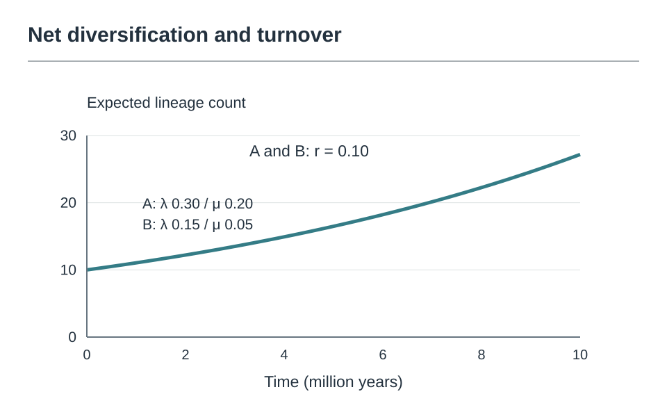

# M22-L3 – Macroevolution {#L3}

**Course area:** M22 – Evolutionary Genomics and Biodiversity

**Level:** Master – elective profile

**Prerequisites:** [M13-L3](M13-L3.md), [M13-L5](M13-L5.md), [M2-L1](M2-L1.md): speciation, phylogenies and exponential models.

**Learning objective:** Distinguish speciation and extinction rates in birth-death models and recognise limitations of macroevolutionary inference.

## Introduction {#S1}

Macroevolution examines patterns at and above species level over long periods. Species richness arises through branching and is reduced by extinction; morphological trait changes are a separate dimension. A species-rich clade need not have an exceptionally high speciation rate.

## Principles and model {#S2}

### A stochastic diversification model

In a homogeneous birth-death model, each existing lineage produces new lineages at rate $\lambda$, while lineages become extinct at rate $\mu$. With constant rates, expected lineage number $E[N(t)]$ follows

$$\frac{dE[N]}{dt}=(\lambda-\mu)E[N],\qquad E[N(t)]=N_0e^{(\lambda-\mu)t}.$$

Net diversification rate $r=\lambda-\mu$ has units of inverse time. The expectation over many model trajectories is not the actual count in a single trajectory; a small clade may become entirely extinct. Identical $r$ can occur with high or low turnover.

### Phylogenies, fossils and identifiability

Dated trees of living species depict reconstructed branching of surviving lineages. Extinct branches without living descendants are missing. With time-varying rates, very different speciation and extinction histories can be consistent with the same observed patterns. Identifiability means different parameters can in principle be distinguished with ideal data; more data of the same type do not automatically resolve structural non-identifiability. Fossils can provide additional information but are affected by preservation, sampling effort, dating and taxonomic assignment.

Adaptive radiation connects diversification with ecological and phenotypic differentiation. Temporal coincidence of trait change and increasing species counts does not establish causation. Comparative analyses must consider shared ancestry, alternative environmental factors and observation processes. Mass extinctions can alter lineage composition; subsequent radiations do not necessarily restore the same diversity.

*Figure: Two birth-death scenarios with equal expected lineage counts but different individual rates.*

## Application {#S3}

A model starts with ten lineages. Scenario A: $\lambda=0.30$ and $\mu=0.20$ per million years; B: $\lambda=0.15$ and $\mu=0.05$. Both yield $r=0.10$ and after ten million years $E[N]=10e^1\approx27.18$. A has higher lineage turnover. Equal expectations do not imply identical distributions or fossil histories.

## Self-assessment {#S4}

### Exercises

1. Calculate $E[N]$ after five million years for $N_0=20,r=0.20$ per million years.
2. What additional information might distinguish the example scenarios?
3. Why is species richness alone not evidence of adaptive radiation?

::: {.lc-solutions data-lc-section="S4"}
1. $20e^1\approx54.37$.
2. Dated fossil occurrences, information on extinct lineages and an explicit fossil detection model may help.
3. Richness also depends on age and extinction; ecological and phenotypic differentiation must be demonstrated separately.
:::

## Assumptions and limitations {#S5}

The model ignores density dependence, time-varying environments and differences among lineages, among other factors. All rates are fictional. Equal means illustrate a teaching example, not general equivalence of complete probability models.

## Summary and transition {#S6}

Macroevolutionary reconstructions combine mathematical models with independent evidence. M22-L4 considers spatial history within species.

**Continue:** [M22-L4](M22-L4.md)

## Sources {#S7}

- [Louca & Pennell (2020) – Extant timetrees are consistent with a myriad of diversification histories](https://www.nature.com/articles/s41586-020-2176-1) · Identifiability of diversification histories and importance of fossils; abstract · Last accessed: 2026-11-25
- [Birth-Death Models in Macroevolution](https://www.annualreviews.org/content/journals/10.1146/annurev.ecolsys.37.091305.110035) · Speciation and extinction models, fossils and phylogenies; abstract · Last accessed: 2026-11-25

