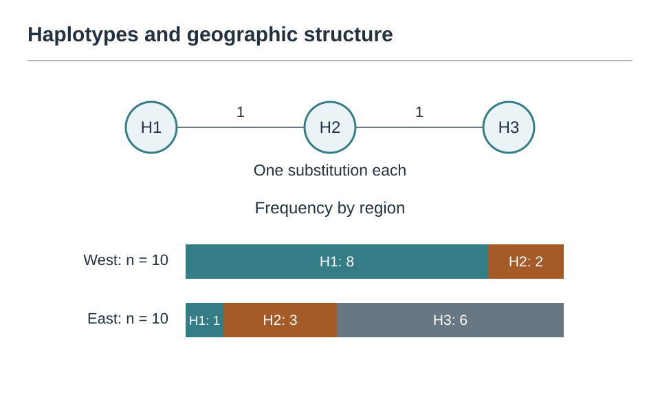

# M22-L4 – Phylogeography {#L4}

**Course area:** M22 – Evolutionary Genomics and Biodiversity

**Level:** Master – elective profile

**Prerequisites:** [M13-L5](M13-L5.md), [M22-L2](M22-L2.md): genealogies and genetic structure.

**Learning objective:** Evaluate geographically distributed haplotypes, formulate historical hypotheses and assess their identifiability.

## Introduction {#S1}

Populations in two mountain regions may carry similar or different genetic variants. Phylogeography asks how dispersal, isolation, climate and demographic history shaped spatial patterns. The present distribution of a variant is not necessarily its place of origin.

## Principles and model {#S2}

### Genealogy and geography

A haplotype is a combination of variants on a jointly inherited sequence segment. A haplotype network connects observed or reconstructed sequence states through possible changes. Edges may represent a putative substitution, for example. Networks are especially useful when short sequence distances allow several equally plausible connections. Without a suitable outgroup or other information, a network need not be directed. A frequent haplotype need not be the oldest.

Haplotype diversity in a sample of $n>1$ individuals with observed frequencies $f_i$ is often estimated as

$$h=\frac{n}{n-1}\left(1-\sum_i f_i^2\right).$$

It equals the probability of observing different haplotypes in two individuals drawn without replacement. A haploid marker region is assumed to provide one state per individual. Unlike nucleotide diversity, it does not account for how many bases differ between two haplotypes.

### Historical models and coalescence

Coalescence describes common ancestors of gene copies backwards in time. Gene trees may differ from population history because of random ancestry, introgression or recombination. A single mitochondrial or plastid region may have a different history from the nuclear genome. Models of refugia, subsequent expansion or sustained isolation should therefore be evaluated with multiple independent data sources. Historical climate data, geology and spatial sampling complement sequences. Converting genetic distances to times depends on calibration, rate models and uncertainty. Comparative phylogeography tests whether multiple species support a similar spatial history rather than generalising from one pattern.

*Figure: Undirected H1–H2–H3 network and regional frequencies: West 8/2/0, East 1/3/6.*

## Application {#S3}

Ten haploid markers are recorded in each of two fictional regions. West: H1 eight times, H2 twice; East: H1 once, H2 three times, H3 six times. For West, $h=(10/9)(1-0.8^2-0.2^2)\approx0.356$. For East, $(10/9)(1-0.1^2-0.3^2-0.6^2)=0.60$. H1 and H2 differ at one position, as do H2 and H3; the two differences involve distinct positions. Higher eastern diversity is compatible with several histories, such as different demography or unequal sampling. It does not establish an eastern origin.

## Self-assessment {#S4}

### Exercises

1. Calculate $h$ for ten individuals with five H1 and five H2.
2. Why does a network edge not demonstrate a direction of migration?
3. Name two additional data sources for a historical refugium hypothesis.

::: {.lc-solutions data-lc-section="S4"}
1. $(10/9)(1-0.25-0.25)=5/9\approx0.556$.
2. It represents sequence differences, not directly a geographic route or its temporal orientation.
3. For example, independent nuclear markers and palaeoclimatic habitat models; fossils or dated distribution records may also be relevant.
:::

## Assumptions and limitations {#S5}

All data are simulated. Small and spatially biased samples influence frequencies. The network is a simplified undirected representation, not a reconstructed migration route.

## Summary and transition {#S6}

Phylogeographic hypotheses connect genetic variants, space and history. The next lesson addresses the translation of biological observations into biodiversity indicators.

**Continue:** [M22-L5](M22-L5.md)

## Sources {#S7}

- [The structure of biodiversity – insights from molecular phylogeography](https://pmc.ncbi.nlm.nih.gov/articles/PMC544936/) · Geographic genetic structure, haplotype networks and demographic history; indexed text · Last accessed: 2026-11-25
- [Holsinger & Weir (2009) – Genetics in geographically structured populations](https://pmc.ncbi.nlm.nih.gov/articles/PMC4687486/) · Definition and interpretation of F-statistics; indexed text · Last accessed: 2026-11-25

