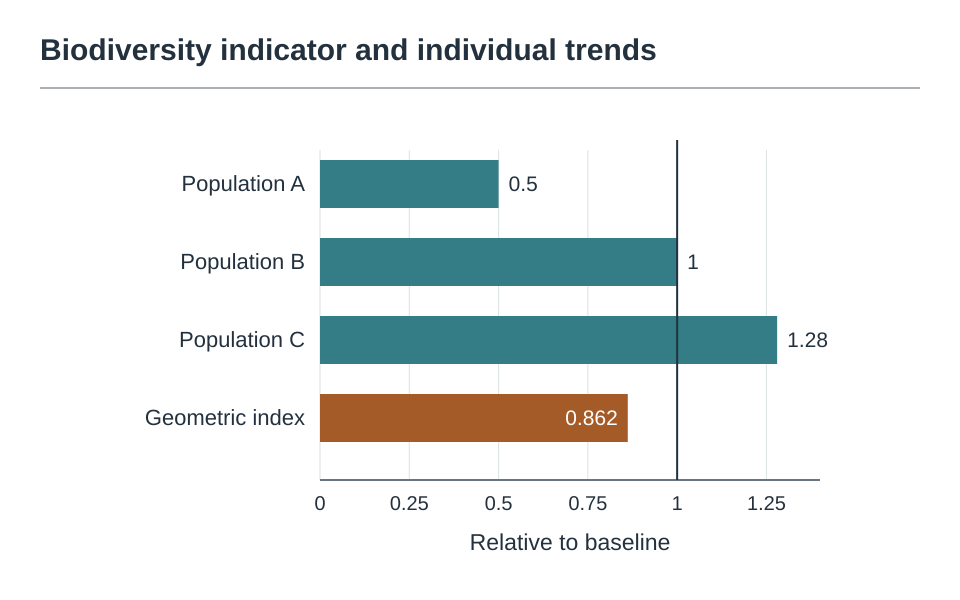

# M22-L5 – Biodiversity indicators {#L5}

**Course area:** M22 – Evolutionary Genomics and Biodiversity

**Level:** Master – elective profile

**Prerequisites:** [M14-L5](M14-L5.md), [M8-L5](M8-L5.md), [M22-L2](M22-L2.md): monitoring, diversity and genetic variation.

**Learning objective:** Calculate biodiversity indicators from defined baselines and evaluate their meaning for research and conservation.

## Introduction {#S1}

Changes in species richness capture only one dimension of biodiversity. Populations may decline, lose genetic variation or shift their distributions even when local recorded species counts remain unchanged. Indicators summarise observations for a particular question; they are not a complete representation of nature.

## Principles and model {#S2}

### Observation, variable and indicator

A monitoring project defines taxa, spatial units, sampling times and measurements. Observations can be used to derive comparable quantities such as estimated abundance, distribution or genetic diversity. The Essential Biodiversity Variables (EBV) approach connects such standardised quantities to further analysis. The GEO BON data portal, for example, includes spatially resolved changes in species richness. Different baselines, grid sizes and taxonomic groups can nevertheless yield different findings.

For a positive baseline $X_0$, relative change is

$$\Delta_X=100\frac{X_t-X_0}{X_0}\ \%.$$

For multiple populations a simplified equally weighted geometric index of relative abundances can be calculated:

$$I_t=\exp\left(\frac{1}{k}\sum_{i=1}^{k}\ln\frac{N_{i,t}}{N_{i,0}}\right).$$

All ratios must be positive. A value of 1 corresponds to the reference level; it does not mean every population is unchanged. An actual index methodology must define weighting, missing values, zeros and uncertainty. A geometric index is not equivalent to the change in total individual counts.

### Interpretation and decisions

Detection probability, spatial coverage and changing identification standards influence trends. Changes in recording should be distinguished from biological change where possible. Confidence intervals or suitable hierarchical models help represent uncertainty in observations and populations. Conservation decisions combine indicators with specific objectives, such as preserving genetic diversity or restoring habitat. An index can conceal trade-offs; individual trends and data gaps should remain visible. For rare species, publishing precise occurrence locations should be assessed for possible conservation risks.

*Figure: Three relative abundances 0.5, 1 and 1.28 yield a geometric index of 0.862.*

## Application {#S3}

Three fictional populations have relative abundances of 0.5, 1 and 1.28 compared with their baselines. The geometric index is $(0.5\cdot1\cdot1.28)^{1/3}\approx0.862$, a change of approximately −13.8% from 1. The arithmetic mean is approximately 0.927. These statistics answer different questions. In a separate grid cell, observed richness falls from 40 to 36: $\Delta_X=-10\%$. None of these calculations automatically corrects detection errors.

## Self-assessment {#S4}

### Exercises

1. Calculate the geometric index for two populations with relative abundances of 0.5 and 2.
2. Why should an undetected taxon not automatically be assigned zero abundance?
3. What information is needed to compare two surveys?

::: {.lc-solutions data-lc-section="S4"}
1. $(0.5\cdot2)^{1/2}=1$; the relative increase of the second offsets the decline of the first in the index.
2. Imperfect detection may produce zero observations even when individuals are present.
3. Among other things, taxa, spatial unit, period, sampling effort, detection method, baseline and uncertainty.
:::

## Assumptions and limitations {#S5}

The calculation is a simplified teaching index, not an implementation of an official global indicator. Zeros require explicit statistical treatment; arbitrary pseudovalues can change trends. All numbers are fictional.

## Summary and transition {#S6}

This elective connects genetic, historical and ecological evidence. Further master's elective profiles are alternative specialisations.

**Continue:** [M23-L1](M23-L1.md)

## Sources {#S7}

- [GEO BON – EBV Data Portal: species richness change](https://portal.geobon.org/ebv-detail?id=31&v=1) · Example of a spatially defined biodiversity change variable; dataset metadata · Last accessed: 2026-11-25

