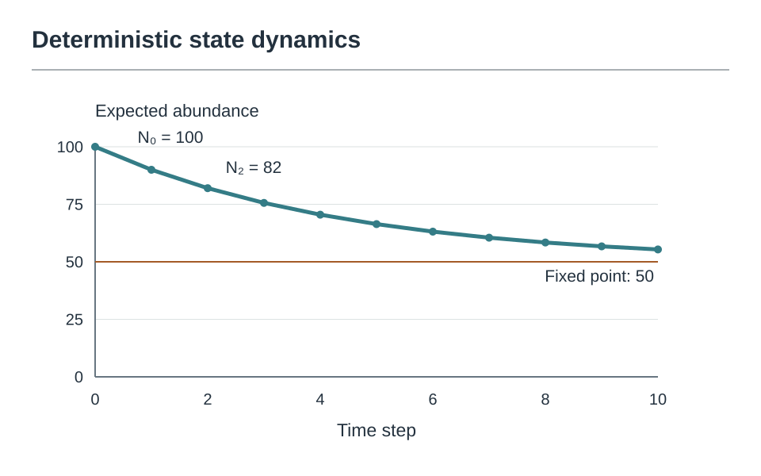

# M23-L1 – Ecological modelling {#L1}

**Course area:** M23 – Advanced Ecology and Environmental Biology

**Level:** Master – elective profile

**Prerequisites:** [M2-L1](M2-L1.md), [M14-L1](M14-L1.md), [M21-L3](M21-L3.md): dynamics and modelling.

**Learning objective:** Distinguish process and observation models, calculate state forecasts and evaluate predictive accuracy outside the fitting data.

## Introduction {#S1}

Ecological models abstract processes to test hypotheses about population dynamics, material flows or spatial distribution. A model that reproduces historical data well need not reliably predict new observations. Model structure should follow the research question and the available observation scale.

## Principles and model {#S2}

### State space and measurement process

A discrete state-space model separates a latent state $N_t$ (population) from a measured quantity $Y_t$. A simple open-population model is

$$N_{t+1}=sN_t+b+\eta_t,\qquad Y_t=qN_t+\epsilon_t.$$

Here $s$ is the expected fraction surviving and remaining in the area per time step, $b$ is mean recruitment per step, and $q$ is an observation factor. The terms $\eta_t$ and $\epsilon_t$ represent process and measurement deviations respectively. The additive model is an approximation; integer-valued nonnegative distributions are more plausible for small populations. For $0\leq s<1$ and constant $b$, the deterministic fixed point is $N^*=b/(1-s)$. Deviations from it shrink by a factor $s$ per step.

Parameters are not always identifiable. A small observed population can reflect low abundance or low detectability. Repeated observations and independent calibration may help. Alternative model structures include density dependence, changing environmental conditions and age classes.

### Forecasting and model evaluation

Forecasts distinguish process, parameter, observation and, where relevant, scenario uncertainty. Time series benefit from time-ordered validation: train on earlier data and evaluate later forecasts. Random shuffling can obscure temporal dependence. A simple benchmark forecast is the last observed value. Root mean squared error (RMSE) is one possible metric for point forecasts; probabilistic forecasts also require calibration and appropriate interval widths. New observations can then inform a documented model update.

*Figure: Model abundance approaches the fixed point of 50 under constant parameters.*

## Application {#S3}

In a fictional wetland, let $N_0=100$, $s=0.8$, $b=10$ and $q=0.6$. Without random deviations, $N_1=90$, $N_2=82$, $N^*=50$. Expected detections at the second time point are $49.2$ as a mean, not 49.2 individual animals. For separate later observations 52, 48, 45 and predictions 50, 50, 48, $RMSE=\sqrt{(4+4+9)/3}=2.38$. The value is meaningful only relative to a benchmark and with uncertainty considered.

## Self-assessment {#S4}

### Exercises

1. Find the fixed point for $s=0.75,b=20$.
2. Calculate $N_1$ for $N_0=120$ using those parameters.
3. Why should a model not be selected solely from its fitting data?

::: {.lc-solutions data-lc-section="S4"}
1. $20/(1-0.75)=80$.
2. $0.75\cdot120+20=110$.
3. Flexible models can reproduce random patterns in the fitting data; separate temporal test data assess transferability.
:::

## Assumptions and limitations {#S5}

All numbers are simulated. The fixed point assumes time-constant parameters. An observation factor of 0.6 is not an empirically established detection probability. Model structure can be mechanistically wrong despite good short-term forecasts.

## Summary and transition {#S6}

State models connect biological processes with incomplete measurements. The next lesson examines spatial dependence.

**Continue:** [M23-L2](M23-L2.md)

## Sources {#S7}

- [White et al. (2019; online 2018) – Developing an automated iterative near-term forecasting system for an ecological study](https://doi.org/10.1111/2041-210x.13104) · Forecast construction, evaluation and iterative updating; indexed text · Last accessed: 2026-11-25

