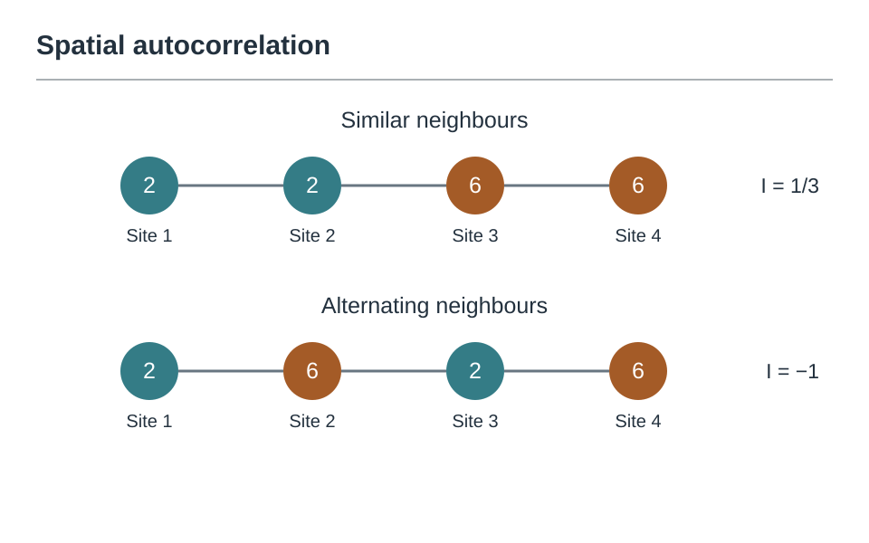

# M23-L2 – Spatial statistics {#L2}

**Course area:** M23 – Advanced Ecology and Environmental Biology

**Level:** Master – elective profile

**Prerequisites:** [M2-L4](M2-L4.md), [M14-L5](M14-L5.md), [M16-L4](M16-L4.md): inference and spatial sampling.

**Learning objective:** Quantify spatial autocorrelation, justify spatial weights and plan spatially separated validation.

## Introduction {#S1}

Nearby sampling sites may share similar soil, climate and species composition. The assumption of independent residuals is therefore often problematic in ecological data. Spatial dependence can represent either a biological process or an artefact of sampling design.

## Principles and model {#S2}

### Moran's index

Let $z_i=x_i-\bar x$ be the centred measurement at site $i$, and $w_{ij}$ a predefined neighbourhood weight (zero diagonal). Global Moran's index is

$$I=\frac{n}{\sum_{ij}w_{ij}}\frac{\sum_{ij}w_{ij}z_i z_j}{\sum_i z_i^2}.$$

The definition requires nonconstant data and positive total weight. With usual weights, positive values indicate similarity between neighbours and negative values spatial contrast. The null expectation under random permutation is $-1/(n-1)$, not exactly zero. The possible bounds depend on the weight matrix. A permutation test assumes exchangeability under the null hypothesis; structured sampling may require restricted permutation.

### Models and validation

Spatial models can account explicitly for residual correlation, for example through a spatial covariance function or autoregressive error structure. Geostatistical methods use the increase of differences with distance, for example in a semivariogram. Choice of scale and neighbourhood influences results. For transfer to new regions, withhold contiguous spatial blocks sized to match the dependence scale and intended use. Examine the spatial structure of residuals, not just raw data. Spatial association does not establish a causal process.

*Figure: Four sites in two arrangements illustrate similar and alternating neighbouring values.*

## Application {#S3}

Four equally spaced sites on a line have model values 2, 2, 6, 6. Weights are one for immediate neighbours in both directions and zero otherwise. Then $\bar x=4$, $z=(-2,-2,2,2)$, total weight 6, squared sum 16 and weighted product sum $2(4-4+4)=8$. Thus $I=(4/6)(8/16)=1/3$. The null expectation is $-1/3$. Only four sites are insufficient for a robust spatial conclusion.

## Self-assessment {#S4}

### Exercises

1. Calculate $I$ for the arrangement 2, 6, 2, 6 with the same weights.
2. Why is randomly splitting densely sampled spatial points into training and test sets risky?
3. How does a directional river network change the modelling problem?

::: {.lc-solutions data-lc-section="S4"}
1. Product sum $-24$, squared sum 16; $I=(4/6)(-24/16)=-1$.
2. Nearby test points may resemble training points closely; measured accuracy may overestimate performance in new regions.
3. Flow direction and distance along the river network may be more informative than symmetric Euclidean neighbourhoods.
:::

## Assumptions and limitations {#S5}

The line example uses artificial data. Coordinate projection, grid resolution, boundaries and measurement error influence spatial analysis. Report alternative neighbourhood definitions as a sensitivity analysis.

## Summary and transition {#S6}

Spatial dependence is part of both modelling and validation. The next lesson connects spatial distribution with climate change.

**Continue:** [M23-L3](M23-L3.md)

## Sources {#S7}

- [Dormann et al. (2007) – Methods to account for spatial autocorrelation in the analysis of species distributional data](https://eref.uni-bayreuth.de/id/eprint/12970/) · Spatial dependence and regression methods; abstract · Last accessed: 2026-11-25

