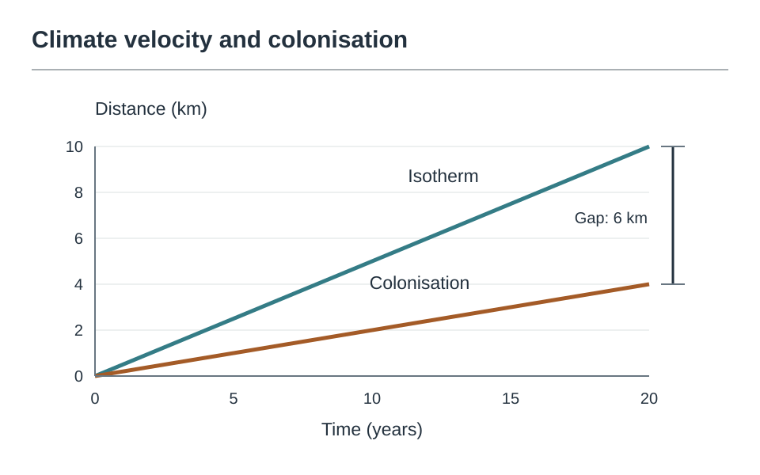

# M23-L3 – Climate change ecology {#L3}

**Course area:** M23 – Advanced Ecology and Environmental Biology

**Level:** Master – elective profile

**Prerequisites:** [M14-L4](M14-L4.md), [M10-L4](M10-L4.md), [M23-L2](M23-L2.md): environmental change, stress and space.

**Learning objective:** Model climate-related range shifts, calculate climate velocity and distinguish exposure from biological response.

## Introduction {#S1}

Climate change alters temperature, water availability, disturbance regimes and seasonal processes. Species respond through changes in phenology, demography, distribution or adaptation. The IPCC documents observed changes and future risks to terrestrial and freshwater ecosystems. These differ by region, species and scenario.

## Principles and model {#S2}

### Climate velocity and ecological niche

Under simplified conditions, the speed of a moving isotherm can be estimated from temporal temperature change and the magnitude of the spatial temperature gradient:

$$v=\frac{|\partial T/\partial t|}{|\nabla T|}.$$

With gradients in °C/km and trends in °C/year, the result is in km/year. The formula describes movement of a climatic condition, not actual movement of a species. The ratio becomes unstable in regions with almost no gradient. Topography and local microclimates modify exposure. Species distribution models relate occurrences to environmental variables; projections into future climates require tested assumptions about niche stability, dispersal and biotic interactions. Realised niches do not necessarily represent physiological tolerance limits.

### Risk and uncertainty

Exposure is contact with changed conditions, sensitivity is the strength of biological responses, and adaptive capacity is the ability to limit negative consequences. Species may fail to reach suitable new climates because of fragmentation or slow dispersal. Conversely, microrefugia can sustain local populations. Attribution studies compare alternative explanations for observed changes; projections explore conditional future pathways. Climate models, emissions scenarios and ecological model structures contribute different uncertainties. Ensemble averages must not be interpreted as a single certain future.

*Figure: Two model rates of 0.5 and 0.2 km per year produce a gap of 6 km after 20 years.*

## Application {#S3}

A fictional regional trend is $0.03\ ^\circ\mathrm{C/year}$, with a gradient of $0.06\ ^\circ\mathrm{C/km}$. The isotherm moves at $0.5$ km/year in the appropriate direction. A model organism can colonise new sites at an average of only 0.2 km/year under the specified assumptions. Over 20 years these rates correspond to 10 km and 4 km respectively. The difference of 6 km is a simplified spatial gap, not a predicted extinction probability.

## Self-assessment {#S4}

### Exercises

1. Calculate climate velocity for $0.02\ ^\circ\mathrm{C/year}$ and $0.1\ ^\circ\mathrm{C/km}$.
2. What property of a landscape corridor affects actual colonisation?
3. Why is an observed range shift insufficient for causal attribution?

::: {.lc-solutions data-lc-section="S4"}
1. $0.02/0.1=0.2$ km/year.
2. Connectivity, habitat quality and barriers determine whether individuals can reach suitable sites and establish there.
3. Land use, sampling intensity, biotic interactions and other environmental changes must be tested as alternative explanations.
:::

## Assumptions and limitations {#S5}

All numbers are model data, not IPCC projections. The ratio ignores nonlinear and multidimensional climatic changes; species responses also depend on life history and disturbances.

## Summary and transition {#S6}

Climate risks are mediated by space and biology. Conservation planning can explicitly account for these differing conditions.

**Continue:** [M23-L4](M23-L4.md)

## Sources {#S7}

- [IPCC (2022) – AR6 WGII, Chapter 2: Terrestrial and Freshwater Ecosystems and Their Services](https://www.ipcc.ch/report/ar6/wg2/chapter/chapter-2/) · Sections 2.4 and 2.5: observed responses and future risks; indexed chapter text · Last accessed: 2026-11-25

