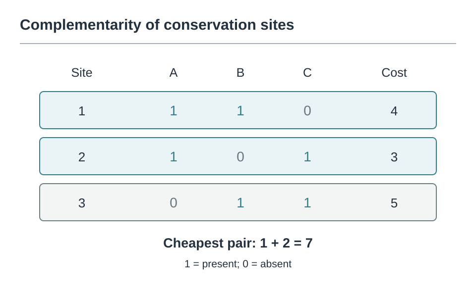

# M23-L4 – Conservation planning {#L4}

**Course area:** M23 – Advanced Ecology and Environmental Biology

**Level:** Master – elective profile

**Prerequisites:** [M14-L5](M14-L5.md), [M22-L5](M22-L5.md), [M23-L3](M23-L3.md): biodiversity indicators and climate risks.

**Learning objective:** Translate conservation targets into a simplified optimisation model and assess complementarity, costs and trade-offs.

## Introduction {#S1}

Protected areas are not selected solely by the number of species present. A network of sites should represent different conservation features, support their long-term persistence and account for practical and social conditions. Complementarity describes a site's additional contribution to targets already achieved.

## Principles and model {#S2}

### A target-coverage model

For planning units $i$ and conservation features $j$, let $a_{ij}$ be the amount of the feature in unit $i$, $c_i$ its cost and $x_i\in\{0,1\}$ the selection decision. A simple model minimises

$$\sum_i c_i x_i$$

subject to $\sum_i a_{ij}x_i\geq T_j$ for every feature, where $T_j$ is the defined target. Costs can represent finance, management effort or foregone alternative use, provided the units are consistent. Incompatible targets may make the problem infeasible. A model with a budget ceiling and maximised target achievement formulates a different decision.

### From map to decision

A representative site network is not automatically ecologically viable. Connectivity, minimum area, temporal stability and habitat quality are important additional criteria. Uncertain populations may warrant robust scenarios or safety margins. Results depend on the stated targets and data; different weights produce different possible solutions. Planning models support transparent decisions but do not replace local rights, participation processes and legal review. Subsequent evaluation tests whether anticipated effects actually occur.

*Figure: Three sites with complementary features and costs; sites 1 and 2 are the cheapest complete pair.*

## Application {#S3}

Three fictional sites contain conservation features A, B, C: site 1 contains A and B and costs 4 units; site 2 contains A and C and costs 3; site 3 contains B and C and costs 5. Every feature must be represented at least once. All pairs cover the three features; their costs are 7, 9 and 8. The cheapest pair is 1+2 for 7. Site 3 should not be preferred merely because it adds a different feature: marginal contribution depends on the existing selection.

## Self-assessment {#S4}

### Exercises

1. Which combination is feasible and cheapest if site 2 is unavailable?
2. Is the original target feasible with a budget of 6?
3. Name two criteria that could argue against the cheapest pair despite full target coverage.

::: {.lc-solutions data-lc-section="S4"}
1. Sites 1 and 3, cost 9.
2. No; every feasible pair costs at least 7 and no single site covers all features.
3. For example, lack of functional connectivity or low long-term habitat quality; land-use rights must also be assessed.
:::

## Assumptions and limitations {#S5}

The example contains artificial binary occurrence data and additive costs. Real populations require more than one detection per conservation feature. Sensitivity to targets, data errors and future scenarios must be disclosed.

## Summary and transition {#S6}

Systematic planning makes selection rules explicit. The next lesson examines how appropriate field studies can evaluate conservation effects.

**Continue:** [M23-L5](M23-L5.md)

## Sources {#S7}

- [Margules & Pressey (2000) – Systematic conservation planning](https://www.nature.com/articles/35012251) · Complementarity and systematic planning; abstract and figure descriptions · Last accessed: 2026-11-25

