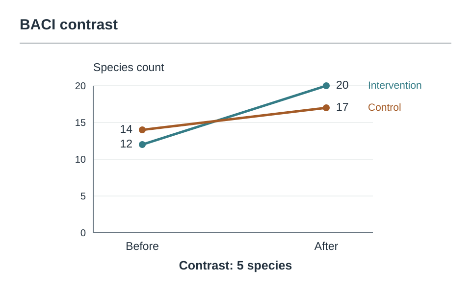

# M23-L5 – Monitoring and field research design {#L5}

**Course area:** M23 – Advanced Ecology and Environmental Biology

**Level:** Master – elective profile

**Prerequisites:** [M16-L4](M16-L4.md), [M19-L3](M19-L3.md), [M23-L4](M23-L4.md): field sampling and control groups.

**Learning objective:** Explain BACI design, calculate a difference in differences, and assess causal interpretation and replication limits.

## Introduction {#S1}

Ecological monitoring describes conditions and changes. An impact study also asks whether a particular intervention caused the observed change. Natural temporal fluctuations and different starting conditions make this distinction difficult.

## Principles and model {#S2}

### Before–After–Control–Impact

A BACI design measures an impacted group I and an unaffected comparison group C before and after an event. A simplified interaction estimate is

$$\hat\delta=(\bar Y_{I,after}-\bar Y_{I,before})-(\bar Y_{C,after}-\bar Y_{C,before}).$$

This subtracts a shared temporal change from the change in the impacted group. Causal interpretation assumes, among other things, that both groups would on average have followed comparable trends without the intervention and that the comparison group is not affected by it. Multiple pre-intervention periods can provide evidence of differing trends but do not guarantee this assumption. A single control site may be atypical. Multiple independent sites and repeated time points help capture spatial and temporal variation. Repeated measurements at the same site are not independent intervention replicates.

### Analysis and monitoring strategy

A linear model with group, time and interaction terms yields the BACI contrast with appropriate coding; hierarchical models account for nested sites and temporal dependence. Count data may require other distributions. Imperfect detection must not be mistaken for population change; consistent survey methods and repeated visits help. Define the outcome, meaningful effect size, survey duration, independent units and data quality rules in advance. Power analysis should match the intended model structure. Report results with intervals, raw-data summaries, documented missing observations and alternative explanations. Protection of sensitive species locations and required permissions are part of field planning.

*Figure: Model values 12 to 20 in the intervention group and 14 to 17 in the control group yield a contrast of 5.*

## Application {#S3}

Fictional mean species counts in a restoration project: impacted before 12, after 20; control before 14, after 17. The BACI contrast is $(20-12)-(17-14)=5$ species. The before–after difference alone would be 8 species. The contrast of 5 is not robust evidence of effectiveness without replication and an uncertainty interval.

## Self-assessment {#S4}

### Exercises

1. Calculate the BACI contrast for I before 30, after 32, C before 28, after 34.
2. Why are ten quadrats within a single restored site not ten independent intervention replicates?
3. Which condition is violated if the intervention also affects the control site?

::: {.lc-solutions data-lc-section="S4"}
1. $(32-30)-(34-28)=-4$.
2. The intervention acts at site level; the quadrats share the same intervention and site conditions. They are subsamples.
3. The control no longer represents the trajectory without intervention; interference biases causal interpretation.
:::

## Assumptions and limitations {#S5}

The data are simulated. Multiple controls do not exclude unobserved confounders. BACI is a design principle, not a guarantee of causality. Model choice, missing data, detection error and effect uncertainty require separate evaluation.

## Summary and transition {#S6}

Advanced ecology connects forecasts, spatial analysis and testable decisions. This elective prepares learners for independent environmental research.

**Continue:** [M24-L1](M24-L1.md)

## Sources {#S7}

- [Underwood (1994) – On beyond BACI: sampling designs that might reliably detect environmental disturbances](https://groups.nceas.ucsb.edu/monitoring-kb/resources/references/underwood-1994.html) · Limitations of single-control designs; institutional reference summary · Last accessed: 2026-11-25

