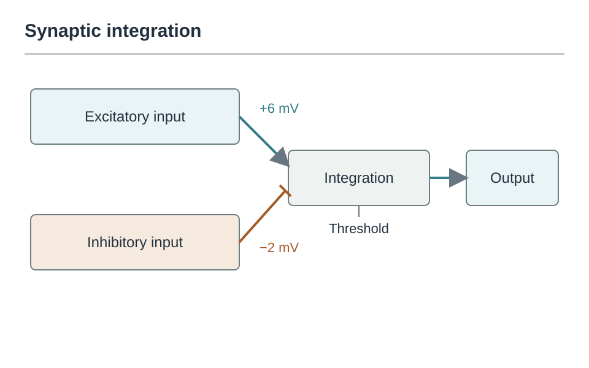

# M24-L1 – Neural circuits {#L1}

**Course area:** M24 – Neuroscience and Behavioural Research

**Level:** Master – elective profile

**Prerequisites:** [M4-L2](M4-L2.md), [M11-L1](M11-L1.md), [M21-L3](M21-L3.md): membrane potential, synapses and dynamical models.

**Learning objective:** Model synaptic integration quantitatively, distinguish circuit motifs and explain the limits of linear approximations.

## Introduction {#S1}

A neural circuit processes signals through interactions among many cells. The function of a connection depends not only on the transmitter but also on receptors, reversal potentials, cellular state and temporal context. Anatomy identifies possible signal paths, but does not automatically specify their functional strengths.

## Principles and model {#S2}

### Integration and excitability

Excitatory synaptic inputs typically increase the probability of an action potential, whereas inhibitory inputs reduce it. In a conductance-based description, an input contributes membrane current $I_i=g_i(E_i-V)$, with inward current defined as positive here. $g_i$ is conductance, $E_i$ the reversal potential and $V$ the current membrane potential. An inhibitory input can attenuate other voltage changes by increasing conductance even when it causes little hyperpolarisation (shunting inhibition).

For small deviations from the resting potential, temporal integration can be approximated as

$$\Delta V(t)=\sum_{t_i\leq t} a_i\exp[-(t-t_i)/\tau].$$

Amplitude $a_i$ in mV is positive or negative, and $\tau$ is a common time constant. This model ignores nonlinear dendrites, changing conductances and reset after a spike. In a threshold model, a spike occurs once the potential reaches a boundary; the calculation stops at that point.

### Circuit motifs

Converging inputs can integrate information from different sources. Divergence distributes a signal to different targets. Feedforward inhibition restricts the excitation time window; feedback inhibition responds to output activity. Recurrent excitation may sustain activity; without stabilising mechanisms a linear model can become unstable. A functional circuit diagram therefore distinguishes direction, sign and temporal dynamics. Correlated activity between two cells does not prove a direct connection because both might receive a common input.

*Figure: Excitatory and inhibitory inputs are integrated in a simplified threshold model.*

## Application {#S3}

A fictional neuron rests at $-65$ mV and has a model threshold of $-55$ mV. At $t=0$, a $+6$ mV input arrives; 10 ms later another $+6$ mV input and a simultaneous $-2$ mV inhibitory input arrive. With $\tau=20$ ms, the sum at 10 ms is $6e^{-0.5}+6-2=7.64$ mV. The potential is $-57.36$ mV, below threshold. Without inhibition it would be $-55.36$ mV, still just below threshold. Two simultaneous $+6$ mV inputs without inhibition would cross the model threshold.

## Self-assessment {#S4}

### Exercises

1. Calculate the remaining amplitude of an 8 mV input after 20 ms with $\tau=20$ ms.
2. Two simultaneous inputs contribute $+8$ and $-3$ mV. What is the change in the linear model?
3. Why is an anatomical contact insufficient evidence of functional excitation?

::: {.lc-solutions data-lc-section="S4"}
1. $8e^{-1}=2.94$ mV.
2. $+5$ mV.
3. Receptors, reversal potential, synaptic strength and current cellular state determine the effect; a contact alone does not.
:::

## Assumptions and limitations {#S5}

All numbers are simulated. Linear summation does not model voltage-dependent channels, refractory periods or shunting inhibition. The threshold is a teaching constant, not a universal physiological measurement.

## Summary and transition {#S6}

Circuits are dynamical systems. Studying their function requires appropriate measurement methods.

**Continue:** [M24-L2](M24-L2.md)

## Sources {#S7}

- [Purves et al. (2001) – Neuroscience, 2nd ed.: Summation of Synaptic Potentials](https://www.ncbi.nlm.nih.gov/books/NBK11104/) · Synaptic integration; indexed section · Last accessed: 2026-11-25

