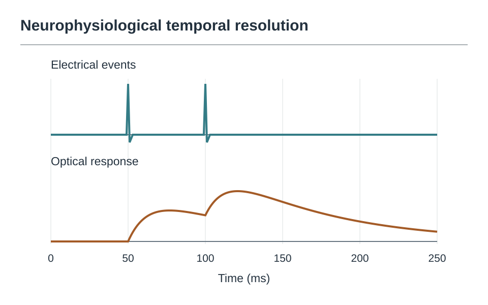

# M24-L2 – Neurophysiological measurements {#L2}

**Course area:** M24 – Neuroscience and Behavioural Research

**Level:** Master – elective profile

**Prerequisites:** [M11-L1](M11-L1.md), [M16-L1](M16-L1.md), [M20-L3](M20-L3.md): neural signals, microscopy and measurement quality.

**Learning objective:** Distinguish electrical and optical readouts, calculate sampling intervals and fluorescence changes, and evaluate measurement artefacts.

## Introduction {#S1}

Neurophysiological methods capture different aspects of neural activity. An electrical signal is not equivalent to an optical indicator or a haemodynamic signal. Method choice depends on the biological question, spatial scale and required temporal resolution.

## Principles and model {#S2}

### Electrical and optical measurement principles

Intracellular voltage recordings capture potential changes in individual cells. A voltage clamp regulates a target potential and uses the required current as a readout. Extracellular recordings capture electrical fields; assigning individual spike shapes to cells requires additional model assumptions and quality checks. Local field potentials reflect summed, spatially weighted currents and are not directly the mean firing rate of all nearby neurons.

Calcium indicators provide an optical readout related to intracellular calcium. A common relative representation is $\Delta F/F_0=(F-F_0)/F_0$. The baseline $F_0$ must be justified and positive. Sensor kinetics, saturation, motion and photobleaching influence the signal. A fluorescence peak therefore does not automatically represent one spike. Functional magnetic resonance imaging primarily measures haemodynamic changes, not direct action potentials.

### Temporal resolution and sampling

With regular sampling at frequency $f_s$, the interval is $1/f_s$. For ideal band-limited continuous signals, the Nyquist boundary is $f_s/2$; components above it can appear as spurious lower frequencies. An appropriate anti-aliasing filter acts before digitisation. For short pulses, merely specifying a formal Nyquist limit is insufficient: sensor bandwidth, signal-to-noise ratio and enough samples determine the recoverable shape. Comparative studies synchronise time bases and preserve raw data and processing parameters.

*Figure: Two brief electrical events and a slower schematic optical response share a time axis.*

## Application {#S3}

A simulated electrical recording has $f_s=10000$ Hz. The sampling interval is 0.1 ms and the Nyquist boundary 5000 Hz. A 2 ms event spans approximately 20 sampling intervals. An optical recording at 20 frames/s instead has a 50 ms frame interval. With a baseline of 200 and peak of 250 intensity units, $\Delta F/F_0=0.25=25\%$. A slower optical response can combine several fast electrical events. Amplitudes from the two methods cannot be compared directly without calibration.

## Self-assessment {#S4}

### Exercises

1. Find the interval and Nyquist boundary at 2000 Hz.
2. Calculate $\Delta F/F_0$ for $F_0=150$ and $F=180$.
3. Give two reasons why a fluorescence trace and an electrical spike train need not coincide in time.

::: {.lc-solutions data-lc-section="S4"}
1. 0.5 ms; 1000 Hz.
2. $(180-150)/150=0.20=20\%$.
3. For example, slow sensor kinetics and low frame rate. Motion and nonlinear calcium dynamics may also complicate matching.
:::

## Assumptions and limitations {#S5}

The examples are simulations, not experimental protocols. Sampling theory assumes idealised band limitation. Optical signal amplitude and spike count need not be linearly related.

## Summary and transition {#S6}

A measurement's meaning depends on its signal model. The next lesson examines statistical analysis of sensory decisions.

**Continue:** [M24-L3](M24-L3.md)

## Sources {#S7}

- [Approaches and Limitations in the Investigation of Synaptic Transmission and Plasticity (2019)](https://pmc.ncbi.nlm.nih.gov/articles/PMC6667546/) · Electrophysiology and optical readouts; indexed article text · Last accessed: 2026-11-25

