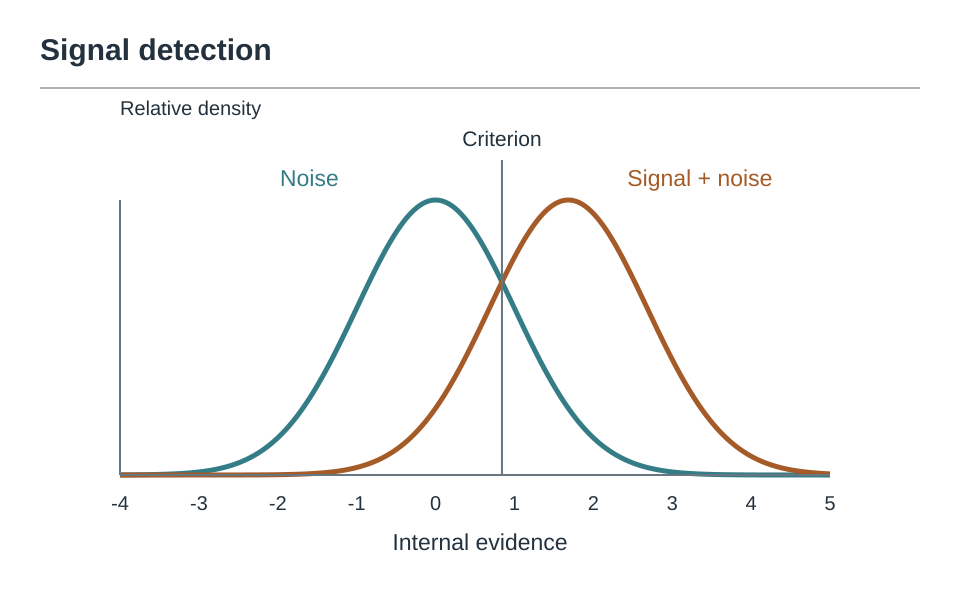

# M24-L3 – Sensory systems and behaviour {#L3}

**Course area:** M24 – Neuroscience and Behavioural Research

**Level:** Master – elective profile

**Prerequisites:** [M2-L2](M2-L2.md), [M11-L7](M11-L7.md): normal distribution and sensory processing.

**Learning objective:** Distinguish hits and false alarms, calculate sensory sensitivity and response criterion, and interpret behavioural data critically.

## Introduction {#S1}

Sensory systems transform physical stimuli into neural activity. Decisions are not determined by stimulus strength alone: internal variability, attention, expectations and the costs of different errors can influence responses. Psychophysics studies relationships between controlled stimuli and observed decisions.

## Principles and model {#S2}

### Signal detection theory

A yes–no task distinguishes trials with and without a signal. Four outcomes are possible: hit, miss, false alarm and correct rejection. Let $H$ be the hit proportion among signal trials and $F$ the false alarm proportion among no-signal trials. The equal-variance Gaussian model separates sensitivity and decision criterion:

$$d'=\Phi^{-1}(H)-\Phi^{-1}(F),\qquad c=-\tfrac12[\Phi^{-1}(H)+\Phi^{-1}(F)].$$

$\Phi^{-1}$ denotes the standard normal quantile function. For $c>0$ the criterion is conservative relative to the midpoint of the distributions; for $c<0$ it is liberal. In the model, $d'=0$ indicates equal distribution means. Proportions of exactly zero or one produce infinite quantiles; finite samples require prespecified corrections or directly fitted models. An ROC curve shows hit rate against false alarm rate at different criteria. It permits comparison beyond a single response threshold.

### Behaviour and biological interpretation

Neural tuning curves describe responses to different stimuli. A decoder can estimate stimulus class from an activity pattern; success on independent test data demonstrates available information, not necessarily its actual use by the animal. Behavioural studies must distinguish motivation, motor performance and sensory limitations. Repeated trials from the same person are not independent biological replicates. Estimating group differences consequently requires hierarchical models or person-level summaries.

*Figure: Two overlapping equal-variance normal distributions and a decision criterion between their means.*

## Application {#S3}

In a fictional task, 100 signal trials yield 80 hits and 100 no-signal trials yield 20 false alarms. Thus $H=0.8$, $F=0.2$, $z(H)=0.842$, $z(F)=-0.842$, $d'\approx1.683$ and $c=0$. At another criterion let $H=0.5$ and $F=0.05$. Then $d'\approx1.645$ and $c\approx0.822$. Observed hit rates differ substantially, while estimated sensitivity is similar. Statistical inference would be required to establish a sensitivity difference.

## Self-assessment {#S4}

### Exercises

1. Find the hit and false alarm rates for 90 hits out of 100 signal trials and 10 false alarms out of 100 no-signal trials.
2. Calculate $d'$ and $c$ using quantiles $\pm1.282$.
3. Why can a higher hit rate occur with unchanged sensitivity?

::: {.lc-solutions data-lc-section="S4"}
1. $H=0.9$, $F=0.1$.
2. $d'\approx2.564$, $c=0$.
3. A more liberal response criterion can increase both hits and false alarms.
:::

## Assumptions and limitations {#S5}

The data are simulated. The formulas assume normally distributed internal evidence with equal variance. A single $d'$ does not fully describe sensory or cognitive performance.

## Summary and transition {#S6}

Signal detection separates response bias from sensitivity. The next lesson examines how expectations and neural connections change through experience.

**Continue:** [M24-L4](M24-L4.md)

## Sources {#S7}

- [Claremont Graduate University – WISE: Signal Detection, d′ Defined](https://wise.cgu.edu/wise-tutorials/tutorial-signal-detection-theory/signal-detection-d-defined-2/) · Sensitivity and normal quantiles; tutorial · Last accessed: 2026-11-25

