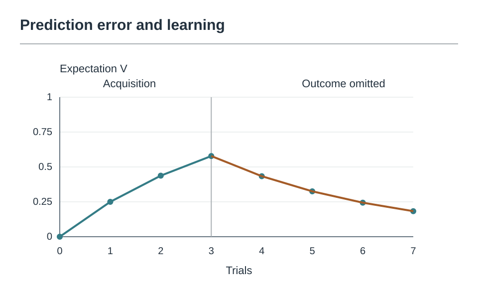

# M24-L4 – Learning and plasticity {#L4}

**Course area:** M24 – Neuroscience and Behavioural Research

**Level:** Master – elective profile

**Prerequisites:** [M11-L6](M11-L6.md), [M12-L2](M12-L2.md), [M24-L1](M24-L1.md): behaviour, signalling and neural integration.

**Learning objective:** Distinguish synaptic plasticity across timescales, calculate a prediction-error model and separate biological from algorithmic explanations.

## Introduction {#S1}

Learning refers to experience-dependent changes in behaviour or processing. Plasticity encompasses changes in neural properties, synaptic strength and network organisation. Not every short-term behavioural change is learning; fatigue, sensory adaptation or motor limitations may produce similar observations.

## Principles and model {#S2}

### Synaptic and systemic plasticity

Short-term plasticity changes transmission strength over brief periods, for example through changes in synaptic vesicle availability or presynaptic calcium dynamics. Long-term potentiation (LTP) and long-term depression (LTD) denote persistent strengthening and weakening of synaptic transmission respectively. At certain hippocampal synapses, NMDA receptors and calcium signalling contribute to induction; other synapses use other mechanisms. Long-term expression can involve changes in receptor distribution and gene expression. Homeostatic plasticity stabilises network activity, whereas associative plasticity can alter specific connections. Memory therefore cannot be equated with a single synaptic mechanism.

### Learning as prediction error

A simple associative model for one cue describes the expected outcome $V_t$ on a normalised scale. Let the observed outcome be $\lambda_t$ and the learning rate $0<\alpha\leq1$:

$$V_{t+1}=V_t+\alpha(\lambda_t-V_t).$$

The term in parentheses is the prediction error. For constant $\lambda=1$ and $V_0=0$, $V_t=1-(1-\alpha)^t$. When the outcome is no longer presented, the model prediction falls by a factor $1-\alpha$ per trial. This single-cue model is a reduced form of error-based associative models. It captures neither all attentional processes nor context-dependent return of learned responses. The parameter is not a directly measured biological synaptic rate.

*Figure: Expectation rises with repeated outcomes and falls after omission; learning rate 0.25.*

## Application {#S3}

For a fictional cue let $\alpha=0.25$, $\lambda=1$ and $V_0=0$. Then $V_1=0.25$, $V_2=0.4375$ and $V_3=0.578125$. If the expected outcome is omitted on the fourth trial ($\lambda_3=0$), the prediction falls to $V_4=0.433594$ (rounded). Separately, a simulated synaptic recording shows a mean response rising from 2 to 3 mV: a 50% increase. These figures describe different levels; synaptic amplitude cannot be derived from the model learning rate.

## Self-assessment {#S4}

### Exercises

1. Calculate $V_2$ for $\alpha=0.5$, $V_0=0$ and $\lambda=1$.
2. Calculate the next value when $\lambda=0$ subsequently.
3. Why does persistent synaptic strengthening alone not demonstrate a particular memory?

::: {.lc-solutions data-lc-section="S4"}
1. $V_1=0.5$, $V_2=0.75$.
2. $V_3=0.75+0.5(0-0.75)=0.375$.
3. Memory requires a link to behaviour and network function; synaptic strengthening can have multiple causes and is not specific to memory content.
:::

## Assumptions and limitations {#S5}

Data are simulated. The model assumes a fixed learning rate, one cue and a scalar outcome. Extinction in the model is a declining prediction, not proof of biological memory erasure.

## Summary and transition {#S6}

Plasticity connects experience with altered processing. Robust evidence requires an ethically and methodologically appropriate research design.

**Continue:** [M24-L5](M24-L5.md)

## Sources {#S7}

- [Purves et al. (2001) – Mechanism of Long-Term Synaptic Plasticity in the Mammalian Nervous System](https://www.ncbi.nlm.nih.gov/books/NBK11136/) · LTP and LTD; indexed section · Last accessed: 2026-11-25
- [Mini-review: Prediction errors, attention and associative learning (2016)](https://pmc.ncbi.nlm.nih.gov/articles/PMC4862921/) · Associative learning and prediction error; indexed article text · Last accessed: 2026-11-25

