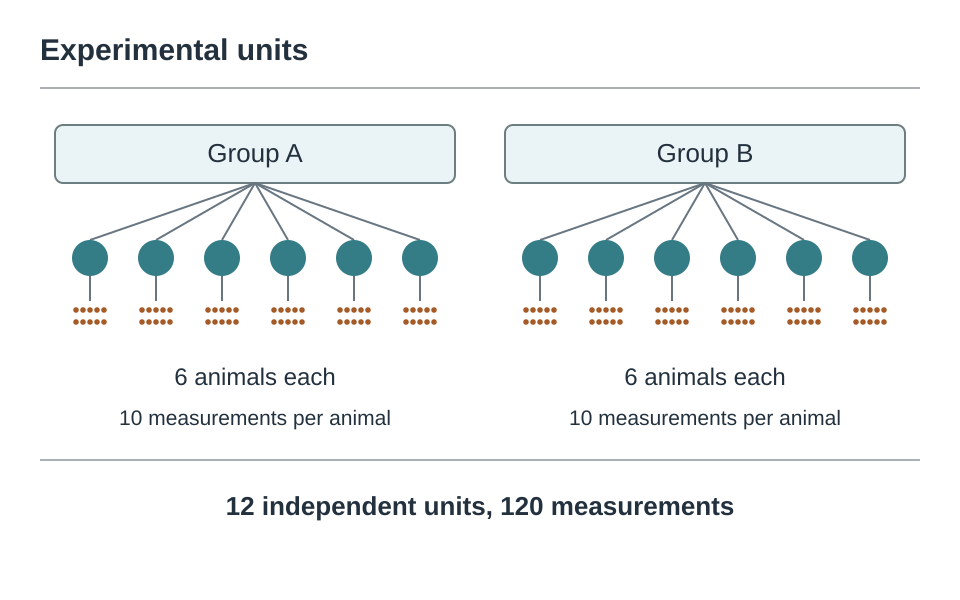

# M24-L5 – Research ethics and model limitations {#L5}

**Course area:** M24 – Neuroscience and Behavioural Research

**Level:** Master – elective profile

**Prerequisites:** [M1-L2](M1-L2.md), [M19-L3](M19-L3.md), [M24-L2](M24-L2.md): research ethics, experimental design and measurement models.

**Learning objective:** Identify experimental units, recognise pseudoreplication quantitatively and justify ethical and methodological limits of neuroscience models.

## Introduction {#S1}

Neurobiological research connects molecular, cellular, organismal and human observational levels. Ethical acceptability and scientific validity are distinct but closely related prerequisites. Unreliable studies can cause burdens without producing commensurate knowledge.

## Principles and model {#S2}

### Ethics and evidence

The 3Rs require consideration of alternative methods (Replacement), avoidance of unnecessary animal numbers (Reduction) and minimisation of burdens (Refinement). Reducing sample size must not result in an unusable design. ARRIVE 2.0 supports transparent reporting of animal research, especially design, sample size, exclusions, randomisation, blinding, outcomes and statistical methods. A reporting standard does not replace regulatory or institutional approval. For human research, informed consent, confidentiality, voluntary participation and appropriate review are essential. Identifiable behavioural and neural data require particular protection.

### Experimental unit and model limitations

The experimental unit is the smallest unit independently assigned to a condition. If assignment occurs at animal level, additional measured cells per animal increase measurement information, not the number of independent animals. For equal clusters of $m$ measurements and intraclass correlation $\rho$, the design effect $D=1+(m-1)\rho$ illustrates the impact of clustering. For a simple mean with equal cluster sizes and equal variance, approximately $n_\mathrm{eff}=n/D$. This does not calculate the degrees of freedom of a treatment effect. Hierarchical models or analysis at experimental-unit level account for actual assignment.

Transferability depends on which biological properties a model shares. Cell cultures and organoids are useful for certain mechanisms but do not reproduce complete behaviour. Animal-model findings cannot be transferred to human experiences or clinical efficacy without further evidence. Correlation, causal mechanism and external validity require separate assessment.

*Figure: Two groups with six independent animals each and nested measurements.*

## Application {#S3}

In a wholly simulated dataset, two groups of six animals each are compared, with ten measurements per animal. There are 120 individual measurements and twelve experimental units if assignment is independent at animal level. With $\rho=0.4$, $D=1+9\cdot0.4=4.6$; $n_\mathrm{eff}\approx26.1$ describes only the precision of the hypothetical overall mean relative to independent individual measurements. The twelve animals remain the independent units for group comparison. A naive test treating 120 values as independent would be inappropriate.

## Self-assessment {#S4}

### Exercises

1. How many independent units are present with eight animals and five cell measurements per animal when assignment is per animal?
2. Calculate $D$ for $m=5$ and $\rho=0.25$.
3. Does a complete ARRIVE checklist replace ethical approval?

::: {.lc-solutions data-lc-section="S4"}
1. Eight animals; 40 measurements.
2. $D=1+4\cdot0.25=2$; for a simple mean this corresponds to approximately 20 independent individual measurements.
3. No. Transparent reporting and legally or institutionally required approvals serve different purposes.
:::

## Assumptions and limitations {#S5}

The examples contain no real experimental data and provide no intervention instructions. The design-effect approximation assumes equal cluster sizes and common correlation. Complex designs need separate planning and appropriate statistical models.

## Summary and transition {#S6}

This elective integrates circuits, measurement methods, behaviour, learning and responsible research. Subsequent master's profiles consider other levels of biological research.

**Continue:** [M25-L1](M25-L1.md)

## Sources {#S7}

- [Percie du Sert et al. (2020) – ARRIVE guidelines 2.0](https://pmc.ncbi.nlm.nih.gov/articles/PMC7360023/) · Essential 10, experimental unit and bias; indexed article text · Last accessed: 2026-11-25
- [NC3Rs – The 3Rs](https://nc3rs.org.uk/who-we-are/3rs) · Definitions of the 3Rs · Last accessed: 2026-11-25

