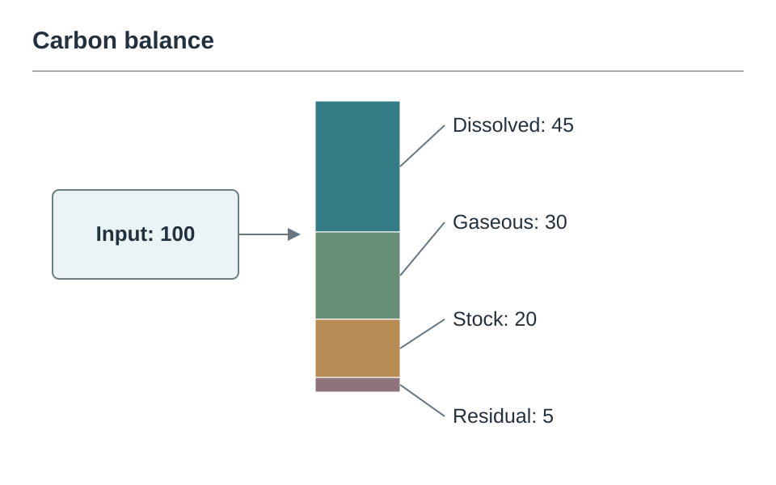

# M25-L1 – Microbial physiology {#L1}

**Course area:** M25 – Microbiology and Infection Biology

**Level:** Master – elective profile

**Prerequisites:** [M5-L4](M5-L4.md), [M9-L2](M9-L2.md), [M21-L3](M21-L3.md): metabolism and systems models.

**Learning objective:** Interpret metabolic states using carbon and redox balances and explain the limitations of flux models.

## Introduction {#S1}

Microbial physiology considers the state of a biological system, not just its taxonomic identity. Two communities of similar composition may differ in metabolic activity. Detecting a gene establishes genetic potential, not an actual metabolic flux.

## Principles and model {#S2}

### Metabolism as a coupled network

Catabolic reactions release usable free energy; anabolic reactions use energy and reducing equivalents to build cellular constituents. Electron carriers connect reactions separated in space and time. Thermodynamic feasibility says nothing about reaction speed. Enzyme abundance, regulation and system state jointly determine actual fluxes.

A stoichiometric network can be represented by a matrix $S$, with metabolites as rows and reactions as columns. Vector $v$ contains reaction fluxes. Under a steady-state approximation, internal metabolites satisfy $Sv=0$. Reactions need not stop: the relevant pools neither increase nor decrease on average. Several flux distributions can satisfy the same condition. Distinguishing them requires independent measurements; a calculated flux is not a direct observation.

### Balance and interpretation

In a carbon balance, all quantities use the same unit, such as mol C. The difference between recorded input and output including stock changes is the balance residual. A nonzero residual may reflect unrecorded outputs, measurement errors or unsuitable system boundaries. It does not prove a particular missing pathway.

*Figure: Fictional carbon balance with four components totalling 100 units.*

## Application {#S3}

A wholly fictional ecosystem data archive records 100 carbon units as input. Dissolved outputs contain 45 units, gaseous outputs 30, and stock increase 20. The residual is $100-45-30-20=5$ units, or 5% of input. If combined standard uncertainty is 4 units, the residual corresponds to $5/4=1.25$ standard uncertainties. Without further evidence it cannot be assigned uniquely to a biological mechanism.

## Self-assessment {#S4}

### Exercises

1. Calculate the residual for 80 units of input, 50 of output and 25 of stock increase.
2. What does $Sv=0$ mean for an internal metabolite pool?
3. Why is gene annotation insufficient to determine a metabolic flux?

::: {.lc-solutions data-lc-section="S4"}
1. $80-50-25=5$ units.
2. The pool has zero net change even when inflows and outflows exist.
3. Expression, regulation, reaction conditions and alternative pathways remain unknown.
:::

## Assumptions and limitations {#S5}

The balance values are illustrative and describe neither a real organism nor a cultivation procedure. Steady state must be justified; it need not hold in time-varying systems.

## Summary and transition {#S6}

Material balances connect molecular processes to observable system states. The next lesson examines interactions with a host.

**Continue:** [M25-L2](M25-L2.md)

## Sources {#S7}

- [OpenStax – Microbiology, Ch. 8 Summary](https://openstax.org/books/microbiology/pages/8-summary) · Metabolic pathways, catabolism and anabolism; indexed summary · Last accessed: 2026-11-25

