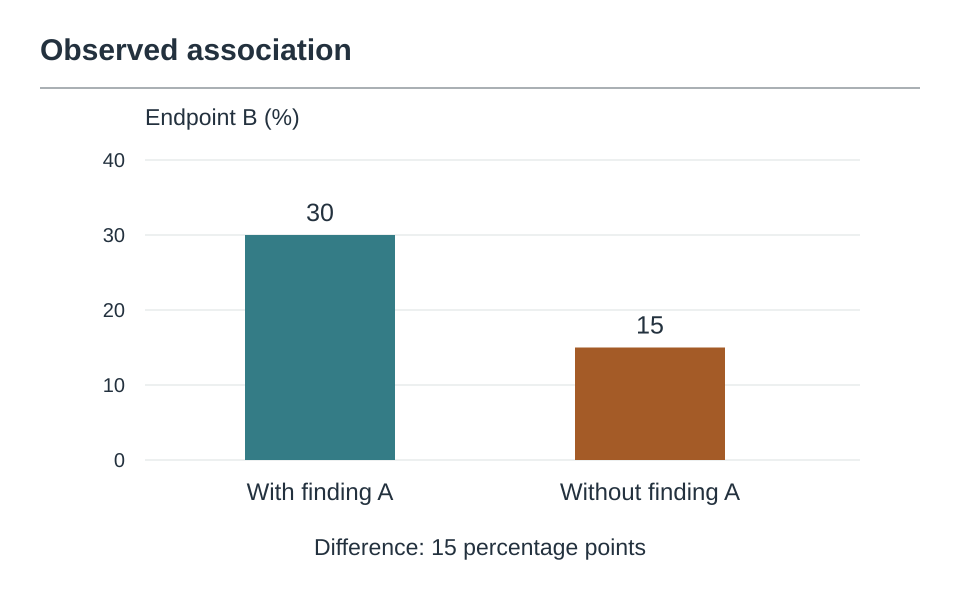

# M25-L2 – Host–microbe interactions {#L2}

**Course area:** M25 – Microbiology and Infection Biology

**Level:** Master – elective profile

**Prerequisites:** [M9-L4](M9-L4.md), [M9-L5](M9-L5.md), [M18-L4](M18-L4.md): immunity, microbiome and diagnostics.

**Learning objective:** Distinguish colonisation, infection and disease, and assess an observed association quantitatively.

## Introduction {#S1}

The presence of a microorganism does not necessarily mean disease. A host may maintain stable relationships with microbes without symptoms. Infection biology examines interactions among host, microorganism and environment.

## Principles and model {#S2}

### Host and biological context

The mucosa forms a physical and immunological interface. Local immune responses help protect tissues while tolerating harmless environmental constituents. The transition from tolerated colonisation to a disease-relevant process depends on many factors. Disease denotes impairment of the host and cannot be inferred solely from detection of a microbial feature.

Resistance in the sense of host defence and tolerance of tissue damage are distinct concepts: the former limits a burden, the latter limits its consequences. An inflammatory marker may change without a corresponding change in microbial burden. Excessive immune responses can also contribute to tissue damage.

### Association and causality

In an observational study, let $p_1$ denote the proportion with an endpoint in a group with a particular finding, and $p_0$ the proportion in a comparison group. Risk difference is $p_1-p_0$ and relative risk is $p_1/p_0$ provided $p_0>0$. Both are initially descriptive. Age, other illnesses, timing of measurement and participant selection may bias the result. Reverse causation is also possible: disease may alter the microbial community.

*Figure: Fictional groups with endpoint proportions of 30 and 15 percent.*

## Application {#S3}

In a fictional dataset, 18 of 60 observations with finding A and 12 of 80 without finding A have endpoint B. The proportions are 0.30 and 0.15; the difference is 0.15 or 15 percentage points, and relative risk is 2. The data alone establish no cause. Comparisons within predefined age groups could examine one possible bias but cannot exclude unobserved differences.

## Self-assessment {#S4}

### Exercises

1. Calculate relative risk for 10/50 versus 5/50.
2. What is the risk difference in percentage points?
3. Name an alternative explanation for the observed association.

::: {.lc-solutions data-lc-section="S4"}
1. $(10/50)/(5/50)=2$.
2. $0.20-0.10=0.10$, or 10 percentage points.
3. A shared influencing variable or reverse causation may explain the relationship.
:::

## Assumptions and limitations {#S5}

The groups are fictional, not clinical data. This example teaches epidemiological interpretation and supports neither personal diagnoses nor claims about particular pathogens or interventions.

## Summary and transition {#S6}

Host–microbe interactions must be inferred from multiple levels of observation. Community data additionally require appropriate statistical representation.

**Continue:** [M25-L3](M25-L3.md)

## Sources {#S7}

- [OpenStax – Microbiology, 15.1 Characteristics of Infectious Disease](https://openstax.org/books/microbiology/pages/15-1-characteristics-of-infectious-disease) · Infection and disease; indexed section · Last accessed: 2026-11-25

