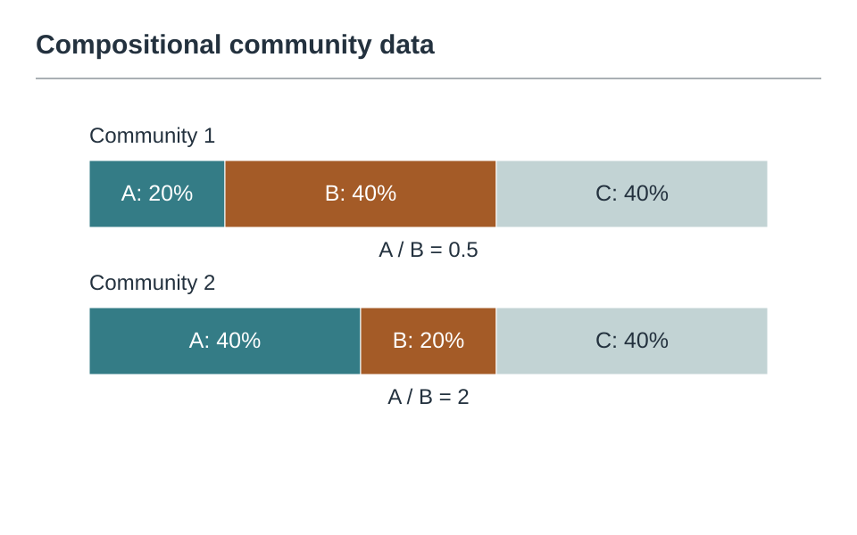

# M25-L3 – Microbial communities {#L3}

**Course area:** M25 – Microbiology and Infection Biology

**Level:** Master – elective profile

**Prerequisites:** [M9-L5](M9-L5.md), [M14-L2](M14-L2.md), [M21-L4](M21-L4.md): community data and multivariate statistics.

**Learning objective:** Analyse compositional community data using log ratios and distinguish ecological interactions from statistical associations.

## Introduction {#S1}

Microbial communities consist of populations with different functions. Sequence-derived observations often provide proportions rather than absolute abundances. Mathematical representation is therefore crucial: an increase in one proportion can force another proportion to change even when its absolute abundance is unchanged.

## Principles and model {#S2}

### Composition and log ratios

For positive proportions $x_i$ in a composition, $\sum_i x_i=1$. A direct ratio $x_A/x_B$ is invariant under common scaling of original counts. Its natural logarithm represents relative changes symmetrically: doubling the ratio gives $\ln 2$ and halving gives $-\ln 2$.

For several components, the centred log-ratio transformation may be used: $\operatorname{clr}(x)_i=\ln(x_i/g(x))$, where $g(x)$ is the geometric mean of all positive components. Transformed values sum to zero. Zeros cannot be logged directly; structural absence must be distinguished from non-detection. Arbitrary zero replacement can materially influence results.

### Ecological meaning

Co-occurrence may arise from shared environmental conditions, indirect interactions or statistical dependence. A network edge derived from correlations is not a confirmed material-exchange relationship. Genetic functional potential, measured activity and independent ecological evidence complement one another.

*Figure: Two stacked proportion bars show a fourfold change in the A/B ratio.*

## Application {#S3}

Two fictional communities have proportions A/B/C = 0.20/0.40/0.40 and 0.40/0.20/0.40. The A/B ratio changes from 0.5 to 2. The difference in natural log ratios is $\ln(2)-\ln(0.5)=\ln(4)=1.3863$. This indicates a fourfold relative shift of A against B, not necessarily an absolute increase of A.

## Self-assessment {#S4}

### Exercises

1. Calculate $\ln(A/B)$ for A = 0.30 and B = 0.30.
2. By what factor does a ratio change from 2 to 0.5?
3. Why does correlation between two taxa not prove direct material exchange?

::: {.lc-solutions data-lc-section="S4"}
1. $\ln(1)=0$.
2. $0.5/2=0.25$, or one quarter.
3. Shared environmental conditions, indirect processes and compositional structure can generate correlations.
:::

## Assumptions and limitations {#S5}

Data are simulated and unrelated to any actual microbial community. Log ratios require positive values. Absolute abundances need suitable independent quantitative evidence.

## Summary and transition {#S6}

Compositional models help describe relative community changes correctly. The next section considers general system balances.

**Continue:** [M25-L4](M25-L4.md)

## Sources {#S7}

- [Gloor et al. (2017) – Microbiome Datasets Are Compositional: And This Is Not Optional](https://pubmed.ncbi.nlm.nih.gov/29187837/) · Compositional nature of sequence-derived abundance; abstract · Last accessed: 2026-11-25

