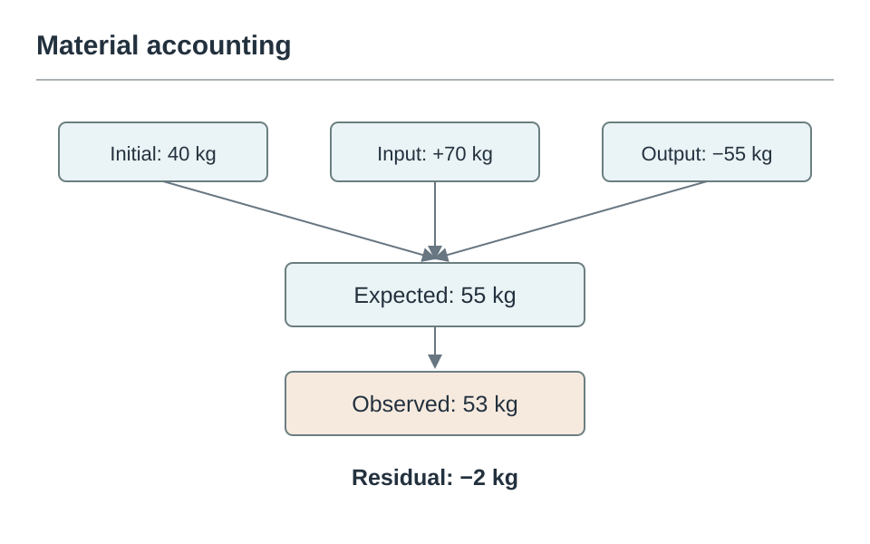

# M25-L4 – Overview of bioprocess models {#L4}

**Course area:** M25 – Microbiology and Infection Biology

**Level:** Master – elective profile

**Prerequisites:** [M3-L2](M3-L2.md), [M14-L3](M14-L3.md), [M21-L3](M21-L3.md): material balances and dynamical models.

**Learning objective:** Define system boundaries, formulate a material balance and assess what a balance residual can establish.

## Introduction {#S1}

Bioprocess models describe biological transformations from a systems perspective. A consistent balance is necessary but not sufficient for a mechanistically correct model.

## Principles and model {#S2}

### Control volume and conservation of material

For the stock $M$ of a component, the balance is

$$\frac{dM}{dt}=F_{\mathrm{in}}-F_{\mathrm{out}}+R_{\mathrm{form}}-R_{\mathrm{cons}}.$$

The quantities $F$ denote amounts of material per time crossing the system boundary, and $R$ denotes internal formation and consumption. For total mass, chemical formation and consumption terms cancel because chemical reactions redistribute rather than create mass. Component balances must include them. Steady state means $dM/dt=0$, not absence of internal processes.

### Model assessment

In a time-integrated total balance, the stock change is the difference between input and output. The residual is the observed stock change minus the predicted change. Units, time windows and system boundaries must agree. Measurement uncertainties can be correlated, for example when several values share a calibration. Raw data and their provenance therefore belong alongside the balance.

A model can satisfy a balance and still contain incorrect internal mechanisms. Different reaction networks can explain the same total throughput. Mechanistic interpretation requires additional observations. This lesson deals exclusively with analysing abstract, pre-existing material accounting records.

*Figure: Abstract total mass balance with expected and observed final stock.*

## Application {#S3}

A fictional environmental engineering ledger contains 40 kg of total mass at the beginning, 70 kg input and 55 kg output during the same reporting interval. The expected final stock is $40+70-55=55$ kg. Observed final stock is 53 kg. The residual is $53-55=-2$ kg. With an independently estimated combined standard uncertainty of 3 kg, its magnitude is $2/3=0.67$ standard uncertainties. Without further evidence, actual mass loss has not been demonstrated.

## Self-assessment {#S4}

### Exercises

1. Determine expected final stock for 20 kg initial stock, 30 kg input and 25 kg output.
2. What residual follows from observed final stock of 27 kg?
3. Why cannot a complete total mass balance prove a specific reaction pathway?

::: {.lc-solutions data-lc-section="S4"}
1. $20+30-25=25$ kg.
2. $27-25=+2$ kg.
3. Different internal transformations may produce the same total flows.
:::

## Assumptions and limitations {#S5}

The calculation is a dimensional accounting exercise, not instructions for production, cultivation or process operation. Standard uncertainty alone does not define a significance test. Real processes require institutional expertise and additional safety assessment.

## Summary and transition {#S6}

Balance models show how data and conservation laws interact. Research applications additionally require responsible risk assessment.

**Continue:** [M25-L5](M25-L5.md)

## Sources {#S7}

- [Colorado State University – Introduction to Chemical and Biological Engineering: Material Balances](https://www.engr.colostate.edu/CBE101/topics/material_balances.html) · Control volume and conservation of mass; indexed section · Last accessed: 2026-11-25

