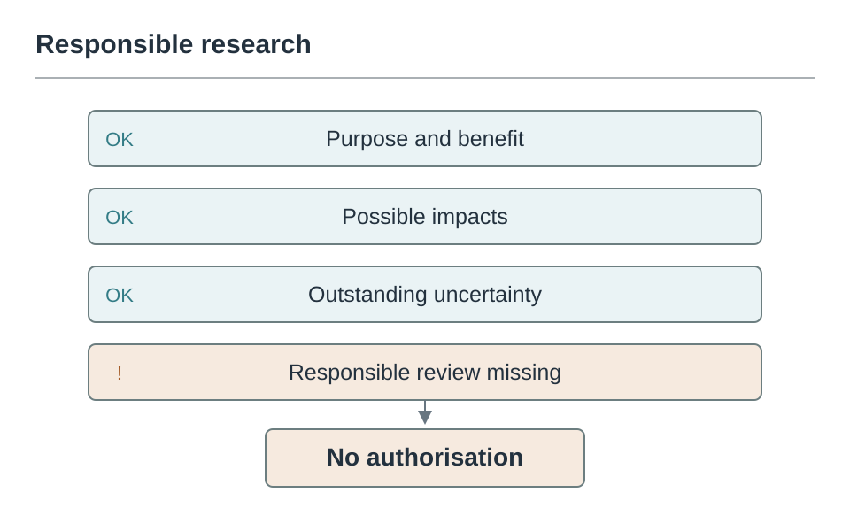

# M25-L5 – Biosafety and responsibility {#L5}

**Course area:** M25 – Microbiology and Infection Biology

**Level:** Master – elective profile

**Prerequisites:** [M1-L2](M1-L2.md), [M1-L3](M1-L3.md), [M18-L5](M18-L5.md): research ethics and safety.

**Learning objective:** Distinguish biosafety, biosecurity and responsible research, and critically assess a documented risk review.

## Introduction {#S1}

Biological research can provide substantial societal benefits and also enable accidental or deliberate harm. Responsibility therefore belongs to researchers, institutions, funders and other stakeholders.

## Principles and model {#S2}

### Safety concepts

Biosafety aims to protect against accidental exposure and release. Biosecurity concerns protection against loss, unauthorised access and misuse of biological materials, technologies and information. Both belong to comprehensive risk management but address different kinds of hazards.

A hazard is a potential source of harm. Risk additionally considers the likelihood and severity of possible harm in its specific context. WHO emphasises evidence-based, risk-oriented assessment rather than purely schematic classification. Uncertainties and responsibilities must be documented. Assessment needs reconsideration when the project or evidence changes.

### Research and communication

Dual use refers to the possibility that knowledge or technology can serve beneficial as well as harmful purposes. Assessment should consider benefits, risks, alternatives and responsible oversight bodies. Open science and responsible communication can be in tension; decisions require reasoned institutional review. Researchers should neither rely solely on their own assessment nor treat a checklist as approval.

Risk assessment, legal requirements, ethical review and organisational authorisation are distinct layers. The global WHO framework provides guidance, not a substitute for applicable local law or qualified supervision.

*Figure: Three documented items do not substitute for the missing responsible review.*

## Application {#S3}

A fictional research data project is checked for four documentation items: purpose and benefit, possible impacts, responsible review and outstanding uncertainty. Three items are documented, but responsible review is missing. Formal completeness is $3/4=75$%. This explicitly does not establish acceptable residual risk. A missing critical review item may prevent authorisation irrespective of a high completeness score. The project remains open pending appropriate assessment.

## Self-assessment {#S4}

### Exercises

1. What is the fundamental distinction between biosafety and biosecurity?
2. What is the documentation fraction if five of six items are recorded?
3. Can that fraction replace institutional risk assessment?

::: {.lc-solutions data-lc-section="S4"}
1. Biosafety addresses accidental hazards; biosecurity particularly addresses loss, unauthorised access and misuse.
2. $5/6=83.3$% (rounded).
3. No. A completeness fraction does not automatically assess risk, legality or authorisation status.
:::

## Assumptions and limitations {#S5}

This lesson teaches concepts and governance, not practical safety protocols, pathogen procedures or authorisations. The fictional documentation fraction is not a WHO-recommended risk metric.

## Summary and transition {#S6}

This elective connects physiological models, host relationships, community data and responsibility. The following master's profile considers molecular plant sciences.

**Continue:** [M26-L1](M26-L1.md)

## Sources {#S7}

- [WHO (2020) – Laboratory biosafety manual, 4th edition](https://www.who.int/publications/i/item/9789240011311) · Risk-based framework; official publication page · Last accessed: 2026-11-25
- [WHO (2022) – Global guidance framework for the responsible use of the life sciences](https://www.who.int/publications/i/item/9789240056107) · Shared responsibility for mitigating biorisks; official publication page · Last accessed: 2026-11-25

