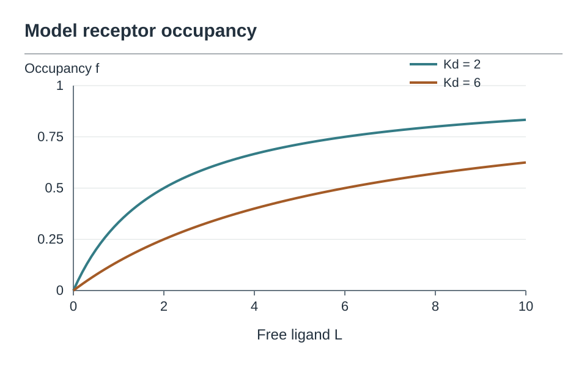

# M26-L1 – Plant signalling networks {#L1}

**Course area:** M26 – Molecular Plant Sciences and Biotechnology

**Level:** Master – elective profile

**Prerequisites:** [M10-L3](M10-L3.md), [M18-L1](M18-L1.md) and [M20-L1](M20-L1.md): hormones, binding and signalling networks.

**Learning objective:** Interpret plant signalling pathways as feedback networks and quantitatively evaluate a simplified receptor occupancy model.

## Introduction {#S1}

A plant does not respond to water deficit with one universal response. Guard cells, root tissues and growing leaves can process the same hormonal signal differently. Outcomes depend on receptor abundance, cell state, temporal dynamics and other signals. Molecular concentration alone therefore cannot explain a complete phenotype.

## Principles and model {#S2}

### Signalling and context

Abscisic acid (ABA) mediates responses to water deficit and influences seed dormancy, among other functions. In a simplified core pathway, ABA binds PYR/PYL/RCAR receptors. The complex inhibits PP2C phosphatases, relieving their inhibition of SnRK2 kinases. Activated kinases can phosphorylate target proteins. In guard cells, such signals influence ion transport and hence osmotic potential and turgor. Reduced turgor can decrease stomatal aperture. This conserves water but can restrict CO₂ uptake.

Auxin influences cell elongation, organ formation and root architecture, among other functions. Polar auxin transport can generate spatial concentration differences; receptor and transcriptional networks translate these into tissue-specific responses. ABA and auxin can influence each other at several levels. There is no context-independent rule that one hormone always promotes growth and the other always inhibits it.

### Model and identifiability

For one independent binding site at equilibrium, occupancy can be represented as $f=L/(K_d+L)$. $L$ denotes free ligand concentration and $K_d$ the dissociation constant in the same unit. At $L=K_d$, half the binding sites are occupied. However, a signal may become stronger or weaker despite identical occupancy: amplification, phosphatase activity, gene expression and feedback operate downstream of binding. A reporter therefore does not automatically measure receptor occupancy. Time-resolved observations and independent measurements help test a model.

*Figure: Two saturation curves for different dissociation constants; fictional parameters.*

## Application {#S3}

A fictional receptor has $K_d=2$ in normalized concentration units. At $L=1,2,6$, $f=1/3,1/2,3/4$. Tripling $L$ from 2 to 6 raises occupancy only from 50 to 75%. In a second model with $K_d=6$, occupancy at $L=6$ is only 50%. The example illustrates saturation and binding affinity, not actual ABA receptor parameters.

## Self-assessment {#S4}

### Exercises

1. Calculate occupancy for $K_d=2$ and $L=8$.
2. Why could reporter activity decline despite unchanged occupancy?
3. What trade-off arises when stomata close?

::: {.lc-solutions data-lc-section="S4"}
1. $8/(2+8)=0.8$, or 80%.
2. A downstream component may be inhibited; receptor occupancy and signalling response are distinct quantities.
3. Water loss decreases, but CO₂ uptake may also decline.
:::

## Assumptions and limitations {#S5}

The model assumes equilibrium, free ligand concentration and independent binding sites. Actual ABA receptors, co-receptors, signal transport and temporal adaptation can be more complex. All values are fictional; no physiological response can be predicted from them.

## Summary and transition {#S6}

Signalling networks link perception, regulation and phenotype. Next we consider exchange between plants and symbiotic microorganisms.

**Continue:** [M26-L2](M26-L2.md)

## Sources {#S7}

- [Auxin-Abscisic Acid Interactions in Plant Growth and Development (2020)](https://pmc.ncbi.nlm.nih.gov/articles/PMC7072425/) · ABA perception and auxin–ABA crosstalk; indexed review · Last accessed: 2026-11-25

