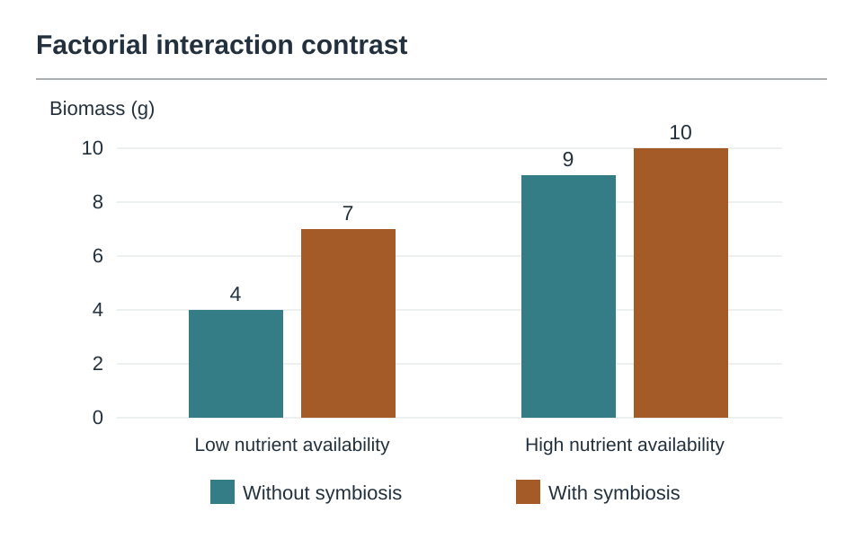

# M26-L2 – Plant–microbe interactions {#L2}

**Course area:** M26 – Molecular Plant Sciences and Biotechnology

**Level:** Master – elective profile

**Prerequisites:** [M7-L5](M7-L5.md), [M10-L1](M10-L1.md) and [M25-L2](M25-L2.md): symbiosis, mineral transport and host relationships.

**Learning objective:** Explain nutrient exchange in mycorrhiza and assess context-dependent interactions using a factorial model.

## Introduction {#S1}

Plant roots are part of a biologically active soil system. Microorganisms influence nutrient availability, plant development and material cycles. Whether a particular association benefits a plant depends on costs and benefits under the relevant environmental conditions.

## Principles and model {#S2}

### Exchange at biological interfaces

In arbuscular mycorrhiza, fungi form a network of hyphae outside the root and branched arbuscules within root cortical cells. The fungal structure remains separated from plant cytoplasm by a plant-derived membrane. Specific transport proteins enable nutrient transfer at this interface. Fungal hyphae can explore soil regions less accessible to roots alone. The plant may receive phosphate and other minerals; the fungus receives photosynthetically derived carbon compounds including lipids.

Not all plant species establish this type of symbiosis. Exchange depends on the partners, developmental state and nutrient availability. A high fraction of colonized roots is neither a direct measure of phosphate flux nor proof of increased growth. Functional measurements therefore complement observations of colonization alone.

### Interaction contrast

A factorial data model distinguishes two factors, such as nutrient status and symbiosis status. For two groups per factor, the interaction contrast is $I=(Y_{11}-Y_{10})-(Y_{01}-Y_{00})$. The first subscript identifies nutrient availability (1 = low, 0 = high), the second symbiosis status (1 = with, 0 = without symbiosis). If the symbiosis contrast is identical under both nutrient conditions, $I=0$ on the additive scale. On a logarithmic scale, absence of interaction instead implies constant ratios. The scale should therefore have a biological justification.

*Figure: Fictional biomass values of 4 and 7 g at low and 9 and 10 g at high nutrient availability.*

## Application {#S3}

A fictional archive contains mean biomass values (g) for four groups. With low nutrient availability, means without and with symbiosis are 4 and 7 g; with high availability they are 9 and 10 g. Contrasts are $7-4=3$ g and $10-9=1$ g respectively. Defining $I$ as the first minus the second contrast gives $I=2$ g. Relative changes are 75% and approximately 11.1%. Means alone are insufficient for statistical inference; dispersion and independent experimental units are missing.

## Self-assessment {#S4}

### Exercises

1. Calculate the interaction contrast for group pairs 5/8 g and 10/13 g.
2. Why is root colonization not a direct measure of nutrient transfer?
3. What data are required for a confidence interval of the contrast?

::: {.lc-solutions data-lc-section="S4"}
1. $(8-5)-(13-10)=0$ g.
2. Colonized area does not establish actual flux across the exchange membrane.
3. Individual observations or suitable information on variability and sample sizes, together with the dependency structure of measurements.
:::

## Assumptions and limitations {#S5}

The fictional data illustrate an additive interaction, not a real causal finding. Observational data may be confounded by soil properties and plant species. The values imply neither a practical treatment procedure nor an agricultural recommendation.

## Summary and transition {#S6}

Symbiotic interactions depend on context. Next we examine the temporal control of plant developmental programmes.

**Continue:** [M26-L3](M26-L3.md)

## Sources {#S7}

- [Plant Signaling and Metabolic Pathways Enabling Arbuscular Mycorrhizal Symbiosis (2017)](https://pmc.ncbi.nlm.nih.gov/articles/PMC5940448/) · Nutrient exchange during symbiosis; indexed review · Last accessed: 2026-11-25

