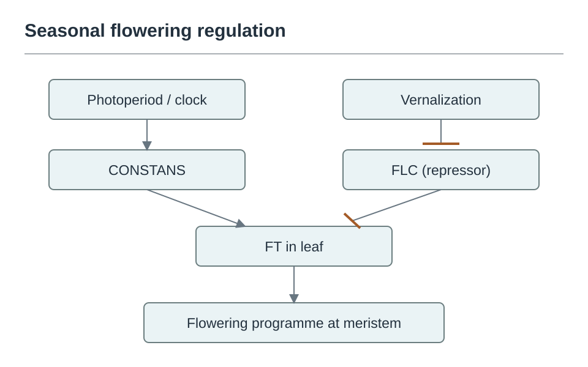

# M26-L3 – Plant development and gene regulation {#L3}

**Course area:** M26 – Molecular Plant Sciences and Biotechnology

**Level:** Master – elective profile

**Prerequisites:** [M6-L6](M6-L6.md), [M10-L3](M10-L3.md) and [M12-L2](M12-L2.md): gene regulation, hormones and pattern formation.

**Learning objective:** Distinguish photoperiodic and epigenetic developmental control and interpret regulatory interactions using a simplified model.

## Introduction {#S1}

The transition from vegetative to reproductive growth must be coordinated with environmental conditions and developmental state. The model plant Arabidopsis thaliana demonstrates how a temporary environmental influence can produce a longer-lasting change in gene activity. Its mechanisms cannot automatically be generalized to all plant species.

## Principles and model {#S2}

### Seasonal signals and gene regulation

Photoperiodism describes a response to the relative duration of light and dark phases. In Arabidopsis, the CONSTANS system integrates light signals with the internal clock. Suitable temporal overlap promotes expression of FLOWERING LOCUS T (FT) in leaves. FT protein can move to the shoot apical meristem, where it promotes floral development together with transcription factors.

FLOWERING LOCUS C (FLC) represses the flowering programme in many Arabidopsis genotypes. Prolonged cold can result in epigenetic repression of FLC (vernalization). The altered chromatin state may persist during subsequent vegetative development. It enables a changed response to later environmental signals without requiring a change in DNA sequence. The vernalization response is normally reset in the next generation. Photoperiod and vernalization are distinct signals that can converge at shared regulatory nodes.

### Quantitative modelling

A purely educational model uses a normalized photoperiodic activation signal $A$ and repressor activity $R$. Let relative output be $F=A/(1+R)$. This equation is not established biochemical kinetics of FT, but a monotonic response to activation and repression. At fixed $R$, $F$ increases proportionally with $A$; at fixed $A$, $F$ decreases with $R$. An observed output cannot uniquely identify both inputs. Several combinations generate the same result.

*Figure: Simplified scheme: photoperiod activates FT through CONSTANS, vernalization reduces FLC-mediated repression.*

## Application {#S3}

In the model, $A=0.8$ and $R=3$. Thus $F=0.8/4=0.2$. At unchanged activation and $R=1$, $F$ increases to 0.4. Another combination, $A=0.4$ and $R=0$, also gives 0.4. All quantities are dimensionless. The example illustrates convergence and non-identifiability; it does not predict actual flowering dates.

## Self-assessment {#S4}

### Exercises

1. Calculate $F$ for $A=0.6$ and $R=2$.
2. Why may the same FT measurement reflect different regulatory states?
3. How does an epigenetic vernalization response differ from a DNA mutation?

::: {.lc-solutions data-lc-section="S4"}
1. $0.6/3=0.2$.
2. Different combinations of activation, repression and other influences may generate the same output.
3. It changes the regulatory chromatin state without necessarily changing DNA sequence.
:::

## Assumptions and limitations {#S5}

The model omits temporal dynamics, spatial transport, thresholds and other flowering regulators. Vernalization and photoperiodic responses differ between plant species and genotypes. This illustration represents a selected model organism, not a universal law.

## Summary and transition {#S6}

Plant development integrates genetic, epigenetic and seasonal information. The next lesson links such traits to applied plant research.

**Continue:** [M26-L4](M26-L4.md)

## Sources {#S7}

- [Genetic and Epigenetic Understanding of the Seasonal Timing of Flowering (online 2019; journal issue 2020)](https://pmc.ncbi.nlm.nih.gov/articles/PMC7747966/) · Vernalization and photoperiodic regulation of flowering; indexed review · Last accessed: 2026-11-25

