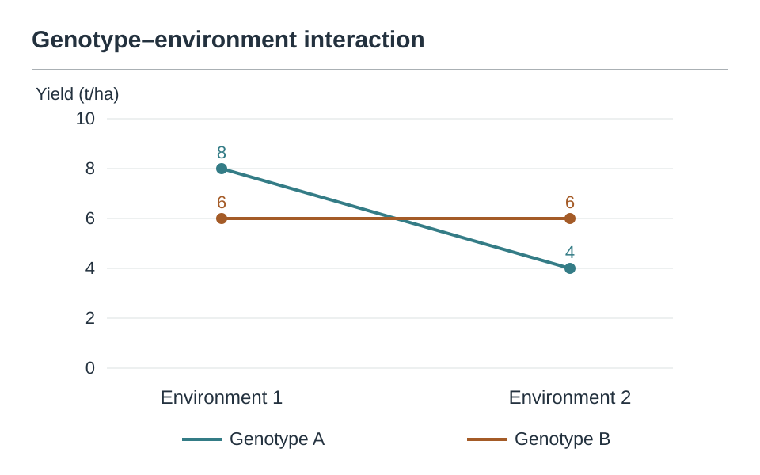

# M26-L4 – Applied plant research {#L4}

**Course area:** M26 – Molecular Plant Sciences and Biotechnology

**Level:** Master – elective profile

**Prerequisites:** [M2-L5](M2-L5.md), [M18-L2](M18-L2.md) and [M23-L5](M23-L5.md): experimental design, functional genetics and field research.

**Learning objective:** Recognize genotype-by-environment interactions in multi-environment data and distinguish evidence from phenotyping, genetic markers and prediction models.

## Introduction {#S1}

In applied plant research, a trait is rarely equally beneficial under all conditions. A cultivar may produce high biomass at a wet site but perform worse under drought than another cultivar. Analysis must distinguish genetic differences from site and year effects. Molecular findings and field performance represent different levels of evidence.

## Principles and model {#S2}

### Phenotype, genotype and environment

Phenotyping records observable traits such as flowering time, leaf area or yield. Sensors and imaging can scale data collection but require calibration, standardized metadata and checks for systematic errors. Genotyping identifies genetic variants; an association of a marker with a trait does not establish its causal function. Linkage disequilibrium and population structure can produce associations that fail to transfer to other populations.

A multi-environment trial records genotypes in several site–year combinations. A simple model is $Y_{ij}=\mu+G_i+E_j+(GE)_{ij}+\varepsilon_{ij}$. $\mu$ is the overall mean, $G_i$ the genotype effect, $E_j$ the environmental effect, $(GE)_{ij}$ the interaction term and $\varepsilon_{ij}$ the residual. Real trials also include, for example, block effects and repeated observations. Depending on the question, genotypes and environments are modelled as fixed or random effects. Stability does not necessarily mean a high average.

### Prediction and validation

Genomic prediction uses many markers jointly to estimate genetic values. Testing on randomly selected records can be overly optimistic if closely related individuals or measurements from the same site–year occur in both training and test data. Validation using entirely withheld sites, years or families answers a different and often more demanding question. The target environment must be defined before evaluation.

*Figure: Reaction norms of fictional genotypes A (8, 4) and B (6, 6) with reversed rankings.*

## Application {#S3}

A fictional cultivar comparison gives genotype A yields of 8 and 4 t/ha in environments 1 and 2, and B yields of 6 and 6 t/ha. Both have an unweighted mean of 6 t/ha. A leads by 2 t/ha in environment 1 and trails by 2 t/ha in environment 2. The interaction contrast is $2-(-2)=4$ t/ha. With equal weighting the means do not differ, but the ranking reverses. A mean alone conceals this crossover interaction.

## Self-assessment {#S4}

### Exercises

1. Calculate the means of A and B if environment 1 has a weight of 75% and environment 2 a weight of 25%.
2. What distinguishes a marker association from causal evidence?
3. Why should validation for new site–years withhold entire site–years?

::: {.lc-solutions data-lc-section="S4"}
1. A: $0.75\cdot8+0.25\cdot4=7$ t/ha; B: 6 t/ha.
2. An association may arise through linkage or population structure; causal evidence requires additional independent support.
3. This prevents correlated measurements from the same site–year from inflating estimated predictive performance.
:::

## Assumptions and limitations {#S5}

The values are simulated. No cultivar recommendations are justified without replication, measurement uncertainty and representative environments. Plant breeding and biotechnology also require assessment of ecological, legal and societal considerations.

## Summary and transition {#S6}

Applied plant research combines measurement quality, genetics and environmental context. The final elective lesson investigates modelling of yield responses.

**Continue:** [M26-L5](M26-L5.md)

## Sources {#S7}

- [Data synthesis for crop variety evaluation. A review (2020)](https://pmc.ncbi.nlm.nih.gov/articles/PMC7440334/) · Genotype × environment interactions and multi-environment trials; indexed review · Last accessed: 2026-11-25

