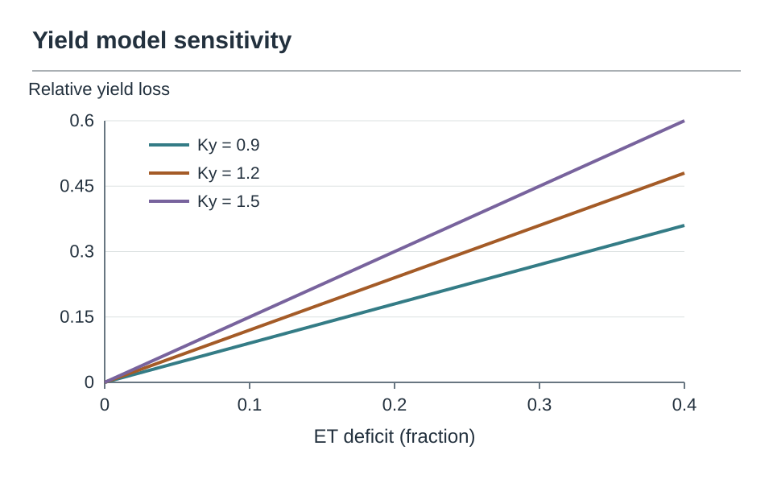

# M26-L5 – Yield and stress models {#L5}

**Course area:** M26 – Molecular Plant Sciences and Biotechnology

**Level:** Master – elective profile

**Prerequisites:** [M10-L4](M10-L4.md), [M23-L1](M23-L1.md) and [M26-L4](M26-L4.md): stress physiology, modelling and genotype–environment interactions.

**Learning objective:** Apply an empirical yield–water model, examine sensitivity to parameters and explain the limits of transfer to new environmental conditions.

## Introduction {#S1}

Drought affects plants at several levels: water transport, stomata, photosynthesis, development and reproduction. The relationship between water deficit and yield therefore depends on stress timing and duration. A model can summarize part of these relationships without explicitly representing every mechanism.

## Principles and model {#S2}

### Empirical yield model

Evapotranspiration (ET) combines evaporation from surfaces and plant transpiration. A simplified empirical FAO relationship is:

$$1-\frac{Y_a}{Y_m}=K_y\left(1-\frac{ET_a}{ET_m}\right).$$

Here $Y_a$ is actual yield, $Y_m$ a reference yield without the water stress under consideration, $ET_a$ actual evapotranspiration and $ET_m$ reference evapotranspiration without water deficit. Both ratios are dimensionless. The empirical factor $K_y$ describes relative yield sensitivity to a relative ET deficit. It is not equivalent to water-use efficiency. At $ET_a=ET_m$, the equation predicts $Y_a=Y_m$; for the same deficit, a larger $K_y$ implies a larger yield reduction.

### Uncertainty and transfer

The model is a linear approximation over a limited validity range. Very severe deficits can mathematically produce negative yields, which are biologically meaningless. Such a result indicates invalid extrapolation, not a negative harvest. Temperature, nutrient status, developmental stage and site conditions can alter the relationship. Process-based models attempt to couple development, transport and carbon balance explicitly. They require additional parameters and independent validation data. A more complex model is not more reliable merely because of its complexity.

*Figure: Three linear model curves for relative yield loss at different fictional Ky values.*

## Application {#S3}

A fictional reference yield is 8 t/ha, $ET_a/ET_m=0.8$ and $K_y=1.2$. Relative deficit is 0.2 and relative yield loss is $1.2\cdot0.2=0.24$. Thus $Y_a/Y_m=0.76$ and $Y_a=6.08$ t/ha. Using $K_y=0.9$ or 1.5 instead gives 6.56 and 5.60 t/ha respectively. This parameter sensitivity is not a statistical confidence interval because no parameter probability distribution was specified.

## Self-assessment {#S4}

### Exercises

1. Calculate yield for $Y_m=10$ t/ha, $ET_a/ET_m=0.9$ and $K_y=1.1$.
2. What is the result at $ET_a/ET_m=1$?
3. Why does parameter sensitivity alone not establish predictive performance?

::: {.lc-solutions data-lc-section="S4"}
1. $10(1-1.1\cdot0.1)=8.9$ t/ha.
2. $Y_a=Y_m$ regardless of $K_y$.
3. Sensitivity shows dependence on parameters; predictive performance requires assessment with independent observations.
:::

## Assumptions and limitations {#S5}

The numbers are educational model data, not site- or cultivar-specific parameters. The model provides neither irrigation instructions nor a reliable yield forecast. It omits other stressors and assumes comparable reference quantities.

## Summary and transition {#S6}

Empirical yield models connect physiological processes with observable consequences. This concludes the plant science elective profile. The final research pathway brings together methods from different profiles.

**Further reading:** [M27-L1](M27-L1.md)

## Sources {#S7}

- [FAO – Annex II: Irrigation scheduling](https://www.fao.org/4/X5647E/x5647e0e.htm) · Yield response to evapotranspiration deficit; equation 1 · Last accessed: 2026-11-25
- [Data synthesis for crop variety evaluation. A review (2020)](https://pmc.ncbi.nlm.nih.gov/articles/PMC7440334/) · Genotype × environment interactions and multi-environment trials; indexed review · Last accessed: 2026-11-25

