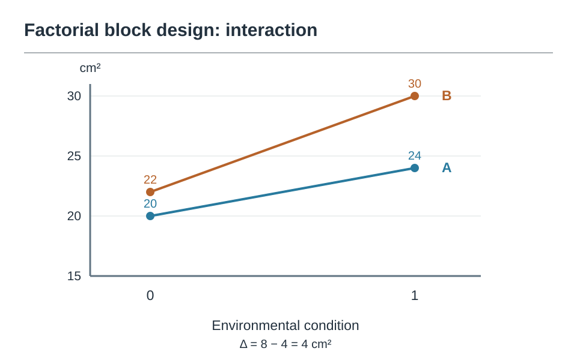

# M27-L1 – Advanced study designs {#L1}

**Course area:** M27 – Research Project, Statistics and Thesis

**Level:** Master – research completion

**Prerequisites:** [M19-L3](M19-L3.md), [M23-L5](M23-L5.md).

**Learning objective:** Assess study designs for nuisance variables, interactions and independent experimental units, and calculate a factorial contrast.

## Introduction {#S1}

A master’s project aims to determine whether leaf-area development in two plant lines differs across two environmental conditions. The subject is deliberately fictional. What matters is not just the number of measurements but which units were independently assigned and which conclusions the design supports.

## Principles and model {#S2}

### Randomization and blocking

Randomization distributes known and unknown nuisance variables across conditions in expectation. Blocking groups units by an anticipated nuisance factor, such as measurement time or site, before randomization within each block. Each block should contain all conditions of interest. If every sample in one condition belongs to a single block, the condition effect cannot be separated from the block effect. Repeated measurements on the same individual improve temporal resolution but do not increase the number of independent individuals.

### Factorial and hierarchical designs

A 2×2 design combines two factors with two levels each. If $\mu_{ij}$ denotes the expected response at level $i$ of the first and level $j$ of the second factor, the interaction contrast is

$$\Delta_I=(\mu_{11}-\mu_{10})-(\mu_{01}-\mu_{00}).$$

On the chosen additive scale it tests whether the effect of the second factor differs between levels of the first. A mixed model can represent block effects as random intercepts and treatments as fixed effects: $Y_{ijk}=\mu+\alpha_i+\beta_j+(\alpha\beta)_{ij}+b_k+\varepsilon_{ijk}$. It requires, among other things, an appropriate model of variance and dependence. With few blocks, block-variance estimates can be imprecise. Analysis must follow the actual randomization level. If an entire chamber is assigned to an environmental condition, individual plants in that chamber are not independent replicates of that condition.

*Figure: Fictional mean leaf areas of two plant lines in two environmental conditions; nonparallel lines show an additive interaction contrast.*

## Application {#S3}

Fictional group means in cm²: line A under conditions 0 and 1: 20 and 24; line B: 22 and 30. The condition contrast is 4 cm² for A and 8 cm² for B. The interaction is 8 − 4 = 4 cm². Means alone allow neither a significance test nor an assessment of precision. Assuming four blocks with one independently assigned plant per combination, there are 16 experimental units; three images per plant give 48 observations, not 48 independent units. A randomized complete block design permits treatment comparisons within blocks.

## Self-assessment {#S4}

### Exercises

1. Calculate the interaction contrast for A0=10, A1=12, B0=15, B1=18.
2. How many independent plants and individual measurements are there in six complete 2×2 blocks with two images per plant?
3. Why can one chamber per environmental condition not replace independent chamber replication?

::: {.lc-solutions data-lc-section="S4"}
1. (18 − 15) − (12 − 10) = 1 cm² if leaf areas are measured in cm².
2. 24 plants and 48 images, assuming plants are the independently assigned units.
3. Chamber effects are completely confounded with the environmental condition; additional plants cannot resolve the confounding.
:::

## Assumptions and limitations {#S5}

The example does not establish a real genotype–environment interaction. An additive interaction may change when the response is transformed. Randomization, missing observations, block-dependent effects and planned inference must be described transparently.

## Summary and transition {#S6}

A design determines which effects are identifiable. The next lesson addresses uncertainty and multiple hypothesis testing.

**Further reading:** [M27-L2](M27-L2.md)

## Sources {#S7}

- [NIST/SEMATECH – Randomized block designs](https://www.itl.nist.gov/div898/handbook/pri/section3/pri332.htm) · 5.3.3.2; blocking and nuisance factors; retrieved text · Last accessed: 2026-11-25
- [DFG – Code of Conduct](https://www.wissenschaftliche-integritaet.de/en/code) · Guidelines 4, 7–14, 17; official overview retrieved, individual guidelines not independently retrieved in this pass · Last accessed: 2026-11-25
